L'introduzione del WEB fa si che internet passi da piattaforma **accademica** a piattaforma che offre **servizi**, ovvero un contratto che lega due entità (fornitore - utilizzatore).
I primi servizi erano **monoliti**, ma nel corso del tempo si è pensato di utilizzare delle astrazioni che potessero semplificare il tutto e implementare pagine dinamiche. Questo avviene in quanto nasce la necessità di rendere disponibili applicazioni distribuite sul web con una grossa scalabilità e capace di gestire una grande mole di richieste contemporaneamente le aziende: **enterprise computing** (sviluppo di applicazioni per le aziende).
# Enterprise Computing
Si occupa di rispettare i requisiti funzionali e non su scala **industriale**:
## Requisiti
>[!multi-column]
>
>>[!important] Requisiti funzionali
>>cosa un sistema deve offrire
>
>>[!important] Requisiti non funzionali
>>come il servizio deve fornire quella funzionalità

------
Un esempio di requisiti fondamentali non funzionali sono:
- **Portabilità**:  capacità SW di essere eseguito su macchine diverse
- **Interoperabilità**: capacità di scambiare dati e cooperare con altri sistemi
- **Integrazione**: capacità di comporre moduli e servizi (se uno non funziona non si rompe tutto)
- **Interoperabilità tra ambienti**: integrazione con sistema già esistente (pagamento) spesso obsoleto -> retrocompatibilità
- **Supporto**: gestione del sistema in esecuzione (monitoraggio, update) -> creo strumenti per questa funzione
- **Scalabilità**: capacità di adattare la macchina nel caso di upgrade
	- verticale: aggiungo risorse per rendere macchina più potente
	- orizzontale (mantengo vecchia macchina e ne aggiungo altre
- **Efficienza**: uso ottimale delle risorse
- **Affidabilità**: bassa probabilità di failure
- **Tolleranza ai guasti**: capacità di continuare anche a seguito di guasto
- **Qualità**: insieme di attributi non funzionali
- **Time to market**: strumenti che permettono di incorporare funzionalità già esistenti

## Paradigma a tre livelli
Gli elementi costitutivi di ogni applicazione enterprise si sviluppa su più **livelli** per lo sviluppo di tali caratteristiche:
- **presentation** **logic**: design dell'applicazione - come appare
- **business** **logic**: verifica prodotti - come funziona
- **data access logic**: fatture, spedizioni - come gestire i dati
- **servizi di sistema**: verifica del corretto funzionamento interno logico del sistema - su quali macchine far girare sistema

### Single tier
Inizialmente veniva installato tutto su una singola macchina [[0. Intro sistemi operativi#Sistema mainframe|mainframe]].
Essendo tutto centralizzato era molto più semplice recuperare le risorse, ma tutto è strettamente integrato, quindi un guasto o la necessità di un aggiornamento sul mainframe non permette l'utilizzo del programma.
### Two tier
I dati venivano mantenuti sui server, mentre tutto il resto veniva eseguito sui computer client. Le interfacce locali venivano riempite dai dati provenienti dai server.
Rimaneva il problema di non avere un sistema distribuito e il client è costretto ad installare software molto pesante.

L'idea di base è quella di avere il minimo software necessario sul client, un server che gestisce la business logic e c'è un ulteriore server che mantiene il database con i dati.
Il server centrale può inoltre utilizzare del caching per velocizzare le operazioni.
Questo sistema può essere implementato tramite remote procedure call.
Il server centrale può essere invocato tramite interfaccia (**chiamata a procedura remota**), ma risulta sovraccaricato.

Possiamo quindi passare a remote object: le chiamate al server centrale restituiscono oggetti e non soli dati, che vengono gestiti dal client, ma il middle tier rimane ugualmente sovraccaricato.

### Three tier
Oggi viene quindi utilizzato uno stile architetturale a tre livelli:
1. **web server**
   gestisce le richieste HTTP, si occupa del routing e smista il traffico
2. **application server**
   business logic
3. **database server**
   persistenza dei dati


>[!question] Stiamo tornando ad un approccio a monolite
>Negli ultimi anni sono cambiate le necessità del mercato e la potenza di calcolo

In questo modo la distribuzione del carico è ottimale. Inoltre un livello può essere aggiornato senza creare problemi agli altri livelli.

Ogni richiesta però deve attraversare obbligatoriamente tutti i livelli.
Se non ben sviluppato l'application server potrebbe soffrire di ridondanza, poichè alcuni servizi potrebbero essere gli stessi per applicazioni diverse.

Per evitare questo problema implementiamo all'interno dell'application server un **container**.
>[!important] Modello componente-container (non docker)
>Tutte le funzionalità comuni a basso livello vengono delegate a dei container, in modo da potersi concentrare sulla business logic (*es.* concorrenza, sicurezza, ...). Questo modello permette di automatizzare servizi e metterli in comune. 
>Per l'implementazione dei container possono essere utilizzate applicazioni open source come **Jakarta** (Java enterprise), per permettere facilmente il cambio, effettuando una *migrazione* quasi immediata.
# Risorse
Con il termine risorsa intendiamo qualunque entità abbia una identità: un documento, un'immagine, un servizio, una collezione di altre risorse.
Gli **URI** (Uniform resource identifier) forniscono un meccanismo semplice ed estensibile per identificare una risorsa, per garantire interoperabilità
- concetto generale (non fa riferimento necessariamente a risorse accessibili tramite HTTP o a entità disponibili in rete)
- rappresenta solo l'involucro
- è un mapping concettuale ad una entità: non si riferisce necessariamente ad una particolare versione dell'entità esistente in un dato momento. Il mapping può rimanere inalterato anche se cambia il contenuto della risorsa
- rispettano una sintassi standard (insieme di termini e regole) e semantica (significato) semplice e regolare

>[!note] Vantaggi dell'uniformità
>- convenzioni sintattiche comuni e semantica comune → **interoperabilità**
>- possibilità di usare nello stesso contesto identificatori diversi, anche con protocolli di accesso diversi → **versatilità**
>- facilità nell'introdurre nuovi tipi di identificatori → **estensibilità**

## Sintassi degli URI
Forma più generale (dipende dallo schema):
```
<scheme>:<scheme-specific-part>
```
Per la `<scheme-specific-part>` non esiste una struttura o semantica comune a tutti gli URI. Esiste però un sottoinsieme che condivide una sintassi comune per rappresentare **relazioni gerarchiche** (risorse organizzate come nel file system) in uno spazio di nomi (forma tipica degli URL HTTP/HTTPS):
```
<scheme>://<authority><path>?<query>
```
Ogni URI è composto dalle seguenti sezioni:
- **schema**
  indica il tipo di URI sulla base del protocollo usato (es. `http`, `ftp`, `mailto`)
- **specifica**
	- **authority**
	  mappa l'host e l'eventuale porta tramite il quale raggiungere il server
	- **path**
	  percorso gerarchico della risorsa
	- **query**
	  ulteriori parametri

A parte lo `<scheme>`, le altre parti possono essere omesse (es. senza `<authority>` o senza `<query>`).

Esempio:
```
https://www.example.com:8080/api/students?id=10
└─┬─┘   └───────┬───────┘└┬─┘└─────┬─────┘ └─┬──┘
scheme      authority   port    path       query
                        (opz.)
```

## URN e URL
Esistono due specializzazioni dell'URI: URN e URL
- **URN** uniform resource name
  identifica la risorsa per mezzo di un nome (*es.* ISBN) in un particolare dominio di nomi (namespace). L'URN deve essere unico e duraturo (statico, pensato per la persistenza) e deve esistere una entità che conoscendo il nome può ricondurlo ad indirizzi fisici. Permette di "parlare" di una risorsa prescindendo dalla sua ubicazione e dalle modalità di accesso.
  Esempio: `urn:isbn:0-9553010-9` → identifica il libro ma non dice come/dove procurarselo
- **URL** uniform resource locator
  tiene conto anche della modalità per accedere alla risorsa (es. locazione nella rete) piuttosto che il suo nome o i suoi attributi. Specifica il protocollo necessario per il trasferimento (non solo HTTP). Tipicamente il nome dello schema corrisponde al protocollo utilizzato; la parte rimanente dipende dal protocollo.

>[!note] Analogia con una persona
>- URN = nome+cognome, o meglio codice fiscale
>- URL = indirizzo di casa o numero di telefono (se univoci)

Forma più comune dell'URL (schema HTTP-like):
```
<protocol>://[<username>:<password>@]<host>[:<port>][/<path>[?<query>][#<fragment>]]

https://example.com/articles.html?search=tecnologia&page=2#Capitolo1
```
Vale per HTTP, HTTPS, FTP, WAP, … ma non, ad esempio, per la posta elettronica (`mailto:info@example.com`: non c'è percorso né protocollo di trasferimento).

Situazione tipica: il browser invia una richiesta usando un URL per connettersi al server e richiedere una specifica risorsa. **HTTP lavora quindi principalmente con URL.**

le sezioni che compongono l'URL sono identiche a quelle dell'URI, tranne per la presenza (anche se deprecated) di username e password.

- `<protocol>`: come comunicare con il server (HTTP, HTTPS, FTP, MMS, …)
- `<username>:<password>@`: credenziali di autenticazione (deprecato)
- `<host>`: indirizzo del server su cui risiede la risorsa. Può essere un indirizzo IP logico o fisico
- `<port>`: porta da utilizzare (TCP come protocollo di trasporto, HTTP è a livello applicativo). Se non indicata si usa la porta standard del protocollo (per HTTP è 80)
- `<path>`: percorso (pathname) che identifica la risorsa nel file system del server. Se manca, tipicamente si accede alla risorsa predefinita (es. home page)
- `<query>`: stringa per passare al server uno o più parametri, di solito nel formato `parametro1=valore1&parametro2=valore2…`

### URN vs URL
| Caratteristica                      | URL (Locator)                    | URN (Name)                        |
| ----------------------------------- | -------------------------------- | --------------------------------- |
| Tipo                                | Sottoinsieme di URI              | Sottoinsieme di URI               |
| Scopo                               | Localizzare una risorsa          | Identificare una risorsa per nome |
| Indica dove si trova?               | Sì                               | No                                |
| Indica come accedervi?              | Sì (es. HTTP, FTP)               | No                                |
| Dipende dalla posizione?            | Sì                               | No                                |
| Usato direttamente in HTTP?         | Sì                               | No                                |
| Esempio                             | `https://example.com/index.html` | `urn:isbn:9780134685991`          |
| Cambia se la risorsa cambia server? | Sì                               | No                                |
| In breve                            | *pratico ma fragile*             | *stabile ma astratto*             |


# HTTP

>[!important] Protocollo
>Insieme di regole che servono a normare un aspetto di un sistema

Protocollo generico e stateless, tramite cui client e server comunicano: richiedono e trasferiscono **rappresentazioni di risorse identificate da URL**.
È importante la rappresentazione: uno stesso contenuto informativo può avere più rappresentazioni (HTML, JSON, ecc.).

- **client/server**
  c'è una netta distinzione tra chi richiede le risorse e chi le fornisce. Il client attiva la connessione e richiede i servizi; il server accetta la connessione, se serve identifica il richiedente, risponde alla richiesta e alla fine chiude la connessione
- **generico**
  è indipendente dal formato con cui i dati vengono trasmessi: funziona per HTML come per binari, eseguibili, oggetti distribuiti o altre strutture dati
- **stateless**
  ogni operazione non tiene memoria delle precedenti, il server non è tenuto a mantenere informazioni tra una connessione e la successiva su natura, identità e richieste precedenti di un client. È il client che deve ricreare il contesto per effettuare ogni richiesta
- **progettato per sistemi distribuiti complessi**
  l'approccio **stateless** è essenziale per gestire le **comunicazioni intermedie**: in un sistema distribuito con multipli Proxy o Gateway, non sarebbe scalabile o efficiente obbligare i nodi di rete a memorizzare lo stato di ogni singola connessione client.

Non serve solo per scambiare documenti ipertestuali, ma per una moltitudine di applicazioni (name server, sistemi object-oriented distribuiti).

È possibile negoziare il formato dei dati (il client dice che formato preferisce, il server sceglie il più adatto), questo favorisce l'indipendenza del sistema dal formato di rappresentazione dei dati.
Nonostante sia stateless sono comunque presenti dei sistemi di "caching sofisticato" (a seconda del tipo di connessione) per migliorare prestazioni, scalabilità e ridurre il traffico.
Sono disponibili sistemi di autenticazione sofisticata su vari livelli (supporto a vari livelli di sicurezza).

## Applicazioni HTTP
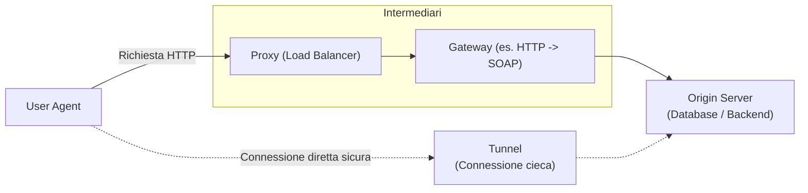
Ruoli delle applicazioni HTTP:
- **User agent**
  è il client che invia richieste HTTP. Può essere un browser (Chrome, Firefox, Safari), ma anche un'app mobile, un bot o qualsiasi altro software
- **Proxy**
  usato per vari scopi: sicurezza, caching, modifica di richieste/risposte. Può gestire il traffico in entrata verso più server backend (spesso per bilanciamento del carico)
- **Gateway**
  permette la comunicazione tra due sistemi che usano protocolli diversi, per fornire interoperabilità. Spesso il routing è più sofisticato, con logica che può includere la gestione dei protocolli (es. HTTP verso SOAP)
- **Origin server**
  il server che ospita e fornisce la risorsa richiesta
- **Tunnel**
  connessione diretta tra client e server usata per instradare dati senza che i contenuti vengano alterati o interpretati. Garantisce sicurezza, privacy e integrità dei dati, evitando che intermediari (come i proxy) possano interferire o monitorare la comunicazione

## Semantica dei messaggi HTTP
>[!important] Idempotenti
>Se invoco lo stesso metodo più volte dopo l'invocazione non ho nuovi effetti.
>Più formalmente: un metodo è idempotente se può essere chiamato più volte con lo stesso input senza cambiare lo stato del server (non viene creato, modificato o cancellato nulla; la risposta potrebbe variare) oltre il primo effetto

| Metodo     | Dove invia i dati                    | Risposta del server        | Uso tipico                                  | Supporto in `<form>` | Idempotente |
| ---------- | ------------------------------------ | -------------------------- | ------------------------------------------- | -------------------- | ----------- |
| **GET**    | Query string nell'URL                | Headers + Body             | Lettura dati, ricerche, navigazione         | Sì                   | Sì          |
| **POST**   | Body della richiesta                 | Headers + Body             | Creazione o invio dati (registrazioni, login) | Sì                 | No          |
| **PUT**    | Body della richiesta                 | Headers + Body             | Aggiornamento **completo** di una risorsa (API REST) | No (serve JS/AJAX) | Sì   |
| **HEAD**   | Nessun dato (o query string opzionale) | Solo Headers (no Body)   | Controllo risorse, validità link, metadata  | No (serve JS/AJAX)   | Sì          |
| **DELETE** | URL (identifica la risorsa)          | Headers + Body (opzionale) | Eliminazione di una risorsa (API REST)      | No (serve JS/AJAX)   | Sì          |

### JDBC connectivity
>[!blank|float-right]
>```mermaid
>flowchart TB
>    id1(Java application) --> id2(Loading driver)
>    id2 --> id3(Creating connection)
>    id3 --> id4(Creating statement)
>    id4 --> id5(Executing statement)
>    id5 --> id6(Processing ResultSet)
>    id6 --> id7(Closing connection)
>```

JDBC opera attraverso una serie di fasi per l'utilizzo dei database:
1. **Creating Connection**:
	- stabilisce una connessione con il database: spesso la fase di connection è molto costosa, per questo vengono utilizzare delle tecniche di **polling** per riutilizzare connessioni già aperte
	- fase strutturale $\to$ permette di creare politiche
2. **Statement**
   creazione dell'oggetto che consente passaggio dal livello applicativo $\to$ livello logico: consente di inviare query SQL $\to$ restituisce result set (iterabile)
3. **Result set**
   contiene i risultati di una query di selezione - rappresenta un ponte tra il modello relazionale e il modello a oggetti di java (contiene ciò che viene fornito dal database come oggetto di java)
4. **Closing Connection**
   chiusura della connessione

>[!multi-column]
>
>>[!done] Vantaggi
>>Permette di rendere il codice più modulare, portabile ed evitare problemi di performance, creando una vera e propria **pipeline**.
>>
>
>>[!bug] Svantaggi
>>Bisogna gestire oggetti che non sono nativi di Java


>[!attention] Per l'esame
>Le scelte prese in fase di progettazione devono essere dettate da cosa è necessario: se sto facendo operazioni in **lettura** non ho bisogno di appesantire troppo la query con livelli di *sicurezza innecessari*
``` java
import java.sql.*;
public class PrimoTestJDBC {
	public static void main(String[] args) {
		String url = "jdbc:mysql://localhost:3306/testdb";
		String user = "root"; String password = "admin";
		try {
		    Connection conn = DriverManager.getConnection(url, user, password);
		    Statement stmt = conn.createStatement();
		    ResultSet rs = stmt.executeQuery("SELECT id, name FROM users");
		    while (rs.next()) {
		        System.out.println(rs.getInt("id") + " - " + rs.getString("name"));
		    }
		} catch (SQLException e) {
		    e.printStackTrace();
		} finally {
		    rs.close();
		    stmt.close();
		    conn.close();
		}
	}
}

```

>[!question] Tramite java possiamo anche ricavare dei metadati da parte del database

### GET
Recupera dati dal server. I dati (parametri) viaggiano nella query string dell'URL.
```
GET /users/123 HTTP/1.1
Host: example.com
→
HTTP/1.1 200 OK
Content-Type: application/json

{ "id": 123, "name": "Mario Rossi" }
```
### POST
Inviare dati al server. I dati viaggiano nel body della richiesta.
```
POST /users HTTP/1.1
Host: example.com
Content-Type: application/json

{ "name": "Luigi Bianchi" }
→
HTTP/1.1 201 Created
Location: /users/124
```
### PUT
Aggiornare o sostituire una risorsa esistente sul server (aggiornamento completo).
```
PUT /users/123 HTTP/1.1
Host: example.com
Content-Type: application/json

{ "id": 123, "name": "Mario Verdi" }
```
### HEAD
Richiedere solo l'header di una risorsa, senza il corpo.
```
HEAD /users/123 HTTP/1.1
Host: example.com
→
HTTP/1.1 200 OK
Content-Type: application/json
Content-Length: 48
```
### DELETE
Eliminare una risorsa sul server. La risorsa è identificata dall'URL.
```
DELETE /users/123 HTTP/1.1
Host: example.com
```

## Fasi di scambio client/server
La connessione HTTP è composta da una serie di richieste e corrispondenti risposte.


| Versione | Connessione                | Richieste multiple    | Header         | Limiti principali                      |
| -------- | -------------------------- | --------------------- | -------------- | -------------------------------------- |
| 0.9      | 1 richiesta per connessione | No                   | No             | Molto semplice, non scalabile          |
| 1.0      | Chiusa per default         | No                    | Sì             | Inefficiente per pagine complesse      |
| 1.1      | Persistente (Keep-Alive)   | Sì (pipelining)       | Sì             | Head-of-line blocking                  |
| 2.0      | Persistente                | Sì (multiplexing)     | Sì (compressi) | Richiede supporto binario, più complesso |

- **HTTP/0.9**: solo GET, `open → richiesta → risposta → close` per ogni richiesta
- **HTTP/1.0**: metodi GET, POST, HEAD, PUT, ma ancora una connessione per richiesta
- **HTTP/1.1**: la differenza principale rispetto a 1.0 è la possibilità di specificare coppie multiple di richiesta e risposta nella stessa connessione

introduzione di connessioni persistenti
- richiedono meno connessioni TCP (vantaggio per CPU e rete)
- riducono l'attesa della visualizzazione
- permettono di gestire meglio gli errori

pipeline (possibilità di mettere in coda più richieste, senza necessariamente attendere la risposta), ma introduce un problema: se la prima richiesta è più pesante blocca le successive.
- riduce ulteriormente la latenza, soprattutto per richieste su risorse molto diverse per dimensione o tempo di elaborazione
- le risposte devono essere date **nello stesso ordine** delle richieste, perché HTTP non specifica un metodo esplicito di associazione/riordinamento
- se la prima richiesta è lenta, tutte le altre devono aspettare: **Head-of-Line (HOL) blocking**

Ogni nuova connessione comporta il costo del **TCP three-way handshake**:
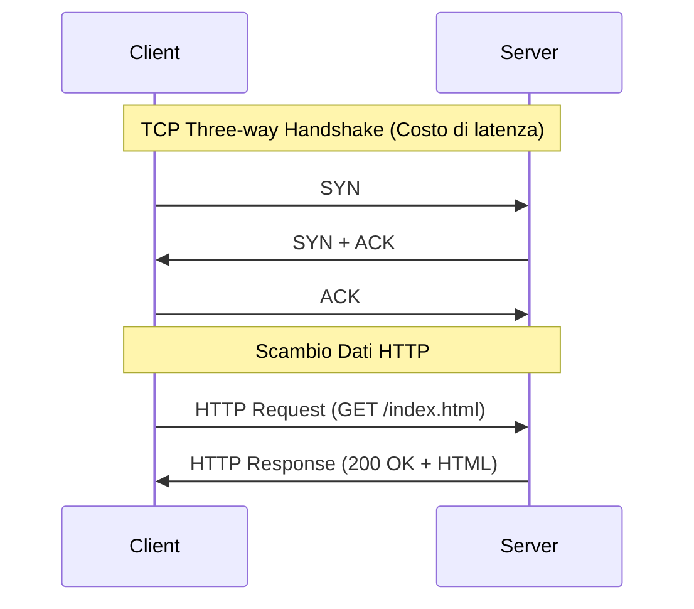

Per risolvere questo problema è stato inventato **HTTP/2** (2015) che effettua una conversione del testo in binario (*binary framing*)
- compressione dell'header (HPACK) → riduce l'overhead
- multiplexing (non abbiamo più pipeline ed effetto coda, ma le informazioni viaggiano in parallelo: più richieste/risposte sulla stessa connessione senza HOL blocking)
- prioritizzazione e server push
- mantiene la semantica di HTTP/1.1 (metodi, status, URI) ma migliora performance e scalabilità, eliminando i limiti del pipelining

Con **HTTP/3** (2022) viene sostituito TCP con **QUIC** e UDP, permettendo di implementare **connection migration**: il cambio rete è trasparente (es. Wi-Fi → 4G). Mantiene il modello HTTP ma ottiene un trasporto più efficiente e resiliente.

| HTTP/2                                                 | HTTP/3                                         |
| ------------------------------------------------------ | ---------------------------------------------- |
| Utilizza TCP                                           | Utilizza QUIC su UDP                           |
| Multiplexing di più stream                             | Multiplexing di più stream                     |
| TCP + TLS                                              | QUIC + TLS 1.3 integrati                       |
| Connessione legata a TCP (cambio rete → riconnessione) | Connection Migration (cambio rete trasparente) |

## Una richiesta
L'utente indica l'URL da aprire, il browser compila gli altri campi.
```
GET /beta.html HTTP/1.1
Referer: http://www.alpha.com/alpha.html
Connection: Keep-Alive
User-Agent: Mozilla/4.61 (Macintosh; I; PPC)
Host: www.alpha.com:80
Accept: image/gif, image/jpeg, image/png, */*
Accept-Encoding: gzip
Accept-Language: en
Accept-Charset: iso-8859-1,*,utf-8
```

| Elemento                     | Descrizione                                                      |
| ---------------------------- | ---------------------------------------------------------------- |
| `GET /beta.html HTTP/1.1`    | Richiede la risorsa `/beta.html` con metodo GET e protocollo HTTP/1.1 |
| `Referer`                    | Pagina da cui è stata generata la richiesta                      |
| `Connection: Keep-Alive`     | Mantiene aperta la connessione per future richieste              |
| `User-Agent`                 | Identifica il browser (Mozilla 4.61) e il sistema operativo (Macintosh, PPC) |
| `Host: www.alpha.com:80`     | Server di destinazione e porta                                   |
| `Accept`                     | Tipi di contenuti accettati (immagini e qualsiasi altro formato) |
| `Accept-Encoding: gzip`      | Il client accetta contenuti compressi con gzip                   |
| `Accept-Language: en`        | Preferisce contenuti in lingua inglese                           |
| `Accept-Charset`             | Set di caratteri accettati (Latin-1, UTF-8, qualsiasi altro)     |

### Header
Gli header servono a trasmettere informazioni aggiuntive tra client e server.
```
Nome-Header: valore
```
**Tipi di header**
- **Generali**
  compaiono in richiesta o risposta, generati da client o server. Forniscono informazioni generali sulla comunicazione/connessione, non sul contenuto specifico. Si applicano al messaggio trasmesso, non necessariamente alla risorsa
	- `Date`: data e ora della trasmissione
	- `MIME-Version`: versione MIME usata (sempre 1.0)
	- `Transfer-Encoding`: formato di codifica usato per la trasmissione
	- `Cache-Control`: meccanismo di caching richiesto o suggerito per la risorsa
	- `Connection`: tipo di connessione (tenere attiva, chiudere dopo la risposta, ecc.)
- **Richiesta**
  compaiono solo nella richiesta, generati dal client. Danno informazioni su di sé, sulle preferenze e su cosa vuole ricevere, o sull'autenticazione
	- `User-Agent`: stringa che descrive il client (tipo, versione e sistema operativo)
	- `Referer`: URL della pagina mostrata all'utente mentre richiede il nuovo URL. Deve essere assente se l'URL è digitato a mano o preso dai bookmark
	- `Host`: **obbligatorio in HTTP/1.1**. Nome di dominio e porta a cui viene fatta la connessione. L'URI nella riga di richiesta è solo la parte locale al server
```
	  GET /beta.html HTTP/1.0
	  Host: www.alpha.com:80
```
	- `From`: e-mail del richiedente (serve l'approvazione dell'utente prima di inserirlo)
	- `Accept`, `Accept-Charset`, `Accept-Encoding`, `Accept-Language`: **negoziazione del formato** (tipo MIME, codice caratteri, codifica, lingua). Il client dice cosa accetta, il server propone il match migliore
	- `If-Modified-Since`, `If-Unmodified-Since`: richieste condizionali (es. aggiornare una cache), portate a termine solo se la condizione è vera. Se la pre-condizione è valida viene ritornato un `304 Not Modified`, altrimenti si procede come un GET normale
	- `Authorization`, `Proxy-Authorization`: stringa di autorizzazione per l'accesso alla risorsa
- **Entità**
  compaiono in richiesta o risposta (solo se c'è un body), generati da chi invia il body. Descrivono il corpo del messaggio o, se non c'è body, la risorsa specificata
	- `Content-Type`: tipo MIME dell'entità
	- `Content-Length`: lunghezza in byte del body
	- `Content-Encoding`, `Content-Language`, `Content-Location`, `Content-MD5`: codifica, linguaggio, URL della risorsa, digest MD5
	- `Expires`: data dopo cui la risorsa non è più valida (va richiesta di nuovo o cancellata dalla cache)
	- `Last-Modified`: data e ora dell'ultima modifica, serve a decidere se la copia posseduta (es. in cache) è ancora valida

| Tipo di header | Dove compare                              | Chi lo genera                   | Scopo                                            |
| -------------- | ----------------------------------------- | ------------------------------- | ------------------------------------------------ |
| Generali       | Richiesta o risposta                      | Client o server                 | Informazioni generali sulla comunicazione        |
| Richiesta      | Solo richiesta                            | Client                          | Preferenze del client o autenticazione           |
| Entità         | Richiesta o risposta (solo se c'è body)   | Chi invia il body (client/server) | Descrivere il corpo del messaggio              |

>[!note] MIME
>Standard per indicare il tipo di contenuto in una comunicazione, nato per le email e poi usato anche in HTTP. In HTTP il tipo è nell'header `Content-Type`; `MIME-Version` indica la versione del protocollo MIME.

## Una risposta
```
GET /index.html HTTP/1.1
Host: www.cs.unibo.it:80

HTTP/1.1 200 OK
Date: Fri, 26 Nov 1999 11:46:53 GMT
Server: Apache/1.3.3 (Unix)
Last-Modified: Mon, 12 Jul 1999 12:55:37 GMT
Accept-Ranges: bytes
Content-Length: 3357
Content-Type: text/html

<HTML> …. </HTML>
```

| Elemento           | Descrizione                                                             |
| ------------------ | ----------------------------------------------------------------------- |
| `HTTP/1.1 200 OK`  | Richiesta andata a buon fine                                            |
| `Date`             | Data e ora della risposta (GMT)                                         |
| `Server`           | Software del server web e sua versione (Apache 1.3.3 su Unix)           |
| `Last-Modified`    | Ultima modifica del file, utile per la cache del client                 |
| `Accept-Ranges: bytes` | Il server supporta richieste **parziali**, utile per il resume dei download |
| `Content-Length`   | Dimensione della risorsa in byte (3357, circa 3.3 KB)                   |
| `Content-Type`     | Il contenuto è in formato HTML                                          |

## Status code
Numero di tre cifre: la prima indica la **classe** della risposta, le altre due la risposta specifica.
- **1xx Informational**: risposta temporanea alla richiesta, durante il suo svolgimento
- **2xx Successful**: il server ha ricevuto, capito e accettato la richiesta
- **3xx Redirection**: il server ha capito la richiesta, ma servono altre azioni da parte del client per completarla
- **4xx Client error**: la richiesta non può essere soddisfatta per un errore del client (errore sintattico o richiesta non autorizzata)
- **5xx Server error**: la richiesta può anche essere corretta, ma il server non riesce a soddisfarla per un problema interno (suo o di applicazioni CGI)

Esempi:

| Codice | Significato                                                      |
| ------ | ---------------------------------------------------------------- |
| 100    | Continue (se il client non ha ancora mandato il body)            |
| 200    | OK (GET con successo)                                            |
| 201    | Created (risorsa creata con successo)                            |
| 301    | Moved permanently (URL non valida, il server conosce la nuova posizione) |
| 400    | Bad request (errore sintattico nella richiesta)                  |
| 401    | Unauthorized (manca l'autorizzazione)                            |
| 403    | Forbidden (richiesta non autorizzabile)                          |
| 404    | Not found (URL errato)                                           |
| 500    | Internal server error (tipicamente un CGI mal fatto)             |
| 501    | Not implemented (metodo non conosciuto dal server)               |

>[!attention] Attenzione
>Nella slide degli esempi il 201 è associato a PUT, ma nella tabella dei metodi l'esempio di 201 Created + `Location` è una POST.

# HTML
>[!bug] Non è un linguaggio di programmazione

HTML (HyperText Markup Language) è un linguaggio di markup per creare pagine Web.
- **Linguaggi di markup**: strutturare e descrivere contenuti
- **Linguaggi di programmazione**: definire algoritmi e comportamenti

Tramite HTML è possibile realizzare documenti con una semplice struttura, con aspetti grafici anche sofisticati, con testo, immagini, oggetti interattivi e connessioni ipertestuali ad altri documenti.
L'obbiettivo è quello di descrivere e strutturare contenuti.

>[!attention] DIfferenza con markdown
>Il markdown è un linguaggio di markup leggero, non lavora con i tag, ma ha dei caratteri particolari che fanno le veci dei tag

```markdown
# Titolo
Questo è un **testo importante**.
```
```html
<h1>Titolo</h1>
<p>Questo è un <strong>testo importante</strong>.</p>
```

Ancora differente dai linguaggio WYSIWYG (what you see is what you get): editor che consentono all'utente di modificare direttamente l'aspetto visivo (es. Word).

## Tag
Linguaggio basato su marcatori (tag) che definiscono diverse proprietà del testo.
- tag di apertura e di chiusura: `<h1>Testo da formattare</h1>`
- marcatori senza testo: `<br/>` (line break)
- un tag può avere degli **attributi** (nome + valore): `<meta name="Author" content="Pinco Pallino">` → tag `meta`, attributo `name`, valore `"Author"`

Struttura del documento:
```html
<html>
  <head>
    .........
  </head>
  <body>
    .........
  </body>
</html>
```
### Head
Contengono metadati
- il tag `<head>` è opzionale
- può contenere `<title>` e più `<meta>`
```html
<title>The global structure of an HTML Document</title>
<meta name="Author" content="Pinco Pallino">
```
**Meta tags**: definizione di coppie proprietà-valore. Non vengono visualizzati sulla pagina, ma sono usati da browser, motori di ricerca e social media per interpretare il contenuto. Due usi:
- coppia nome/valore generica
```html
  <meta name="PropertyName" content="PropertyValue">
```
- coppia nome/valore per creare un header nell'HTTP Response (RFC2616)
```html
  <meta http-equiv="Expires" content="Tue, 20 Aug 1996 14:25:27 GMT">
```
  header risultante → `Expires: Tue, 20 Aug 1996 14:25:27 GMT`

### Body
Il tag `<body>` delimita il corpo del documento. Alcuni attributi:
- `background = uri`: URI di un'immagine da usare come sfondo
- `text = color`: colore del testo
- `bgcolor = color`: in alternativa a `background`, colore di sfondo della pagina

Il colore si esprime come `#RRGGBB`: Red `#FF0000`, Blue `#0000FF`, Black `#000000`, Yellow `#FFFF00`.

**Heading** (testo strutturato su più livelli)
```html
<h1>Titolo più significativo</h1>
<h2>Un po' meno significativo</h2>
...
<h6>Titolo meno significativo</h6>
```
Attributo: `align = left / center / right / justify`

**Testo strutturato** (elementi della frase)
```html
<em>Testo da enfatizzare</em>
<strong>Enfasi ancor più forte</strong>
Frase o citazione
<code>static void main(String[] args) { }</code>
a<sup>2</sup>+b<sub>0</sub>   →  a² + b₀
```

**Font**: il tag `<font>` permette di formattare il testo. Attributi:
- `size = [+|-]n`: dimensioni (1-7 o relative)
- `color = color`: colore
- `face = text`: font

Il tag `<basefont>` definisce le impostazioni di default del documento.

**Font style** (formattazione del testo)

| Tag                     | Effetto           |
| ----------------------- | ----------------- |
| `<tt>`                  | monospaced        |
| `<i>`                   | italic            |
| `<b>`                   | bold              |
| `<big>`                 | big               |
| `<small>`               | small             |
| `<u>`                   | underlined        |

**Horizontal rule**: `<hr>` inserisce una riga di separazione. Attributi:
- `align = left / center / right`: allineamento rispetto a ciò che la circonda
- `size = pixels`: altezza della riga
- `width = length`: larghezza, assoluta o in percentuale del contenitore
- `noshade`: riga "solida" invece che con effetto di ombreggiatura
```html
<hr width="50%" align="center">
<hr size="5" width="50%" align="center">
<hr noshade size="5" width="50%" align="center">
```

**Paragrafi**: il tag `<p>` delimita un paragrafo (dentro si può usare `<br/>` per andare a capo). Attributo: `align = left / center / right / justify`

**Immagini**: il tag `` inserisce immagini
```html

```
Attributi:
- `src = uri`: indirizzo dell'immagine (**required**)
- `alt = text`: testo alternativo se non è possibile visualizzare l'immagine
- `align = bottom / middle / top / left / right`: posizione rispetto al testo circostante
- `width`, `height = length` (pixels): larghezza e altezza
- `border = pixels`: spessore del bordo (0 = nessun bordo)
- `hspace`, `vspace = pixels`: spazio orizzontale e verticale fra immagine e ciò che la circonda

**Link**
- il link è il costrutto di base dell'ipertesto: una connessione fra una risorsa Web e un'altra (concetto semplice, ma chiave per l'affermazione dell'HTML)
- ha due estremi detti *anchors* e una direzione: **source anchor → destination anchor**
- il destination anchor può essere una qualsiasi risorsa web (immagine, video, eseguibile, documento HTML)
- la risorsa di destinazione si ottiene visitando il link
```html
<p>
  You'll find a lot more in
  <a href="chapter2.html">chapter two</a>.
  See also this
  <a href="../images/forest.gif">map of the enchanted forest.</a>
</p>
```
Destination anchors (link interni al documento):
```html
<h1>Table of Contents</h1>
<p>
  <a href="#section1">Introduction</a><br/>
  <a href="#section2">Some background</a><br/>
  <a href="#section2.1">On a more personal note</a><br/>
</p>
<h2><a name="section1">Introduction</a></h2>
  ...section 1...
<h2><a name="section2">Some background</a></h2>
  ...section 2...
<h3><a name="section2.1">On a more personal note</a></h3>
  ...section 2.1...
```

**Liste**
- non ordinate (`type`: disc, circle, square)
```html
  <ul type="disc">
    <li>Unordered information.</li>
    <li>Ordered information.</li>
    <li>Definitions.</li>
  </ul>
```
- ordinate (`type`: `1` → 1,2,.. / `a` → a,b,.. / `A` → A,B,.. / `i` → i,ii,.. / `I` → I,II,..). `VALUE` su un `<li>` forza il numero
```html
  <ol type="I">
    <li>Unordered information.</li>
    <li VALUE="4">Ordered information.</li>
    <li>Definitions.</li>
  </ol>
```
  risultato: I. / IV. / V.
- di definizione
```html
  <dl>
    <dt><strong>UL</strong></dt>
    <dd>Unordered List.</dd>
    <dt><strong>OL</strong></dt>
    <dd>Ordered List.</dd>
  </dl>
```

**Tabelle**
```html
<table border="1">
  <caption align="top"><em>A test table with merged cells</em></caption>
  <tr>
    <th rowspan="2"></th>
    <th colspan="2">Average</th>
    <th rowspan="2">Red<br/>eyes</th>
  </tr>
  <tr><th>height</th><th>weight</th></tr>
  <tr><th>Males</th><td>1.9</td><td>0.003</td><td>40%</td></tr>
  <tr><th>Females</th><td>1.7</td><td>0.002</td><td>43%</td></tr>
</table>
```
- `<table>`: racchiude la tabella. Attributi:
	- `align = left / center / right`: allineamento rispetto alla pagina
	- `width = "n" / "n%"`: larghezza (anche in percentuale)
	- `bgcolor = "#xxxxxx"`: colore di sfondo
	- `border = "n"`: spessore dei bordi (0 = senza bordi)
	- `cellspacing`, `cellpadding`: spazio tra le celle / tra bordo e contenuto della cella
- `<tr>`: racchiude ciascuna riga. Attributi:
	- `align = left / center / right / justify`: allineamento del contenuto delle celle
	- `valign = top / middle / bottom / baseline`: allineamento verticale
	- `bgcolor = "#xxxxxx"`: colore di sfondo della riga
- `<th>` e `<td>`: racchiudono la cella (`th` = intestazione). Attributi: gli stessi di `<tr>` più
	- `width`, `height = length`: dimensioni (pixels o percentuale)
	- `rowspan`, `colspan = n`: su quante righe/colonne si estende la cella

#### Form
Sezione del documento HTML che contiene elementi di controllo con cui l'utente può inserire dati o in generale **interagire**.
- i dati inseriti possono essere poi inoltrati ad un agente che può processarli
- gli elementi di controllo sono accessibili da script client-side
- sono caratterizzati da un valore iniziale e da un valore corrente
- possono essere: bottoni, checkbox (switch on/off), radio buttons (switch mutuamente esclusi), menu di selezione (lista di opzioni), inserimento di testo, oggetti nascosti (elementi di controllo valorizzati ma invisibili)

**Tag `<form>`**: racchiude tutti gli elementi della form. 
Attributi:
- `action = uri`: URI dell'agente che riceverà i dati
- `name = text`: nome della form
- `method = get / post`: modo in cui i dati vengono inviati
```html
<form action="http://somesite.com/prog/adduser" method="post">
  ...form contents...
</form>
```

| Metodo | Scopo HTTP     | Form HTML                     | Dove vanno i dati   | Stato server  |
| -------- | -------------- | ----------------------------- | ------------------- | ------------- |
| GET       | Richiedere dati | Ricerca, filtri              | URL (query string)  | Non cambia    |
| POST   | Fornire dati   | Login, registrazione, acquisti | Body della richiesta | Può cambiare |
>[!question] Osservazione
>La `post`, così come la `get`, è una funzione che permette anche di ricevere dati a seguito di una richiesta un cui sono forniti dei dati

Esempio GET (i dati finiscono nell'**URL**):
```
GET /SomeProgram?firstName=Joe&lastName=Hacker HTTP/1.0 <- mandati in chiaro i dati
Referer: http://localhost/GetForm.html
Connection: Keep-Alive
User-Agent: Mozilla/4.7 [en] (Win98; U)
Host: localhost:8088
...
```
Esempio POST (i dati finiscono nel **body**):
```
POST /SomeProgram HTTP/1.0
Referer: http://localhost/PostForm.html
...
Content-type: application/x-www-form-urlencoded
Content-length: 29

firstName=Joe&lastName=Hacker <- stessi dati **nascosti** nel body
```

**Text input**
```html
<form action="http://somesite.com/prog/adduser" method="post">
  <p>First name: <input type="text" name="firstname"/><br/></p>
</form>
```
Attributi:
- `name = text`: nome del controllo nella coppia nome/valore
- `value = text`: eventuale valore iniziale
- `size = n`: lunghezza del campo in caratteri
- `maxlength = n`: massima lunghezza del testo in caratteri

**Checkbox**
```html
<input type="checkbox" name="food" value="pane"/>Pane<br/>
<input type="checkbox" name="food" value="burro"/>Burro<br/>
<input type="checkbox" name="drink" value="acqua" checked/>Acqua<br/>
```
**Radio** (stesso `name` → mutuamente esclusivi)
```html
<input type="radio" name="sex" value="Male">Male<br/>
<input type="radio" name="sex" value="Female">Female<br/>
```
**Buttons and hidden**
```html
<input type="submit" value="Send"><br/>
<input type="reset"><br/>
<input type="button" name="check" value="Check"><br/>
<input type="hidden" name="status" value="view"><br/>
```
**Menù di selezione**
```html
<form action="http://somesite.com/prog/component-select" method="post">
  <p>
    <select multiple size="3" name="component-select">
      <option selected value="Component_1_a">Component_1</option>
      <option selected value="Component_1_b">Component_2</option>
      <option>Component_3</option>
      <option>Component_4</option>
    </select>
    <input type="submit" value="Send"><input type="reset">
  </p>
</form>
```

**Frames**
Strumento che consente di presentare i documenti mediante viste multiple.
- si può suddividere il documento in finestre o porzioni di finestra indipendenti
- permette di mantenere sezioni del documento sempre visibili
- le porzioni possono interagire e scambiare informazioni
```html
<html>
  <head><title>A simple frameset document</title></head>
  <frameset cols="20%, 80%">
    <frameset rows="100, 200">
      <frame src="contents_of_frame1.html">
      <frame src="contents_of_frame2.gif">
    </frameset>
    <frame src="contents_of_frame3.html">
  </frameset>
  <noframes>
    ...........
  </noframes>
</html>
```
Layout risultante: Frame 1 e Frame 2 impilati nella colonna sinistra (20%), Frame 3 nella colonna destra (80%).

---

# Framework
## Requisiti non funzionali
### Principi di progettazione

>[!multi-column]
>
>>[!important] Separation of Concerns
>>Separazione delle varie responsabilità
>
>>[!important] High Cohesion
>>Ogni componente dovrebbe occuparsi di diverse responsabilità
>

>[!multi-column]
>
>>[!important] Low Coupling
>>Riduzione delle dipendenze tra componenti
>
>>[!important] Dependency Inversion
>>Evitare che un componente dipenda da implementazioni concrete
>


## Java Database Connectivity
JDC è un'API di Java che permette la connessione di applicazioni Java con database relazionali. Infatti, fornisce un'interfaccia standard per eseguire query `SQL`, aggiornare dati e gestire connessioni a DBMS. Si può utilizzare in qualunque applicazione.
![[Appunti-1791280412263.webp|center|541]]


>[!multi-column]
>
>>[!blank]
>>Ogni applicazione java, per l'uso dei database, si interfaccia con il **JDBC driver manager** che a sua volta comunica con i vari driver degli specifici DBMS.
>
>>[!blank]
>>![[Appunti-1791280654639.webp | center|180]]

>[!question] Osservazione
>Esiste una differenza tra i DB **relazionali** e **non-relazionali**.
> - **Relazionali**: dati (omogenei) organizzati in tabelle la cui modifica dello schema è altamente sconsigliata(alta probabilità di errore)
> - **Non-relazionali**: dati (eterogenei) contenuti in documenti o grafi 
> L'approccio relazionale in alcuni contesti non è adattabile: se bisogna salvare contenuti multimediali non posso inserirli in tabella, soprattutto se cambiano molto spesso nel tempo.
> I due tipi di DB sono complementari: se uno non è scalabile (r), l'altro permette dinamicamente modifiche.
> 

JDBC è principalmente orientato ai database relazionali, ma può anche essere utilizzato per `NoSql`.
### JDBC data types

| JDBC Type                        | Java Type                  |
| -------------------------------- | -------------------------- |
| BIT                              | boolean                    |
| TINYINT                          | byte                       |
| SMALLINT                         | short                      |
| INTEGER                          | int                        |
| BIGINT                           | long                       |
| REAL                             | float                      |
| FLOAT, DOUBLE                    | double                     |
| BINARY, VARBINARY, LONGVARBINARY | byte[]                     |
| CHAR, VARCHAR, LONGVARCHAR       | String                     |
| NUMERIC, DECIMAL                 | BigDecimal                 |
| DATE                             | java.sql.Date              |
| TIME, TIMESTAMP                  | java.sql.Timestamp         |
| CLOB                             | Clob                       |
| BLOB                             | Blob                       |
| ARRAY                            | Array                      |
| DISTINCT                         | mapping of underlying type |
| STRUCT                           | Struct                     |
| REF                              | Ref                        |
| JAVA_OBJECT                      | underlying Java class      |

### Query
JDBC fornisce un'interfaccia per tutte le query di SQL

|Tipo SQL|Metodo JDBC|Output|Uso principale|
|---|---|---|---|
|SELECT|`executeQuery()`|`ResultSet`|Lettura dati|
|INSERT / UPDATE / DELETE|`executeUpdate()`|`int` (righe modificate)|Modifica dati|
|CREATE / ALTER / DROP|`executeUpdate()`|`0` o `int`|Definizione struttura|
|Qualsiasi tipo|`execute()`|`boolean` + `getResultSet()` / `getUpdateCount()`|Generico / dinamico|

`execute()`serve quando non sai a priori che tipo di query stai eseguendo. Infatti, restituisce:
- `true` se il risultato è un `ResultSet` $\to$ recupero con `getResultSet()`)
- `false` se è un conteggio di righe (allora usi `getUpdateCount()`). 
### Utilizzo di JDBC

| Metodo                               | Classe                                 | Cosa fa                                                                                                                                                                                    |
| ------------------------------------ | -------------------------------------- | ------------------------------------------------------------------------------------------------------------------------------------------------------------------------------------------ |
| `getConnection(url, user, password)` | `DriverManager`                        | Sceglie il driver dal prefisso dell'URL e apre la connessione. Lancia `SQLException`se le credenziali sono errate o il DB non è raggiungibile.                                             |
| `createStatement()`                  | `Connection`                           | Crea l'oggetto `Statement` per inviare SQL al DB.                                                                                                                                          |
| `executeQuery(sql)`                  | `Statement`                            | Esegue una `SELECT` e restituisce un `ResultSet`.                                                                                                                                          |
| `next()`                             | `ResultSet`                            | Sposta il cursore alla riga successiva. Restituisce `false` quando le righe sono finite. All'inizio il cursore sta _prima_ della prima riga, quindi `next()` va chiamato prima di leggere. |
| `getInt("id")`, `getString("name")`  | `ResultSet`                            | Leggono il valore di una colonna della riga corrente, convertendolo nel tipo Java (vedi la tabella dei tipi).                                                                              |
| `close()`                            | `ResultSet`, `Statement`, `Connection` | Rilascia le risorse. Si chiude in ordine inverso rispetto all'apertura: `rs`, poi `stmt`, poi `conn`.                                                                                      |
### Execute Update
Si usa per tutto ciò che **non** è una `SELECT`: modifica dati (DML) e struttura (DDL).

```java
String sql = "INSERT INTO users (name) VALUES ('Mario Verdi')";
Statement statement = conn.createStatement();
int rowsInserted = statement.executeUpdate(sql);
if (rowsInserted > 0) {
    System.out.println("Nuovo utente inserito con successo!");
}
statement.close();
```

- Restituisce un `int`: il **numero di righe toccate**. Per un `INSERT` di una riga vale 1, per un `UPDATE` o `DELETE` quante righe corrispondevano alla `WHERE`. Per `CREATE`/`DROP`/`ALTER` vale 0.
- Per questo il controllo `rowsInserted > 0` dice se l'operazione ha avuto effetto.
- Non restituisce un `ResultSet`: se gli passi una `SELECT` lancia `SQLException`.
- Nell'esempio la colonna `id` non viene inserita perché è auto-incrementale: il DB assegna da solo il 10 a Mario Verdi.
- `setQueryTimeout(secondi)` fissa quanto il driver aspetta il completamento di un'istruzione prima di lanciare `SQLException`.

### Prepared Statement
Il problema di `Statement` è che la query è una stringa costruita a mano. Se dentro ci metti input dell'utente per concatenazione, quell'input diventa parte del codice SQL.
`PreparedStatement` separa **struttura** e **dati**:

```java
String sql = "INSERT INTO users (name) VALUES (?)";
PreparedStatement statement = conn.prepareStatement(sql);
statement.setString(1, "Mario Verdi");
int rowsInserted = statement.executeUpdate();
```

1. Scrivi la query con dei segnaposto `?`.
2. `prepareStatement(sql)` la manda subito al DB, che la analizza e la **precompila**.
3. `setString(1, ...)` assegna il valore al primo `?` (indici da **1**). Esistono `setInt`, `setDouble`, `setDate`, ecc., che seguono la tabella dei tipi JDBC.
4. `executeUpdate()` o `executeQuery()` vanno chiamati **senza argomenti**, perché la query è già stata passata prima.

>[!multi-column]
>
>>[!done] Vantaggi
>>- **Sicurezza**: i valori sono sempre trattati come dati, mai come SQL.
>>- **Prestazioni**: se esegui la stessa query più volte con valori diversi (ad esempio in un ciclo), il DB la compila una volta sola.
>>- **Comodità**: niente apici e concatenazioni, e il driver gestisce da solo la formattazione di date e caratteri speciali.
>
>>[!bug] Limite
>> Il `?` sostituisce solo **valori**, non nomi di tabelle o colonne.

`Statement` solo per query fisse senza input esterno, `PreparedStatement` appena c'è un valore che arriva dall'utente o la query si ripete.

### SQL injection
```java
String username = req.getParameter("user"); // input dell'utente
String sql = "SELECT * FROM users WHERE username = '" + username + "'";
```

Se l'utente scrive `' OR '1'='1`, la stringa finale diventa:

```sql
SELECT * FROM users WHERE username = '' OR '1'='1'
```

`'1'='1'` è sempre vero, quindi la `WHERE` non filtra più nulla e la query restituisce **tutte le righe**. Un attaccante potrebbe anche chiudere la query e aggiungerne altre, ad esempio per cancellare tabelle. Il problema è che l'input ha cambiato la **struttura** della query.

Con `PreparedStatement`:
```java
String sql = "SELECT * FROM users WHERE username = ?";
try (PreparedStatement ps = conn.prepareStatement(sql)) {
    ps.setString(1, username);
    ResultSet rs = ps.executeQuery();
}
```

La struttura è già stata compilata prima che il valore arrivi. L'input `' OR '1'='1` viene cercato come **nome utente letterale**, cioè qualcuno che si chiama proprio così, e non trova nulla.

Il `try (...)` è un **try-with-resources**: chiude automaticamente `ps` a fine blocco, anche in caso di eccezione. Evita i `close()` manuali delle slide ed è la pratica moderna.

**Da ricordare per l'esame:** concatenare input in una query `Statement` = rischio injection. Soluzione = `PreparedStatement` con `?`.
### Stored Procedures
Una **stored procedure** è un blocco di codice SQL **salvato nel database stesso**, con un nome, che le applicazioni possono richiamare. È l'equivalente di una funzione/metodo, ma vive nel DB e lavora direttamente sui dati, non sulla memoria della tua applicazione.
*es.*
```sql
CREATE PROCEDURE GetAllUsers()
BEGIN
    SELECT * FROM users;
END;
```

**Perché usarle:**
- **Riutilizzabilità**: la logica è scritta una volta e richiamabile da qualsiasi applicazione.
- **Meno traffico**: invece di mandare più query avanti e indietro, mandi una sola chiamata e il lavoro avviene sul server DB.
- **Prestazioni**: il DB può precompilarla e ottimizzarla.
- **Sicurezza**: l'app chiama la procedura con dei parametri, quindi non c'è SQL costruito per concatenazione (niente injection, se i parametri sono gestiti correttamente). Inoltre puoi dare all'utente il permesso di eseguire la procedura senza dargli accesso diretto alle tabelle.

### Transaction
![[Appunti-1791288091197.webp|340]]
In JDBC è attivo l'**auto-commit**:  interrogazioni scritte vengono eseguite automaticamente come transazioni. Tuttavia, garantire transazionalità vuol dire garantire delle proprietà che aumentano l'overhead computazionale: per questo motivo si potrebbe non volere rendere transazionale un'operazione (di lettura ad es.).
Quindi tramite il comando `connection.setAutoCommit(false);` si disabilita questa funzione, rendendo le modifiche effettuate **provvisorie**. 
Se, invece un'operazione richiede transazionalità effettuiamo all'interno di un `try () catch`:
``` java
Connection connection = DriverManager.getConnection(url, username,passwd);
connection.setAutoCommit(false);
try {
	statement.executeUpdate(...); //op 1
	statement.executeUpdate(...); //op 2
	[...]
} catch (Exception e) {
	try {
		connection.rollback();   //prima del commit si può tornare indietro
	} catch (SQLException sqle) {
	// report problem
	}
} finally {
	try {
		// sezione in cui si richiede la transazionalità dell'operazione
		connection.commit(); //conferma
		connection.close();
	} catch (SQLException sqle) { … }
	
}
```
- `setAutoCommit(false)` fa sì che le modifiche restino **provvisorie**, visibili solo a te.
- `commit()` le rende definitive.
- `rollback()` le butta via e riporta il DB a com'era prima.
#### Inconsistenze
In JDBC, ogni transaction può avere livello di isolamento che definisce come le operazioni **concorrenti** sul DB si vedono tra loro. Questo è un aspetto fondamentale : quando più transaction accedono allo stesso set di dati contemporaneamente bisogna controllare le **inconsistenze**.

| **Fenomeno**          | **Cosa succede**                                                                                                                                                    | **Esempio**                                                                                                  |
| --------------------- | ------------------------------------------------------------------------------------------------------------------------------------------------------------------- | ------------------------------------------------------------------------------------------------------------ |
| `dirty read`          | una transazione legge dati **modificati ma non ancora**<br>**confermati** (_committed_) da un'altra transazione                                                     | utente visualizza prezzo modificato da un admin, ma la modifica viene annullata                              |
| `non-repeatable read` | La stessa riga, letta **due volte nella stessa transazione**, restituisce valori diversi perché un'altra transazione l'ha modificata e confermata nel frattempo.    | durante modifica di un ordine, prezzo del prodotto modificato durante due letture                            |
| `phantom read`        | La stessa query eseguita **due volte** restituisce un insieme di righe diverso perché un'altra transazione ha inserito o eliminato righe che soddisfano il criterio | durante generazione di un report dati inseriti o eliminati, due query uguali restituiscono risultati diversi |

>[!attention] Esame
>Durante l'esame sono oggetto di discussione le modalità di controllo della concorrenza e i livelli di isolamento.

#### Transaction Isolation
Per evitare inconsistenze è possibile scegliere il **livello di isolamento** della singola transaction:

| Livello JDBC                   | Descrizione                                                       | Problemi evitati                       |
| ------------------------------ | ----------------------------------------------------------------- | -------------------------------------- |
| `TRANSACTION_READ_UNCOMMITTED` | Nessuna protezione, si leggono anche dati non confermati          | nessuno                                |
| `TRANSACTION_READ_COMMITTED`   | Legge solo dati confermati                                        | evita il dirty read                    |
| `TRANSACTION_REPEATABLE_READ`  | Garantisce che righe già lette non cambino durante la transaction | evita dirty read e non repeatable read |
| `TRANSACTION_SERIALIZABLE`     | Massima protezione: esecuzione seriale della transaction          | evita tutte le inconsistenze           |

>[!important] Buon ingegnere
>  i **livelli di isolamento** permettono di bilanciare **consistenza** e **prestazioni** .

Quindi, per ogni funzione è importante scegliere il tipo di livello di isolamento in base alle necessità pratiche. Infatti, nelle transaction ad alto isolamento (`serializable`) il DB blocca la modifica di tabelle impedendo la modifica di altre transaction, mettendo in attesa un processo che occupa memoria, I/O e colpi di clock aggiuntivi. Si consiglia quindi di utilizzare questi flag solo per operazioni molto delicate (pagamenti, aggiornamenti di informazioni del sistema).

# Servlet

Una **servlet** è un componente Java _server-side_ che riceve richieste (tipicamente HTTP) e produce risposte (tipicamente HTTP). Non gira da sola: vive dentro un **servlet container** (es. Tomcat), che ne gestisce l'intero ciclo di vita. Il client è di solito un browser, ma può essere anche un'altra macchina (app, servizio che interroga un'API).

Perché studiarle: framework come Spring o le REST API in Java si appoggiano, direttamente o indirettamente, al modello Servlet. Capire le servlet = capire cosa succede "sotto" quei framework.

> [!info] javax → jakarta Con Jakarta EE 9 i package sono stati rinominati da `javax.servlet.*` a `jakarta.servlet.*`. Le versioni recenti di Tomcat (10+) usano `jakarta`: negli esempi useremo sempre quello.

## Architettura generale

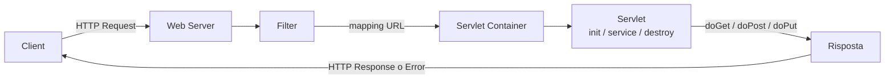

> [!important] Filter
> Un **filter** intercetta la richiesta _prima_ che arrivi alla servlet ed esegue operazioni preliminari (es. controlli di sicurezza, autenticazione, logging). Se la richiesta non supera i controlli viene bloccata lì, e la servlet non la riceve nemmeno. Se li supera, tramite il **mapping** il container capisce a quale servlet consegnarla.

### Gerarchia delle classi

- `Servlet` è un'**interfaccia** (definisce `init()`, `service()`, `destroy()`).
- `GenericServlet` la implementa in modo indipendente dal protocollo.
- `HttpServlet` estende `GenericServlet` e la rende **specifica per HTTP**: il suo `service()` guarda il metodo HTTP della richiesta e la smista a `doGet()`, `doPost()`, `doPut()`…

Noi estendiamo `HttpServlet` e sovrascriviamo solo i `doXxx()` che ci servono.

I due oggetti che ricevi in ogni `doXxx()`:

- `HttpServletRequest` → **input**: da qui leggi parametri, header, cookie, sessione.
- `HttpServletResponse` → **output**: qui costruisci la risposta (contenuto, content type, status code, cookie).

## Ciclo di vita

Le servlet non sono istanziate né chiamate dal programmatore: è il **container** a creare l'oggetto e a invocare i metodi nelle varie fasi.

|Fase|Metodo|Quando|
|---|---|---|
|Inizializzazione|`init()`|**Una sola volta** per istanza, prima di gestire qualsiasi richiesta|
|Elaborazione|`service()` → `doGet()`/`doPost()`/…|**A ogni richiesta**|
|Cleanup|`destroy()`|Quando la servlet viene rimossa (es. arresto del server): rilascia le risorse|

La servlet resta in memoria tra una richiesta e l'altra, finché il server non viene fermato o la servlet rimossa. Se il container si riavvia, `init()` viene richiamato.

> [!important] Quando viene chiamato `init()`
> 
> - **Lazy loading** (default): alla **prima richiesta** diretta a quella servlet. Avvio del server più leggero, ma il primo utente aspetta un po' di più.
> - **Eager loading**: all'**avvio del server**, anche senza richieste. Si configura con `<load-on-startup>` in `web.xml` (o con `loadOnStartup` in `@WebServlet`). Più reattivo alla prima richiesta.

> [!warning] Concorrenza 
> Normalmente il container crea **una sola istanza** della servlet e la usa per **tutte** le richieste, ognuna servita da un **thread diverso**. Quindi più thread eseguono `doGet()` _sulla stessa istanza contemporaneamente_.
> 
> - **Variabili locali** (dentro `doGet`) → sicure: ogni thread ha le sue.
> - **Attributi d'istanza** → condivisi tra tutti i thread: vanno progettati per l'accesso concorrente.
> 
> ```java
> public class MyServlet extends HttpServlet {
>    private String username;   // CONDIVISO tra tutti i thread!
> 
>    protected void doGet(HttpServletRequest req, HttpServletResponse resp) {
>        // Thread A: username = "X"
>        // Thread B: username = "Y"  → A potrebbe leggere "Y"
>    }
> }
> ```

## Contenuto statico vs dinamico

La servlet può produrre risposte di complessità crescente. L'idea chiave: il contenuto è **statico** se è sempre uguale, **dinamico** se dipende dalla richiesta (parametri, utente, dati del DB…).

### 1. Testo semplice (statico)

```java
import java.io.*;
import jakarta.servlet.ServletException;
import jakarta.servlet.annotation.WebServlet;
import jakarta.servlet.http.*;

@WebServlet("/hello")
public class HelloWorld extends HttpServlet {
    public void doGet(HttpServletRequest request, HttpServletResponse response)
            throws ServletException, IOException {
        PrintWriter out = response.getWriter();   // canale di scrittura verso il client
        out.println("Hello World");
    }
}
```

`doGet()` viene invocato **automaticamente dal container** quando arriva `GET /myapp/hello HTTP/1.1`.

> [!question] Cos'è `hello`? Prendi l'URL `http://localhost:8080/myapp/hello`:
> 
> - `localhost:8080` → host e porta del server
> - `/myapp` → **context path**: identifica l'applicazione web deployata sul server
> - `/hello` → **URL pattern** della servlet, quello scritto in `@WebServlet("/hello")`
> 
> Quindi `hello` è il "nome" con cui la servlet è raggiungibile _dentro_ l'applicazione.

### 2. Pagina HTML (statica)

Stessa logica, ma restituisce una pagina HTML vera e propria. Va dichiarato il **content type**, così il browser sa che deve renderizzarla come HTML e non mostrarla come testo.

```java
public class HelloWWW extends HttpServlet {
    public void doGet(HttpServletRequest request, HttpServletResponse response)
            throws ServletException, IOException {
        response.setContentType("text/html");   // prima di scrivere il corpo
        PrintWriter out = response.getWriter();
        out.println("<HTML>\n" +
                    "<HEAD><TITLE>Hello WWW</TITLE></HEAD>\n" +
                    "<BODY>\n" +
                    "<H1>Hello WWW</H1>\n" +
                    "</BODY></HTML>");
    }
}
```

È ancora **statica**: ogni richiesta riceve esattamente la stessa pagina.

### 3. Testo dinamico (dipende dalla richiesta)

Qui la risposta cambia in base ai **parametri** inviati dal client, per esempio nella query string: `http://localhost:8080/miaServlet?nome=Mario&eta=25`

```java
public class HelloWorld extends HttpServlet {
    public void doGet(HttpServletRequest request, HttpServletResponse response)
            throws ServletException, IOException {
        String nome   = request.getParameter("nome");  // "Mario"
        String etaStr = request.getParameter("eta");   // "25"  ← è una String!
        int eta = Integer.parseInt(etaStr);            // 25

        PrintWriter out = response.getWriter();
        out.println("Hello " + nome + " " + eta);
    }
}
```

> [!note] Cast o conversione? 
> Tutto ciò che arriva via HTTP è **testo**, quindi `getParameter()` restituisce sempre una `String` (o `null` se il parametro manca). Per ottenere un `int` non basta un cast: serve una **conversione** (`parsing`) con `Integer.parseInt()`, che lancia `NumberFormatException` se la stringa è `null` o non è un numero.

Un altro esempio, con più parametri:

```java
public class ThreeParams extends HttpServlet {
    public void doGet(HttpServletRequest request, HttpServletResponse response)
            throws ServletException, IOException {
        response.setContentType("text/html");
        PrintWriter out = response.getWriter();
        out.println("param1: " + request.getParameter("param1") + "<br>" +
                    "param2: " + request.getParameter("param2") + "<br>" +
                    "param3: " + request.getParameter("param3"));
    }
}
```

### Parametri di inizializzazione vs parametri di richiesta

Ci sono due tipi di "parametri" da non confondere:

| Init parameters  | Request parameters                         |                                   |
| ---------------- | ------------------------------------------ | --------------------------------- |
| Chi li definisce | Programmatore/amministratore               | Client (browser, app)             |
| Dove             | `web.xml` o annotazioni                    | Query string (GET) o corpo (POST) |
| Quando cambiano  | Mai a runtime: **statici**                 | A ogni richiesta: **dinamici**    |
| Come si leggono  | `getServletConfig().getInitParameter(...)` | `request.getParameter(...)`       |

## Parametri di inizializzazione

Servono a configurare la servlet **senza toccare il codice**: se cambia un valore modifichi la configurazione, non la classe. Si leggono tipicamente in `init()`, una volta sola.

### Versione con `web.xml` (vecchio approccio)

```xml
<servlet>
    <servlet-name>ShowMessage</servlet-name>
    <servlet-class>ShowMessage</servlet-class>
    <init-param>
        <param-name>message</param-name>
        <param-value>Hello, Servlet!</param-value>
    </init-param>
    <init-param>
        <param-name>repeats</param-name>
        <param-value>3</param-value>
    </init-param>
</servlet>
```

### Versione con annotazioni

```java
@WebServlet(
    urlPatterns = {"/showMessage"},
    initParams = {
        @WebInitParam(name = "message", value = "Hello from annotation!"),
        @WebInitParam(name = "repeats", value = "3")
    }
)
public class ShowMessage extends HttpServlet {

    private String message;
    private String defaultMessage = "No message.";
    private int repeats = 1;

    @Override
    public void init() throws ServletException {
        ServletConfig config = getServletConfig();

        message = config.getInitParameter("message");
        if (message == null) {
            message = defaultMessage;          // valore di riserva
        }
        try {
            repeats = Integer.parseInt(config.getInitParameter("repeats"));
        } catch (NumberFormatException nfe) {
            // parametro assente o non numerico: resta repeats = 1
        }
    }

    @Override
    public void doGet(HttpServletRequest request, HttpServletResponse response)
            throws ServletException, IOException {
        response.setContentType("text/html");
        PrintWriter out = response.getWriter();
        out.println("<html><head><title>Messaggio</title></head><body>");
        for (int i = 0; i < repeats; i++) {
            out.println(message + " ");
        }
        out.println("</body></html>");
    }
}
```

Flusso: `init()` legge `message` e `repeats` una volta → li salva in attributi d'istanza → ogni `doGet()` li usa per costruire la pagina. Qui gli attributi d'istanza non creano problemi di concorrenza perché vengono **solo letti** dopo `init()`.

## Mapping

Il **mapping** è l'associazione tra un URL e la servlet che lo gestisce. Il container lo conosce grazie all'annotazione `@WebServlet` (in passato tramite `web.xml`, detto _deployment descriptor_).

### Più URL, una servlet

Una servlet può essere associata a più URL: utile quando più percorsi espongono **la stessa funzionalità** senza dover duplicare la servlet (es. il carrello raggiungibile da più pagine).

```java
@WebServlet({"/users", "/customers", "/hello"})
public class HelloWorld extends HttpServlet {

    protected void doGet(HttpServletRequest request, HttpServletResponse response)
            throws ServletException, IOException {
        String uri = request.getRequestURI();   // quale URL ha generato la richiesta?

        if (uri.endsWith("/users")) {
            // gestione users
        } else if (uri.endsWith("/customers")) {
            // gestione customers
        }
    }
}
```

Il container fa puntare tutti questi URL alla **stessa istanza**; dentro `doGet()` si distingue il caso con `getRequestURI()`.

### Modalità di mapping

Non sono regex: sono **pattern URL** con regole fisse. Jakarta Servlet ne prevede quattro:

|Tipo|Esempio|Cosa intercetta|
|---|---|---|
|Exact|`/users`|solo `/users`|
|Path|`/api/*`|tutto ciò che inizia con `/api/`|
|Extension|`*.jsp`|URL che terminano con `.jsp`|
|Default|`/`|tutto ciò che non è catturato da mapping più specifici|

> [!important] Regola di precedenza
> Se più servlet fanno match con lo stesso URL, si controlla in quest'ordine e vince la prima che corrisponde:
> 1. Exact match
> 2. Longest path match (il prefisso più lungo)
> 3. Extension match
> 4. Default mapping

Esempio:

```java
@WebServlet("/users")
class UsersServlet extends HttpServlet { }

@WebServlet("/users/*")
class UserDetailsServlet extends HttpServlet { }
```

- `/users` → `UsersServlet` (exact match)
- `/users/123` → `UserDetailsServlet` (path match)

Quando le regole di routing diventano tante, i framework (es. Spring) introducono un livello di astrazione superiore per gestirle in modo **dichiarativo**.

## GET, POST e la richiesta HTTP

In entrambi i casi i parametri si leggono con `request.getParameter(...)`. La differenza **non** è nell'API Java, ma in:

- **come i dati viaggiano**: GET → nella query string dell'URL; POST → nel corpo della richiesta;
- **la semantica HTTP**: GET serve a _leggere_ una risorsa, POST a _inviare dati_ che modificano lo stato (es. creare un utente).

```html
<form method="post" action="/users">
    <input name="name">
    <input name="email">
    <button type="submit">Save</button>
</form>
```

```java
@Override
protected void doPost(HttpServletRequest request, HttpServletResponse response) {
    String name  = request.getParameter("name");
    String email = request.getParameter("email");
}
```

Oltre ai parametri, la servlet può:

- leggere gli **header**: `request.getHeader("User-Agent")`
- impostare lo **status code**: `response.setStatus(HttpServletResponse.SC_OK)`
- ordinare al browser di fare una **nuova richiesta** verso un altro URL (redirect, lo vedremo più avanti)

### Header HTTP

Gli header sono **metadati** che accompagnano richiesta e risposta:

|Tipo|Scopo|
|---|---|
|Generali|Informazioni sulla comunicazione in sé|
|Di richiesta|Preferenze del client, autenticazione|
|Di entità|Descrivono il corpo del messaggio|

Esempio: servlet che stampa metodo, URI, protocollo e tutti gli header, gestendo GET e POST **allo stesso modo** (`doPost` delega a `doGet`):

```java
public class ShowRequestHeaders extends HttpServlet {

    public void doGet(HttpServletRequest request, HttpServletResponse response)
            throws ServletException, IOException {
        response.setContentType("text/html");
        PrintWriter out = response.getWriter();
        out.println("<html><head><title>Request Headers</title></head><body>");

        out.println("Request Method: "   + request.getMethod()     + "<br>"); // GET
        out.println("Request URI: "      + request.getRequestURI() + "<br>"); // /showMessage
        out.println("Request Protocol: " + request.getProtocol()   + "<br>"); // HTTP/1.1

        Enumeration<String> headerNames = request.getHeaderNames();
        while (headerNames.hasMoreElements()) {
            String headerName = headerNames.nextElement();
            out.println(headerName + " = " + request.getHeader(headerName) + "<br>");
        }
        out.println("</body></html>");
    }

    public void doPost(HttpServletRequest request, HttpServletResponse response)
            throws ServletException, IOException {
        doGet(request, response);
    }
}
```

> [!warning] Stampare gli header in una pagina è utile per studio/debug, ma è sconsigliato in produzione: possono contenere informazioni sensibili (es. l'header `Cookie` con l'ID di sessione).

---

## Servlet e JDBC

La servlet può accedere a un database e restituire i dati in una pagina HTML. Esempio in ascolto su `http://localhost:8080/MyWebApp/hello`:

```java
@WebServlet("/hello")
public class HelloServlet extends HttpServlet {

    protected void doGet(HttpServletRequest req, HttpServletResponse resp)
            throws ServletException, IOException {
        resp.setContentType("text/html;charset=UTF-8");
        String mysqlURL = "jdbc:mysql://localhost:3306/testdb";
        String us = "root";
        String pwd = "admin";

        PrintWriter out = resp.getWriter();
        out.println("<html><body><h2>Elenco Nomi:</h2><ul>");

        // try-with-resources: chiude rs, stmt e conn automaticamente
        try (Connection conn = DriverManager.getConnection(mysqlURL, us, pwd);
             Statement stmt = conn.createStatement();
             ResultSet rs = stmt.executeQuery("SELECT id, name FROM users")) {

            while (rs.next()) {
                out.println("<li>Codice: " + rs.getInt(1) +
                            ", Nome: " + rs.getString(2) + "</li>");
            }
        } catch (SQLException e) {
            throw new ServletException("Errore JDBC", e);
        }
        out.println("</ul></body></html>");
    }
}
```

Con una **stored procedure** si usa `CallableStatement`, registrando i parametri di output:

```sql
CREATE PROCEDURE getUserStats(OUT totalUsers INT, OUT averageAge DOUBLE)
BEGIN
    SELECT COUNT(*) INTO totalUsers FROM Users;
    SELECT AVG(age)  INTO averageAge FROM Users;
END;
```

```java
@WebServlet("/userStats")
public class UserStatsServlet extends HttpServlet {

    protected void doGet(HttpServletRequest request, HttpServletResponse response)
            throws ServletException, IOException {
        try (Connection conn = DriverManager.getConnection(mysqlURL, us, pwd);
             CallableStatement stmt = conn.prepareCall("{call getUserStats(?, ?)}")) {

            stmt.registerOutParameter(1, java.sql.Types.INTEGER);  // totalUsers
            stmt.registerOutParameter(2, java.sql.Types.DOUBLE);   // averageAge
            stmt.execute();

            int totalUsers    = stmt.getInt(1);
            double averageAge = stmt.getDouble(2);

            PrintWriter out = response.getWriter();
            out.println("<h1>User Statistics</h1>");
            out.println("<p>Total Users: " + totalUsers + "</p>");
            out.println("<p>Average Age: " + averageAge + "</p>");
        } catch (SQLException e) {
            throw new ServletException("Errore JDBC", e);
        }
    }
}
```

> [!bug] Violazione della Separation of Concerns
>  In entrambi gli esempi un solo metodo (`doGet`) fa **tutto**: gestisce la richiesta, apre la connessione, interroga il DB e costruisce l'HTML. Accesso ai dati, logica e presentazione sono mescolati → codice difficile da mantenere, testare e riusare. (In più, le credenziali sono scritte nel codice.) È esattamente il problema che pattern come MVC/DAO risolvono separando i livelli.

## Stato in HTTP

HTTP è **stateless**: ogni richiesta è indipendente e il server, di base, non "ricorda" nulla delle precedenti. Le Servlet API permettono però di memorizzare **attributi** con visibilità e durata diverse (**scope**):

|Scope|Oggetto|Durata|Condiviso tra|
|---|---|---|---|
|Request|`HttpServletRequest`|una singola richiesta|componenti che gestiscono quella richiesta|
|Session|`HttpSession`|la sessione dell'utente|richieste dello stesso client|
|Application|`ServletContext`|tutta la vita dell'applicazione|tutte le servlet e tutti i client|

Tutti e tre usano la stessa coppia di metodi `setAttribute(nome, valore)` / `getAttribute(nome)`.

### Lo stato "sbagliato": attributo d'istanza

```java
public class GetCounter extends HttpServlet {

    private int getNum;   // di ISTANZA → condiviso da tutti i client

    @Override
    public void init() throws ServletException {
        getNum = 0;
    }

    public void doGet(HttpServletRequest req, HttpServletResponse resp)
            throws ServletException, IOException {
        getNum++;
        resp.getWriter().println("GETs=" + getNum);
    }
}
```

- È un **contatore globale**: tutti i client vedono e incrementano lo stesso valore.
- Non si azzera finché la servlet resta in memoria.
- **Non è thread-safe**: `getNum++` non è atomico (leggi → somma → scrivi), quindi due richieste simultanee possono perdere un incremento. Servirebbe `synchronized` o un `AtomicInteger`.
- Se vuoi un valore **per ogni utente**, non è la strada giusta → servono **cookie** o **sessioni**.

> [!note] Nella slide `init` è sovrascritto nella forma `init(ServletConfig config)`. In quel caso bisogna chiamare `super.init(config)`, altrimenti `getServletConfig()` restituirà `null`. Più semplice sovrascrivere `init()` senza argomenti, come sopra.


## Cookie

Un **cookie** è un piccolo dato testuale (coppia nome-valore) memorizzato **nel browser**, usato per tracciare sessioni o preferenze dell'utente.

Funzionamento:

1. la servlet crea un cookie e lo aggiunge alla risposta;
2. il browser lo memorizza;
3. a ogni richiesta successiva verso quel sito, il browser lo **rimanda automaticamente** al server.

Limiti: contiene **solo stringhe** e al massimo circa **4 KB**. Poiché sta sul client, l'utente può leggerlo e modificarlo → **mai** metterci dati sensibili.

### Creare un cookie

```java
Cookie c = new Cookie("name", "value");
c.setMaxAge(60 * 60);      // durata in secondi → il cookie persiste su disco
c.setHttpOnly(true);       // non accessibile da JavaScript (protegge da furti via XSS)
c.setSecure(true);         // inviato solo su HTTPS
response.addCookie(c);
```

> [!info] Significato di `setMaxAge`
> 
> - valore **positivo** → il cookie dura quei secondi, anche dopo la chiusura del browser;
> - **-1** (default) → _cookie di sessione_: sparisce alla chiusura del browser;
> - **0** → il browser cancella subito il cookie.

Cookie "a lunga durata" tramite una sottoclasse:

```java
public class LongLivedCookie extends Cookie {
    public static final int SECONDS_PER_YEAR = 60 * 60 * 24 * 365;

    public LongLivedCookie(String name, String value) {
        super(name, value);
        setMaxAge(SECONDS_PER_YEAR);
    }
}
```

### Cosa mettere nel cookie: due strategie

**Opzione 1 – serializzazione e codifica.** Dati piccoli trasformati in stringa (es. JSON) e codificati per l'URL, perché alcuni caratteri non sono ammessi in un cookie:

```java
Map<String, String> info = new HashMap<>();
info.put("user", "Mario");
info.put("role", "admin");

String json = new Gson().toJson(info);   // libreria Gson
Cookie c = new Cookie("userInfo", URLEncoder.encode(json, "UTF-8"));
response.addCookie(c);
```

⚠️ Sta tutto sul client: un utente potrebbe modificare `role` in `admin`. Per questo i dati importanti non vanno qui.

**Opzione 2 – riferimento a una sessione.** Il cookie contiene solo un **identificativo**; i dati veri (anche oggetti Java grandi) restano sul server, che usa l'ID per ritrovarli. Più sicuro.

```java
Cookie c = new Cookie("sessionId", session.getId());
response.addCookie(c);
```

In pratica non serve farlo a mano: è esattamente ciò che il container fa da solo con le sessioni (cookie `JSESSIONID`, vedi sotto).

### Leggere i cookie

```java
Cookie[] cookies = request.getCookies();   // null se il client non ne ha inviati
if (cookies != null) {
    for (Cookie c : cookies) {
        if (c.getName().equals("someName")) {
            // usa c.getValue()
            break;
        }
    }
}
```

Metodi principali di `Cookie`:

|Metodo|Descrizione|
|---|---|
|`getName()`|nome (immutabile dopo la creazione)|
|`getValue()` / `setValue()`|valore|
|`getMaxAge()` / `setMaxAge()`|durata in secondi|
|`getPath()` / `setPath()`|percorso URL per cui il cookie viene inviato|
|`getSecure()` / `setSecure()`|invio solo su HTTPS|
|`clone()`|copia del cookie|

(`setComment`/`setVersion` compaiono nelle slide ma sono deprecati nelle versioni recenti di Jakarta Servlet.)

## Sessioni
`HttpSession` è un contenitore dati per singolo client (utente/browser). Ogni client ha la sua sessione unica, identificata da un cookie `JSESSIONID`.
``` java
HttpSession session = request.getSession(true); // crea una nuova sessione se non esiste; con false restituisce null
ShoppingCart cart = (ShoppingCart) session.getAttribute("shoppingCart");
if (cart == null) { // nessun carrello nella sessione
	cart = new ShoppingCart();
	session.setAttribute("shoppingCart", cart);
}
// do something with cart
```
**Comportamento**: il contatore è individuale per client e si mantiene finché dura la sessione (timeout o chiusura del browser, a seconda della configurazione).

| Metodo                                                | Descrizione                                                                              |
| ----------------------------------------------------- | ---------------------------------------------------------------------------------------- |
| `getAttribute`                                        | Estrae un valore memorizzato nella sessione, `null` se al nome non è associato nulla     |
| `setAttribute`                                        | Associa un valore a un nome                                                              |
| `removeAttribute`                                     | Rimuove i valori associati al nome                                                       |
| `getAttributeNames`                                   | Restituisce i nomi di tutti gli attributi nella sessione                                 |
| `getId`                                               | Restituisce l'identificativo univoco della sessione                                      |
| `isNew`                                               | Determina se la sessione è nuova per il client                                           |
| `getCreationTime`                                     | Restituisce l'ora in cui la sessione è stata creata                                      |
| `getLastAccessedTime`                                 | Restituisce l'ora dell'ultima richiesta inviata dal client                               |
| `getMaxInactiveInterval`, `setMaxInactiveInterval`    | Ottiene o imposta il tempo di inattività dopo cui la sessione viene invalidata           |
| `invalidate`                                          | Invalida la sessione e disassocia tutti gli oggetti ad essa associati                    |

Di seguito una Servlet che conta quante volte uno specifico utente ha visitato la pagina nella stessa sessione:
``` java
public class SessionCounter extends HttpServlet {
	public void doGet(HttpServletRequest req, HttpServletResponse resp) throws ServletException, IOException {
		resp.setContentType("text/html");
		PrintWriter out = resp.getWriter();
		HttpSession session = req.getSession(true);
		String heading;
		Integer accessCount = (Integer) session.getAttribute("accessCount");
		if (accessCount == null) {
			accessCount = 0;
			heading = "Welcome, Newcomer";
		} else {
			heading = "Welcome Back";
			accessCount = accessCount.intValue() + 1;
		}
		session.setAttribute("accessCount", accessCount);
		out.println("<h1>" + heading + "</h1><hr><h3>Access no." + accessCount + "</h3>");
	}
}
```
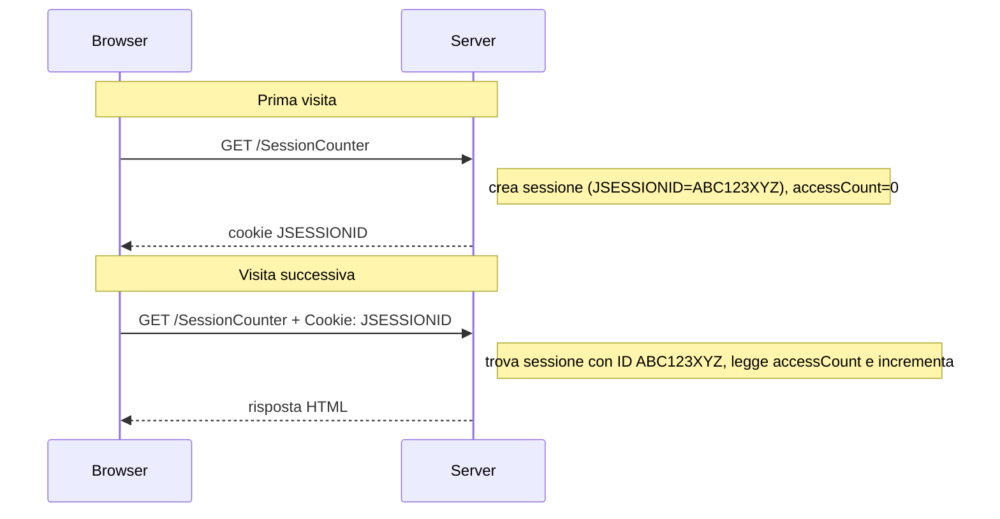

### Session vs Cookie
| Caratteristica         | Sessione                                                 | Cookie                                                  |
| ---------------------- | -------------------------------------------------------- | ------------------------------------------------------- |
| Posizione              | Memorizzata sul **server**                               | Memorizzato sul **client** (browser)                    |
| Dimensione dei dati    | Grandi quantità di dati (oggetti, informazioni utente)   | Limitata (tipicamente ~4 KB max)                        |
| Persistenza            | Fino al timeout (o finché non viene invalidata)          | Può persistere per giorni, settimane o mesi             |
| Sicurezza              | Più sicura (dati lato server)                            | Meno sicura (l'utente può modificare i cookie)          |
| Metodo di tracciamento | Usa un Session ID memorizzato in un cookie               | Usa coppie chiave-valore                                |
| Durata                 | Termina alla chiusura del browser (default) o al timeout | Può scadere in un momento futuro                        |
| Accesso                | Solo sul server (`session.getAttribute()`)               | Sia dal server che dal client (es. JavaScript)          |
| Caso d'uso             | Dati sensibili (sessioni di login, carrelli)             | Preferenze (tema, lingua)                               |

### URL rewriting
Se i cookie non sono abilitati, alcuni server possono usare l'**URL rewriting**: l'ID sessione viene passato direttamente nell'URL.
`http://example.com/app/page;jsessionid=ABC123DEF456`
Utile, ma meno sicura e meno pratica!

| Aspetto                    | Dettaglio                                                                                                                             |
| -------------------------- | ------------------------------------------------------------------------------------------------------------------------------------- |
| Sicurezza                  | L'ID sessione è visibile nell'URL → rischio di furto della sessione se qualcuno copia l'URL o se l'URL è salvato nei log o condiviso |
| Usabilità                  | Se l'utente copia/incolla l'URL o lo condivide, anche altri possono accedere alla sua sessione                                        |
| SEO e caching              | Ogni URL con ID sessione è unico → i motori di ricerca possono indicizzare molteplici URL identici; anche proxy o cache potrebbero memorizzare pagine diverse per lo stesso contenuto |
| Persistenza della sessione | Funziona solo se ogni link nella pagina viene codificato con `response.encodeURL()` o `encodeRedirectURL()`, altrimenti la sessione si perde al click su un link |
| Link interni e navigazione | Tutti i link e form devono passare l'ID sessione: serve molta attenzione nella generazione dinamica dei link                           |
| Timeout e invalidazione    | Non cambia: l'ID sessione rimane valido fino alla scadenza, ma se l'utente chiude la pagina senza passare l'ID negli URL, la sessione può andare persa |
## ServletContext

> [!important] Il **ServletContext** rappresenta il contesto (ambiente condiviso) della Web Application. È creato e gestito dal Servlet Container (es. Tomcat) ed è condiviso da **tutte** le servlet della stessa applicazione.

Cookie e sessioni risolvono il problema "n utenti : 1 servlet". Il ServletContext risolve "N servlet : 1 web application": permette alle servlet di accedere a configurazioni globali, informazioni e risorse comuni.

```java
ServletContext context = getServletContext();
```

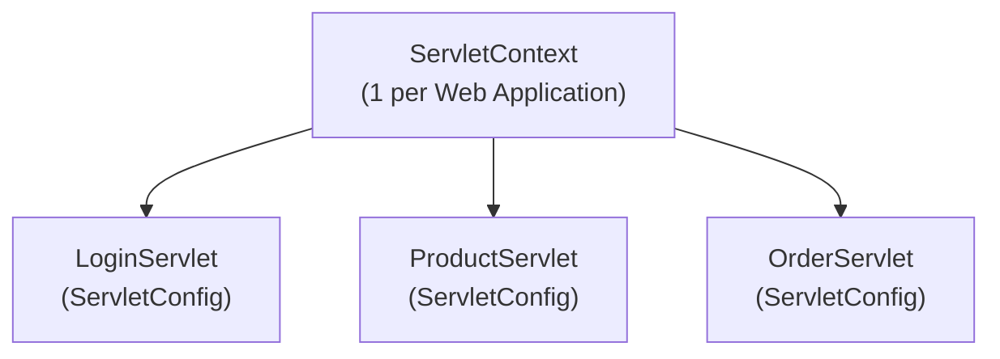

| Oggetto          | Cosa rappresenta                             | Ambito                        |
| ---------------- | -------------------------------------------- | ----------------------------- |
| `ServletConfig`  | configurazione di **1 servlet**              | una sola servlet              |
| `ServletContext` | contesto **condiviso dalla web application** | tutte le servlet              |
| `HttpSession`    | stato **associato a 1 utente**               | richieste dello stesso client |
|                  |                                              |                               |

> [!note] Collegamento con gli scope
> Il ServletContext è lo scope **Application** della tabella vista in [[#Stato in HTTP| Stato]]: gli attributi vivono finché vive l'applicazione.

Esempi d'uso:

1. **Leggere parametri globali** (definiti in `web.xml` con `<context-param>`, non legati a una servlet specifica come gli `<init-param>`)

```xml
<context-param>
	<param-name>applicationName</param-name>
	<param-value>MyShop</param-value>
</context-param>
```

```java
ServletContext context = getServletContext();
String name = context.getInitParameter("applicationName");
```

2. **Condividere informazioni tra componenti** (attributi di contesto)

```java
context.setAttribute("numberOfUsers", 100);
Integer n = (Integer) context.getAttribute("numberOfUsers");
```

3. **Navigare nelle risorse** della web application (vedi [[#Dispatching]]). Si può anche accedere ai file dell'applicazione, es. `context.getResourceAsStream("/WEB-INF/config.txt")`.

> [!bug] Concorrenza
>  Il contesto è condiviso da **tutti i thread** di **tutti gli utenti**: come per gli attributi di istanza della servlet, un `setAttribute` + `getAttribute` non è atomico. Per contatori e strutture condivise usare classi thread-safe (`AtomicInteger`, `ConcurrentHashMap`) o `synchronized`.

## Dispatching

Il **RequestDispatcher** permette a una servlet di **delegare** l'elaborazione di una richiesta a un'altra risorsa del server (servlet, pagina HTML, JSP). Si usa per passare il controllo (es. tra i 3 livelli) o per richiedere contenuto riutilizzabile (header, menu, footer, banner...).

1. si ottiene il dispatcher dal `ServletContext`, fornendo un URL **relativo alla radice dell'applicazione** (deve iniziare con `/`)
2. si invoca `forward()` o `include()`

```java
String url = "/presentations/presentation1.html";
RequestDispatcher dispatcher = getServletContext().getRequestDispatcher(url);
```

> [!note] Alternativa
> Anche `request.getRequestDispatcher(path)` restituisce un dispatcher, ma accetta anche percorsi **relativi** alla richiesta corrente (ad es. `"index.jsp"`).

### Forward o include?

Entrambi delegano l'elaborazione a un'altra risorsa, ma in modo diverso:

> [!important] `forward()` → **passa il controllo** `include()` → **include il contenuto**

> [!multi-column]
> 
> > [!blank] **forward**
> > 
> > ```mermaid
> > sequenceDiagram
> >    participant B as Browser
> >    participant S1 as Servlet1
> >    participant S2 as Servlet2
> >    B->>S1: 1. request
> >    S1->>S2: 2. forward(request, response)
> >    S2-->>B: 3. risposta generata da Servlet2
> > ```
> 
> > [!blank] **include**
> > 
> > ```mermaid
> > sequenceDiagram
> >    participant B as Browser
> >    participant S1 as Servlet1
> >    participant S2 as Servlet2
> >    B->>S1: 1. request
> >    S1->>S2: 2. include(request, response)
> >    S2-->>S1: 3. contenuto di Servlet2
> >    S1-->>B: 4. risposta finale (S1 + S2)
> > ```

| Aspetto                | `forward()`                                       | `include()`                                            |
| ---------------------- | ------------------------------------------------- | ------------------------------------------------------ |
| Chi risponde al client | la risorsa a cui si inoltra                       | la servlet chiamante (con dentro il contenuto incluso) |
| Dopo la chiamata       | il controllo **non torna** alla servlet chiamante | il controllo **torna** alla servlet chiamante          |
| Uso tipico             | passare a una vista (JSP), cambiare "pagina"      | comporre la pagina (header, menu, footer)              |

> [!attention] Forward ≠ redirect 
> Il forward avviene **dentro il server**: il browser non lo sa, l'**URL non cambia** e la richiesta è **una sola** (request e response sono le stesse, quindi gli attributi della request restano disponibili). `response.sendRedirect()` invece dice al browser di fare una **nuova richiesta** (2 richieste, URL che cambia, attributi della request persi). Inoltre con `forward()` la risposta non deve essere già stata inviata (_committed_), altrimenti `IllegalStateException`.

Esempio: la servlet sceglie la pagina in base al parametro `operation`

```java
private void gotoPage(String address, HttpServletRequest request, HttpServletResponse response) throws ServletException, IOException {
	RequestDispatcher dispatcher = getServletContext().getRequestDispatcher(address);
	dispatcher.forward(request, response);
}

public void doGet(HttpServletRequest request, HttpServletResponse response)throws ServletException, IOException {
	String operation = request.getParameter("operation");
	if (operation == null)
		operation = "unknown";
	if (operation.equals("operation1"))
		gotoPage("/operations/presentation1.html", request, response);
	else if (operation.equals("operation2"))
		gotoPage("/operations/presentation2.html", request, response);
	else
		gotoPage("/operations/unknownRequestHandler.html", request, response);
}
```

### Mapping, routing, dispatching

Tre concetti facili da confondere, chiariti seguendo il percorso di una richiesta HTTP:

1. **Mapping** (`@WebServlet`): la _regola_ (configurazione) che dice al container quale servlet gestisce un certo URL → "quale servlet deve ricevere questa richiesta?"
2. **Routing**: l'_applicazione_ delle regole di mapping per indirizzare una richiesta concreta. I Filter hanno un loro mapping e intercettano la richiesta prima/dopo la servlet: possono lasciarla proseguire, modificarla o bloccarla, **interferendo con il routing**.
3. **Dispatching** (`forward`/`include`): avviene **dentro il server**, dopo che una servlet è già stata coinvolta. Non è un nuovo routing del browser.

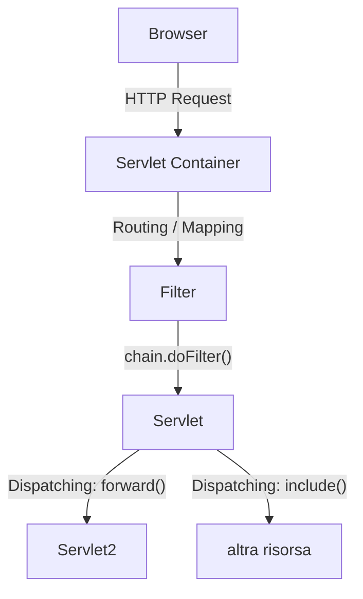

Esempio: `@WebServlet("/products/*")` (mapping) → arriva `GET /products/123` (richiesta concreta) → il routing la indirizza a `ProductServlet`.

## Filtri

> [!important] Un **Filter** è un componente Java che **intercetta le richieste HTTP** prima che arrivino alla servlet (o altra risorsa) e/o **modifica le risposte**.

Si usa per funzionalità **trasversali** (_cross-cutting concerns_), cioè comuni a molte servlet:

- autenticazione / autorizzazione
- logging / monitoraggio
- compressione o modifica delle risposte
- gestione dell'encoding (UTF-8)
- caching o filtro dei contenuti

Evitano **ridondanza** (servlet più snelle, funzionalità comuni centralizzate) e favoriscono la **separazione delle responsabilità** (SoC).

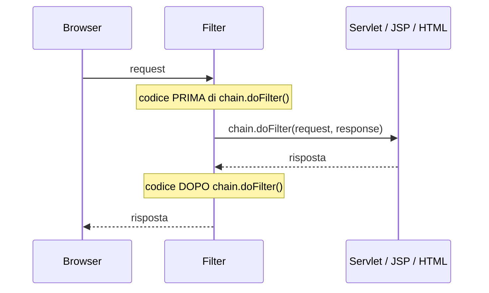

### Interfaccia Filter

Un Filter è una classe Java che implementa l'interfaccia `jakarta.servlet.Filter` (come per le servlet, `javax.servlet` è deprecato) e i suoi 3 metodi:

|Metodo|Quando viene chiamato|
|---|---|
|`init(FilterConfig filterConfig)`|**una sola volta**, quando il container crea e inizializza il filtro|
|`doFilter(ServletRequest, ServletResponse, FilterChain)`|**per ogni richiesta** che passa dal filtro: può modificare request/response o passare il controllo al filtro/servlet successivo con `chain.doFilter(request, response)`|
|`destroy()`|**una sola volta**, quando il filtro viene rimosso dal container e le risorse vengono liberate|

> [!note] `init` e `destroy` 
> Dalla Servlet 4.0 `init()` e `destroy()` hanno un'implementazione di default: l'unico metodo davvero obbligatorio è `doFilter()`.

> [!important] Il ruolo di `chain.doFilter()` 
> Se un filtro **non** chiama `chain.doFilter()` la richiesta si ferma lì: è così che un filtro può **bloccare** una richiesta (es. utente non autenticato).

**Registrazione**: nel `web.xml` oppure con l'annotazione `@WebFilter`. Quando il container avvia l'applicazione crea **un'istanza** di ciascun filtro dichiarato (quindi, come per le servlet, serve attenzione alla concorrenza).

```xml
<filter>
	<filter-name>LoggingFilter</filter-name>
	<filter-class>com.example.LoggingFilter</filter-class>
</filter>

<filter-mapping>
	<filter-name>LoggingFilter</filter-name>
	<url-pattern>/*</url-pattern>
</filter-mapping>
```

```java
@WebFilter("/*") // il filtro si applica a tutte le richieste
public class LoggingFilter implements Filter {
	@Override
	public void init(FilterConfig filterConfig) throws ServletException {
		// logica di inizializzazione, es. lettura di init param
		String someParam = filterConfig.getInitParameter("paramName");
		System.out.println("Filter initialized with param: " + someParam);
	}

	@Override
	public void doFilter(ServletRequest req, ServletResponse res, FilterChain chain) throws IOException, ServletException {
		long start = System.currentTimeMillis();
		chain.doFilter(req, res); // passa il controllo al prossimo elemento
		long elapsed = System.currentTimeMillis() - start;
		System.out.println("Richiesta gestita in " + elapsed + " ms");
	}

	@Override
	public void destroy() { }
}
```

I filtri vengono eseguiti **nell'ordine in cui sono dichiarati** nel `web.xml`.

> [!attention] Ordine con le annotazioni
>  Con `@WebFilter` l'ordine di esecuzione **non è specificato** dallo standard: se l'ordine conta (es. prima l'encoding, poi l'autenticazione) conviene dichiararlo nel `web.xml`.

Esempio: filtro di autenticazione che blocca chi non ha fatto login

```java
@WebFilter("/private/*")
public class AuthFilter implements Filter {
	public void doFilter(ServletRequest req, ServletResponse res, FilterChain chain) throws IOException, ServletException {
		HttpServletRequest request = (HttpServletRequest) req;
		HttpServletResponse response = (HttpServletResponse) res;
		HttpSession session = request.getSession(false); // non crea una nuova sessione
		if (session != null && session.getAttribute("user") != null) {
			chain.doFilter(req, res); // autenticato: prosegui
		} else {
			response.sendRedirect(request.getContextPath() + "/login.html"); // bloccata
		}
	}
}
```

### Filtri: esempi

Catena di filtri + front controller:

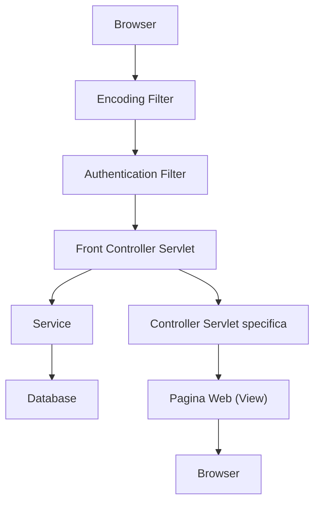

> [!note] Front Controller
>  Una servlet unica che riceve **tutte** le richieste e le smista ai controller specifici. È un pattern (vedi [[#Pattern]]): in Spring è la `DispatcherServlet`.

Esempio completo di navigazione (login → home → ordini) che usa filtri, sessioni, cookie e `include`:

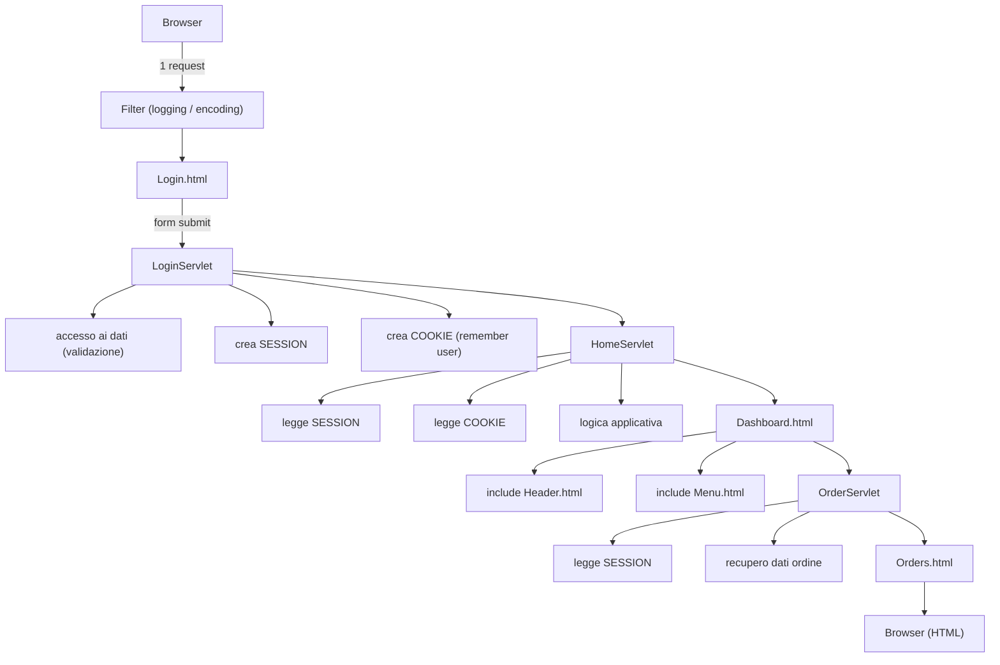

## Listener

> [!important] I **Listener** sono componenti che reagiscono **automaticamente** a determinati **eventi** del ciclo di vita dell'applicazione web, delle sessioni HTTP e delle richieste.

- la **Servlet** gestisce _esplicitamente_ una richiesta HTTP
- il **Listener** reagisce a un _evento_ che si verifica nel container: non è il client a chiamarlo direttamente

Senza listener bisognerebbe controllare manualmente ogni evento in ogni servlet: con i listener è il container a **notificare** automaticamente gli oggetti interessati.

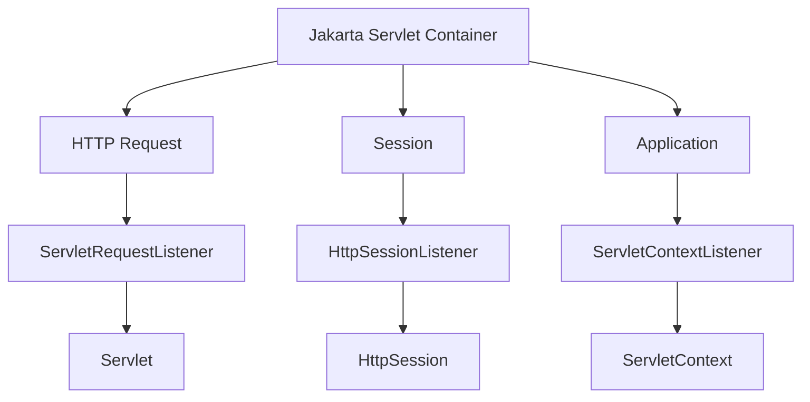

|Livello|Interfaccia|Eventi osservati|
|---|---|---|
|Application|`ServletContextListener`|avvio (`contextInitialized`) e arresto (`contextDestroyed`) dell'applicazione|
|Session|`HttpSessionListener`|creazione (`sessionCreated`) e distruzione (`sessionDestroyed`) delle sessioni|
|Request|`ServletRequestListener`|ciclo di vita delle richieste (`requestInitialized` / `requestDestroyed`)|

Esistono anche i listener sugli **attributi** (es. `ServletContextAttributeListener`, `HttpSessionAttributeListener`) che segnalano quando un attributo viene aggiunto, rimosso o sostituito.

Usi tipici dei listener di Application: inizializzare risorse, caricare configurazioni, inizializzare cache o strutture condivise, **liberare le risorse allo shutdown**.

**Registrazione** con l'annotazione `@WebListener`, che indica al container che quella classe è un listener (il tipo dipende dall'interfaccia implementata):

```java
@WebListener
public class AppListener implements ServletContextListener {
	public void contextInitialized(ServletContextEvent sce) {
		// all'avvio: inizializzo una risorsa condivisa nel contesto
		sce.getServletContext().setAttribute("activeUsers", new AtomicInteger(0));
	}
	public void contextDestroyed(ServletContextEvent sce) {
		// allo shutdown: libero le risorse
	}
}
```

```java
@WebListener
public class SessionCountListener implements HttpSessionListener {
	public void sessionCreated(HttpSessionEvent se) {
		AtomicInteger n = (AtomicInteger) se.getSession().getServletContext().getAttribute("activeUsers");
		n.incrementAndGet();
	}
	public void sessionDestroyed(HttpSessionEvent se) {
		AtomicInteger n = (AtomicInteger) se.getSession().getServletContext().getAttribute("activeUsers");
		n.decrementAndGet();
	}
}
```

Così il numero di utenti con una sessione attiva viene tenuto aggiornato **senza** scrivere codice in nessuna servlet (`AtomicInteger` perché il contesto è condiviso tra thread).

> [!important] Filter vs Listener
>  Il **Filter** partecipa **attivamente** alla pipeline della richiesta (può modificarla o bloccarla). Il **Listener** **osserva** eventi del container.

## Riepilogo annotazioni

|Annotazione|Si applica a|Scopo|
|---|---|---|
|`@WebServlet`|servlet|mapping URL → servlet (alternativa a `web.xml`)|
|`@WebFilter`|filtro|registra un filtro e i pattern URL a cui si applica|
|`@WebListener`|listener|indica al container che la classe è un listener|
|`@WebInitParam`|servlet/filtro|parametro di inizializzazione (alternativa a `<init-param>`)|
|`@MultipartConfig`|servlet|abilita la gestione di richieste `multipart/form-data` (upload di file)|

### @MultipartConfig

Per ricevere file caricati da un form HTML (`method="post"` e `enctype="multipart/form-data"`) la servlet deve essere annotata con `@MultipartConfig`: si accede poi ai file con `request.getPart()`.

```java
@WebServlet("/upload")
@MultipartConfig
public class UploadServlet extends HttpServlet {
	@Override
	protected void doPost(HttpServletRequest request, HttpServletResponse response) throws ServletException, IOException {
		Part file = request.getPart("file"); // "file" = name del campo del form
		String fileName = file.getSubmittedFileName();
		file.write("/tmp/" + fileName);
	}
}
```

Parametri opzionali: `location`, `maxFileSize`, `maxRequestSize`, `fileSizeThreshold`.

> [!attention] Cosa significa "multipart"
>  La slide lo descrive come tecnica che divide un file grande in blocchi caricati in parallelo e ricomposti alla fine. In ambito servlet indica invece la **codifica `multipart/form-data`** del form: il corpo della POST è diviso in **parti** (`Part`), una per ogni campo del form (anche più file), e viaggia in **una sola richiesta**.

> [!bug] Sicurezza `getSubmittedFileName()` è deciso dal client: usarlo così com'è per costruire un percorso permette di scrivere file dove non si dovrebbe (_path traversal_). Va sempre validato/sostituito, come per l'input delle query (vedi [[#SQL injection]]).

## Servlet asincrone

Quando arriva una richiesta il container assegna **un thread** alla servlet e il thread resta occupato finché la servlet non termina. È un problema se l'elaborazione è lunga e il thread deve solo **aspettare**: risposta da un altro servizio, operazione di I/O, risultato di un'elaborazione, arrivo di un evento. Il numero di thread del container è limitato (thread pool): thread bloccati = meno richieste servibili.

> [!important] Le **Asynchronous Servlet** permettono di **sospendere** l'elaborazione della richiesta **senza tenere occupato il thread** del container.

Esempio: in un e-commerce il calcolo delle spese di spedizione è affidato a un servizio esterno.

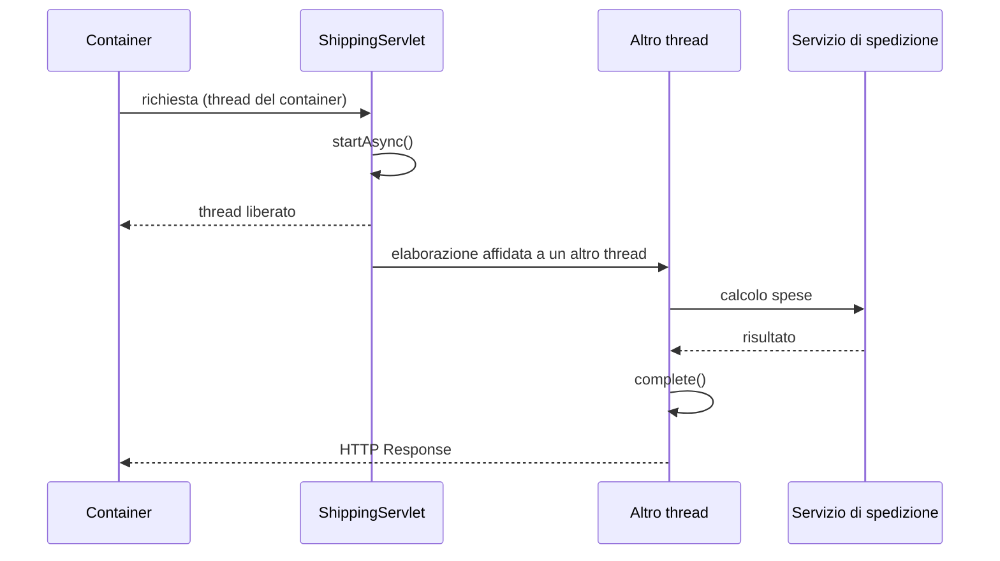

1. **dichiarare** che la servlet supporta l'elaborazione asincrona
2. usare `startAsync()` → elaborazione → `complete()`

```java
@WebServlet(value = "/shipping", asyncSupported = true)
public class ShippingServlet extends HttpServlet {
	protected void doGet(HttpServletRequest req, HttpServletResponse resp)
			throws ServletException, IOException {
		AsyncContext ctx = req.startAsync(); // sospende la richiesta, il thread del container è libero
		ctx.start(() -> {
			try {
				double cost = callShippingService(); // metodo ipotetico: chiamata lenta al servizio esterno
				ctx.getResponse().getWriter().println("Spedizione: " + cost);
			} catch (IOException e) {
				e.printStackTrace();
			} finally {
				ctx.complete(); // la risposta viene inviata al client
			}
		});
	}
}
```

> [!attention] Non rende il lavoro più veloce
>  L'elaborazione dura quanto prima: si **libera il thread del container** per altre richieste (scalabilità), non si accorcia l'attesa del singolo utente. Tutti i filtri e le servlet della catena devono avere `asyncSupported = true`.

# Pattern

> [!important] Un **pattern** è uno schema di soluzione (ricorrente) da adattare a un problema concreto (ricorrente).

Problema ricorrente → riconosciamo una struttura comune → usiamo uno schema di soluzione già sperimentato.

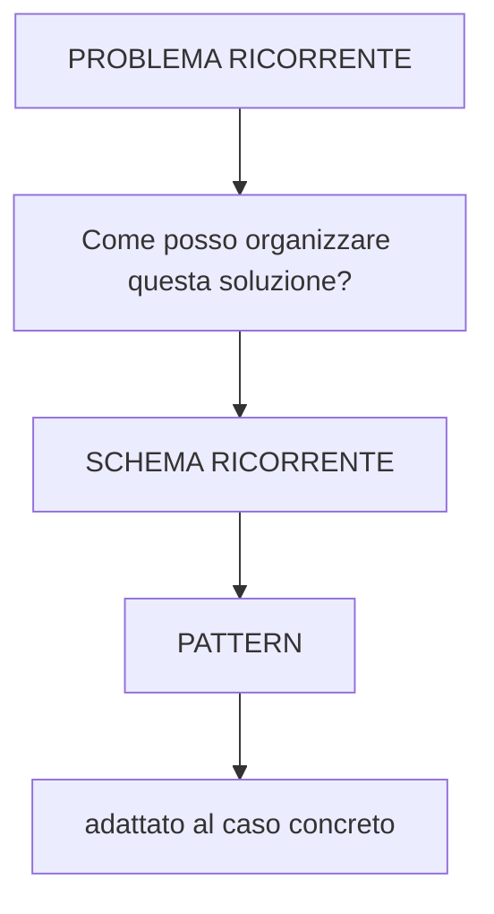

Un pattern **non** è: una classe, una libreria, un algoritmo da copiare, una regola obbligatoria. Descrive _come organizzare_ una soluzione, non è una soluzione pronta.

La parola pattern rimane la stessa, ma cambia l'oggetto a cui applichiamo lo schema:

- come strutturare un'applicazione web separando presentazione, logica e dati? → **MVC** → architectural/design pattern
- come separare l'accesso al database dal resto dell'applicazione? → **DAO** → design/data-access pattern
- come identificare una risorsa sul Web? → **URI** → pattern sintattico/di identificazione

|Tipo di pattern|A cosa serve|Esempi|
|---|---|---|
|Pattern di programmazione|problemi ricorrenti nella scrittura del codice|Iterator, Factory, Singleton|
|Design pattern|organizzare classi e oggetti per problemi ricorrenti di progettazione|MVC, DAO, Observer, Strategy|
|Architectural pattern|struttura complessiva di un sistema software|Layered Architecture, Client–Server, Microservices|
|Integration pattern|comunicazione e scambio di dati tra componenti/sistemi|Message Queue, Publish/Subscribe, API Gateway|
|Data-access pattern|organizzare l'accesso e la gestione dei dati|DAO, Repository, Unit of Work|
|Security pattern|problemi ricorrenti di sicurezza|Authentication, Authorization, Secure Session|

> [!note] Pattern ≠ espressione regolare
>  Una **regex** è un linguaggio formale per descrivere un pattern _testuale_. Es. pattern: "un numero di telefono italiano" → regex: `^\+39\s?[0-9]{9,10}$`

## Model-View-Controller (MVC)

> [!important] Pattern **architetturale** molto diffuso (programmazione a oggetti e applicazioni web) che **separa la logica di presentazione dei dati dalla logica di business**. Si posiziona a livello logico/di business e di presentazione in un'architettura multi-tier (vedi [[#Three tier]]).

- **Model**: i dati e la logica di business
- **View**: come i dati vengono presentati all'utente
- **Controller**: riceve le richieste, coordina Model e View

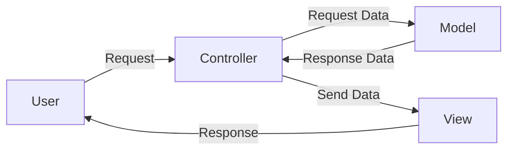

Nelle applicazioni Java web:

1. la richiesta arriva a una **Servlet** (controller), che elabora i parametri, accede al database (pattern **DAO**), esegue la logica di business, ecc.
2. i risultati vengono inseriti in **JavaBean** (oggetti di trasferimento dati che mantengono i dati strutturati e accessibili)
3. la richiesta viene inoltrata (`forward`) a una pagina **JSP** (view) che formatta il risultato; si possono usare diverse JSP per diversi tipi di presentazione

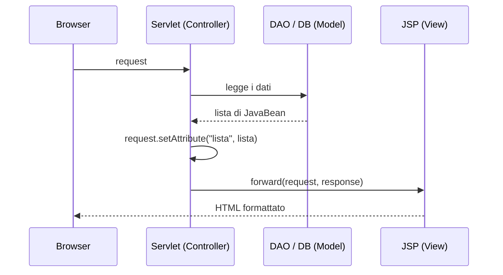

> [!note] In breve 
> Servlet → legge DB → popola lista di JavaBean → mette la lista nella Request → JSP legge la lista e visualizza.

Un **JavaBean** è una classe Java semplice: attributi privati, getter/setter, costruttore senza argomenti, (di solito) `Serializable`.

```java
public class User implements Serializable {
	private int id;
	private String name;

	public User() { }
	public int getId() { return id; }
	public void setId(int id) { this.id = id; }
	public String getName() { return name; }
	public void setName(String name) { this.name = name; }
}
```

> [!question] Perché MVC? 
> Risolve il problema visto in [[#Servlet e database]]: la servlet che gestiva richiesta, dati e HTML insieme violava la SoC. Con MVC ogni parte ha una sola responsabilità.

# JSP

## Il framework JSP (JavaServer Pages)

> [!important] **Idea**: creare pagine web dinamiche in cui la maggior parte della pagina è **HTML standard** e il **codice Java** è contenuto tra **tag speciali**.

La pagina JSP, ospitata in un server web, viene **tradotta automaticamente in una servlet** dal container (**una volta**). La servlet risultante è ciò che viene effettivamente invocato a ogni richiesta.

> [!question] Perché serve se esistono già le servlet? 
> Nella servlet, l'HTML è dentro stringhe Java (`out.println("<li>...")`): scomodo da scrivere e da mantenere. La JSP **inverte** il rapporto: HTML con un po' di Java dentro. Per questo è adatta come **View** in MVC.

Esempio: `firstJSPage.jsp`

```jsp
<html>
[...]
<body>
<H2>JSP Expressions</H2>
<UL>
	<LI>Current time: <%= new java.util.Date() %>
	<LI>Your hostname: <%= request.getRemoteHost() %>
	<LI>Your session ID: <%= session.getId() %>
	<LI>The <CODE>testParam</CODE> form parameter: <%= request.getParameter("testParam") %>
</UL>
</body>
</html>
```

Tutto ciò che sta tra `<%= ... %>` è codice Java, il resto è HTML. Gli oggetti `request`, `session`, ... sono già disponibili senza dichiararli (oggetti impliciti):

|Oggetto|Tipo|Note|
|---|---|---|
|`request`|`HttpServletRequest`|la richiesta|
|`response`|`HttpServletResponse`|la risposta|
|`out`|`JspWriter`|come `PrintWriter`, ma con **buffering** specifico per JSP|
|`session`|`HttpSession`|la sessione (se non disabilitata)|
|`application`|`ServletContext`|il contesto condiviso ([[#ServletContext]])|
|`config`|`ServletConfig`|configurazione della servlet generata|
|`pageContext`|`PageContext`|accesso a tutti gli scope della pagina|
|`page`|`Object`|la servlet stessa (come `this`)|
|`exception`|`Throwable`|solo nelle pagine di errore|

## Ciclo di vita di una JSP

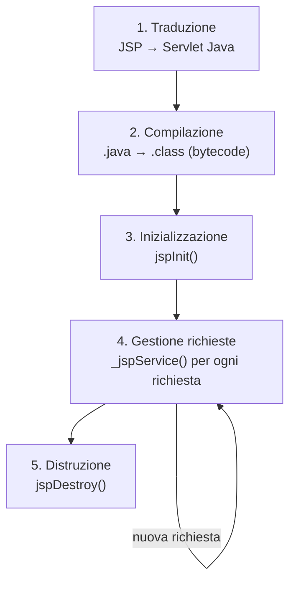

|Fase|Cosa succede|
|---|---|
|1. Traduzione|alla **prima richiesta** (o dopo una modifica) il container traduce il contenuto JSP in codice Java, generando una servlet equivalente|
|2. Compilazione|la servlet generata viene compilata in **bytecode**, pronta per essere eseguita dal server|
|3. Inizializzazione|il container crea un'istanza della servlet e chiama `jspInit()` per inizializzare risorse (connessioni, oggetti, configurazioni)|
|4. Gestione richieste|per **ogni richiesta** il container invoca `_jspService()`, che genera dinamicamente la risposta e produce l'HTML inviato al browser|
|5. Distruzione|quando la JSP non serve più (es. il server viene fermato) il container chiama `jspDestroy()`, libera risorse e chiude le connessioni|

> [!attention] Equivoco: la traduzione non avviene a ogni richiesta
> 
> - **Traduzione**: in genere alla prima richiesta dopo una modifica. I costrutti JSP diventano codice servlet (`jspInit()`, `_jspService()`, ...).
> - **Richiesta**: viene eseguito il **codice servlet**. Non c'è alcuna interpretazione della JSP originale: si usa solo la servlet che ne è derivata.
> 
> Per questo la prima richiesta a una JSP nuova o modificata è più lenta.

La servlet generata implementa `HttpJspPage` (derivata da `Servlet`): è quindi valido tutto quanto visto sul ciclo di vita e sulla **concorrenza** delle servlet (una sola istanza, più thread).

## Tipi di codice Java

|Tipo|Sintassi|Scopo|Esempio|
|---|---|---|---|
|Expression|`<%= ... %>`|stampare un valore|`<%= x + 1 %>`|
|Scriptlet|`<% ... %>`|eseguire codice Java|`<% int x = 5; %>`|
|Declaration|`<%! ... %>`|definire variabili/metodi|`<%! int y = 0; %>`|

> [!attention] Uso moderno
>  Scriptlet, Expression e Declaration **non sono più raccomandati** nei progetti Java EE moderni (ora Jakarta EE): si usano **JSTL** (JSP Standard Tag Library) ed **EL** (Expression Language), che vedremo dopo. Lo studio resta utile per capire l'evoluzione delle tecnologie web Java e per mantenere **applicazioni legacy**.

### JSP Expressions

- **Formato**: `<%= Java expression %>`
- **Effetto**: l'espressione è valutata, **convertita in stringa** e inserita nella pagina HTML nel punto in cui si trovava nella JSP (niente `;` finale)
- **Esempio**: `Current time: <%= new java.util.Date() %>`, `Your hostname: <%= request.getRemoteHost() %>`

Corrispondenza JSP → servlet:

```jsp
<H1>A Random Number</H1>
<%= Math.random() %>
```

```java
public void _jspService(HttpServletRequest request, HttpServletResponse response) throws ServletException, IOException {
	response.setContentType("text/html");
	HttpSession session = request.getSession(true);
	JspWriter out = ...; // ottenuto dal pageContext
	out.println("<H1>A Random Number</H1>");
	out.println(Math.random());
}
```

Il metodo `_jspService()` è **generato automaticamente** dal motore JSP quando la pagina viene compilata in servlet: gestisce la richiesta HTTP e genera la risposta. `JspWriter` è simile a `PrintWriter` ma pensato per il meccanismo di buffering delle JSP.

> [!note] Schema semplificato
>  Nelle slide il codice generato è semplificato: nel codice reale il content type si imposta sulla `response` e `out` è un `JspWriter` ricavato dal `pageContext`. Il concetto da ricordare: l'HTML statico e le expression diventano chiamate a `out.println()` dentro `_jspService()`.

### JSP Scriptlets

- **Formato**: `<% Java code %>`
- **Effetto**: il codice viene inserito **letteralmente** nel `_jspService()` della servlet
- **Esempio**:

```jsp
<% String queryData = request.getQueryString();
   out.println("Attached GET data: " + queryData); %>
<% response.setContentType("text/plain"); %>
```

Corrispondenza: `<%= foo() %>` → `out.println(foo());` e `<% bar(); %>` → `bar();` (una expression stampa, uno scriptlet esegue e basta).

### JSP Declarations

- **Formato**: `<%! Java code %>`
- **Effetto**: il codice viene inserito **letteralmente nella definizione della classe** della servlet, **fuori** da qualsiasi metodo esistente → campi e metodi della servlet
- **Esempio**:

```jsp
<%! private int someField = 5; %>
<%! private void someMethod(...) { ... } %>
```

```jsp
<BODY>
<H1>JSP Declarations</H1>
<%! private int accessCount = 0; %>
<H2>Accesses to page since server reboot: <%= ++accessCount %></H2>
</BODY>
```

Corrispondenza JSP → servlet:

```jsp
<H1>Some Heading</H1>
<%!
	private String randomHeading() {
		return ("<H2>" + Math.random() + "</H2>");
	}
%>
<%= randomHeading() %>
```

```java
public class [..] implements HttpJspPage {
	private String randomHeading() {          // <-- dalla declaration
		return ("<H2>" + Math.random() + "</H2>");
	}

	public void _jspService(HttpServletRequest request, HttpServletResponse response)
			throws ServletException, IOException {
		out.println("<H1>Some Heading</H1>");
		out.println(randomHeading());          // <-- dall'expression
	}
}
```

> [!bug] Concorrenza
>  `accessCount` è un campo della servlet generata: è **condiviso da tutte le richieste e da tutti gli utenti** e `++accessCount` non è atomico (stesso problema di `getNum` in [[#Stato nella servlet]]). Si azzera al riavvio del server.

> [!note] jspInit() e jspDestroy() 
> Poiché le declaration finiscono nella classe, è possibile **ridefinire** `jspInit()` e `jspDestroy()` dentro un `<%! ... %>`.

## Direttive

Le direttive `<%@ ... %>` forniscono **metadati** e configurazioni sulla pagina al container JSP.

### Direttiva page

`<%@ page ... %>` definisce impostazioni della pagina:

|Attributo|Sintassi|Finalità|
|---|---|---|
|`import`|`<%@ page import="package.class" %>` / `import="p.c1,...,p.cN"`|genera gli `import` nella parte superiore della servlet|
|`contentType`|`<%@ page contentType="MIME-Type" %>`|specifica il **tipo MIME** della risposta: dice al browser come interpretare il contenuto inviato|
|`isThreadSafe`|`<%@ page isThreadSafe="true" %>` (default) / `"false"`|comunica al sistema se il codice è thread-safe, così può impedire l'accesso simultaneo|

> [!attention] isThreadSafe
>  Il default è `true`: il sistema presuppone che gli aggiornamenti a campi e dati condivisi siano già **sincronizzati** da noi. `false` impedisce l'accesso concorrente ma **peggiora le prestazioni**: meglio scrivere codice thread-safe.

Altri attributi utili: `pageEncoding` (encoding della pagina), `session="false"` (non crea la sessione), `errorPage` / `isErrorPage` (gestione degli errori).

### Inclusione di file

Per riutilizzare parti di pagina (header, menu, footer) esistono due modi:

```jsp
<jsp:include page="Relative URL" flush="true" />
<%@ include file="Relative URL" %>
```

|Aspetto|`<jsp:include page="..." />`|`<%@ include file="..." %>`|
|---|---|---|
|Quando avviene|**a runtime**, quando la pagina viene eseguita|**in fase di traduzione** della pagina in servlet|
|Tipo|inclusione **dinamica**|inclusione **statica** (il contenuto viene "incollato" nella JSP)|
|Modifiche al file incluso|visibili subito, senza toccare la/le pagina/e principale/i|i server non sono tenuti a rilevarle e molti non lo fanno|
|Equivalente nelle servlet|`RequestDispatcher.include()`|—|

Finalità: riutilizzare contenuti JSP, HTML o testo normale e aggiornarli in un punto solo.

> [!note] Direttiva o azione? 
> Formalmente `<%@ include %>` è una **direttiva** (elaborata in traduzione), mentre `<jsp:include>` è una **azione standard** (elaborata a runtime). 

## Esempi con scriptlet

Gli scriptlet possono essere "spezzati": si apre un blocco Java, si chiude il tag, si scrive HTML, si riapre il tag per chiudere il blocco. L'HTML in mezzo diventa un `out.println()` **dentro** il blocco Java.

### Loop.jsp

```jsp
<html>
<head><title>Loop Example</title></head>
<body>
	<% for (int i = 0; i < 5; i++) { %>
		Message.<br>
	<% } %>
</body>
</html>
```

Equivale, nella servlet generata, a:

```java
for (int i = 0; i < 5; i++) {
	out.println("Message.<br>");
}
```

### Iteration.jsp

```jsp
<body>
<%
	String[] letters = new String[4];
	letters[0] = "Alpha";
	letters[1] = "Beta";
	letters[2] = "Gamma";
	letters[3] = "Delta";
	for (int i = 0; i < letters.length; i++) { %>
		letters[<%= i %>] = <%= letters[i] %><br>
<%	} %>
</body>
```

Scriptlet (dichiarazione + `for`) ed expression (`<%= i %>`) si alternano: l'expression stampa il valore corrente a ogni iterazione.

### Names.jsp: JDBC dentro una JSP

```jsp
<%@ page import="java.sql.*" %>
<html>
	<head>
		<title>Names</title>
	</head>
	<body>
		<OL>  <%-- lista numerata --%>
		<%
			String driverName = "com.mysql.jdbc.Driver";
			try { Class.forName(driverName); }
			catch (Exception e) { out.println("Exception: " + e); }
		
			String mysqlURL = "jdbc:mysql://localhost:3306/simpleschema";
			String username = "root";
			String password = "root";
			java.sql.Connection c = null;
			try {
				c = DriverManager.getConnection(mysqlURL, username, password);
				java.sql.Statement s = c.createStatement();
				String query = "SELECT * FROM names";
				java.sql.ResultSet rs = s.executeQuery(query);
				while (rs.next()) { %>
					<LI>Code: <%= rs.getInt(1) %>, name: <%= rs.getString(2) %></LI>
		<%		}
				rs.close();
				c.close();
			} catch (Exception e) {
				out.println("Exception: " + e);
			}
		%>
		</OL>
	</body>
</html>
```

> [!note] `Class.forName(...)`
>  Serviva a caricare il driver JDBC a mano. Da JDBC 4.0 i driver nel classpath si registrano da soli, quindi la riga non è più necessaria (il nome attuale del driver MySQL è `com.mysql.cj.jdbc.Driver`).

## Riflessioni: servlet o JSP, il problema resta

Le tre funzionalità di un'applicazione web (vedi [[#Model-View-Controller (MVC)]]) sono: **logica applicativa** (controller), **dati** (model), **presentazione** (view).

|Soluzione|Cosa dovrebbe fare|Cosa fa davvero|
|---|---|---|
|Servlet con JDBC (vedi [[#Servlet e JDBC]])|solo la **prima** funzionalità (controllo)|connessione al DB, query **e** HTML con `out.println("<li>...")`|
|JSP con JDBC (`Names.jsp`)|solo la **terza** funzionalità (presentazione)|connessione al DB, query **e** HTML|

> [!important] In entrambi i casi c'è un **mix di logica applicativa, dati e presentazione** nello stesso componente: cambia solo dove sta l'HTML (dentro stringhe Java o intorno al Java), ma la separazione delle responsabilità è violata allo stesso modo.

## Migliorare l'esempio: Servlet + JSP

**Miglioria**: la servlet legge i dati e li passa alla JSP con il `RequestDispatcher` (vedi [[#Dispatching]]). Il `RequestDispatcher` inoltra la request da una risorsa del server a un'altra (pagina HTML o JSP) **senza che il browser lo sappia**: l'URL non cambia.

```java
public class JDBCServletOne extends HttpServlet {
	protected void doGet(HttpServletRequest req, HttpServletResponse resp) throws ServletException, IOException {
		List<String> userList = new ArrayList<>();
		try {
			Connection conn = DriverManager.getConnection(mysqlURL, username, password);
			Statement stmt = conn.createStatement();
			ResultSet rs = stmt.executeQuery("SELECT name FROM users");
			while (rs.next()) {
				userList.add(rs.getString("name"));
			}
			rs.close();
			stmt.close();
			conn.close();
		} catch (Exception e) { e.printStackTrace(); }

		// Passa i dati alla JSP
		req.setAttribute("userList", userList);
		RequestDispatcher dispatcher = req.getRequestDispatcher("index.jsp");
		dispatcher.forward(req, resp);
	}
}
```

`index.jsp` (ancora con scriptlet):

```jsp
<%@ page contentType="text/html; charset=UTF-8" %>
<html>
<body>
<h2>Elenco utenti</h2>
<ul>
<%
	java.util.List<String> users = (java.util.List<String>) request.getAttribute("userList");
	if (users != null && !users.isEmpty()) {
		for (String u : users) {
			out.println("<li>" + u + "</li>");
		}
	} else {
		out.println("<li>Nessun utente trovato</li>");
	}
%>
</ul>
</body>
</html>
```

> [!success] Ci stiamo avvicinando alla filosofia MVC: abbiamo **eliminato l'HTML dalla servlet**. Sparisce il blocco `out.println("<html><body>...")` / `out.println("<li>Codice: " + ...)`.

> [!attention] ...ma nella JSP mescoliamo ancora (un po' di) logica Java e presentazione HTML: cast, `if`, `for`, `out.println`. Servono altri strumenti: **EL** e **JSTL**.

### Integrazione di Servlet e JSP

JSP semplifica lo sviluppo e la manutenzione del contenuto HTML:

- per codice dinamico **semplice** → richiamare codice servlet da espressioni di scripting
- per casi **moderatamente complessi** → classi personalizzate richiamate da espressioni di scripting
- per casi **più complessi** → **bean** e **tag personalizzati** (vedi [[#JavaBeans]])

> [!important] Il presupposto alla base di JSP è che **una singola pagina fornisca un unico aspetto di base**. Se la stessa richiesta può dare risultati con aspetti molto diversi, la scelta va fatta altrove (nella servlet controller, che decide a quale JSP fare forward).

## Expression Language (EL)

> [!important] **EL** è un linguaggio di semplici espressioni `${...}` che permette di accedere in modo diretto e leggibile ai dati presenti negli **scope**, senza scrivere codice Java nella JSP. 
>

Gli scope sono cercati in quest'ordine: **page → request → session → application**.

Esempio: una servlet imposta gli attributi `x` e `y` nella request e invoca la JSP.

```jsp
<%-- JSP senza EL --%>
<html>
	<body>
	<%
		Integer x = (Integer) request.getAttribute("x");
		Integer y = (Integer) request.getAttribute("y");
		int somma = x + y;
		out.println("La somma è: " + somma);
	%>
	</body>
</html>
```

```jsp
<%-- JSP con EL --%>
<html>
	<body>
		<p>La somma è: ${x + y}</p>
	</body>
</html>
```

|Caratteristica|Scriptlet `<% ... %>`|Expression Language `${...}`|
|---|---|---|
|Contiene codice Java|sì|no|
|Sicuro e leggibile|no|sì|
|Accesso ai dati|manuale (`request.getAttribute()` + cast)|diretto (`${var}`)|
|Uso|obsoleto|consigliato (JSTL, JSF, Spring)|

> [!note] Come fa `${x}` a trovare `x`?
>  EL cerca un attributo di nome `x` nei quattro scope, nell'ordine indicato, e usa il **primo** che trova. Se non lo trova restituisce `null`, che viene stampato come stringa vuota (niente `NullPointerException`).

### Operatori EL

| Categoria   | Operatore           | Significato                                   | Esempio                 | Risultato                                           |
| ----------- | ------------------- | --------------------------------------------- | ----------------------- | --------------------------------------------------- |
| Aritmetici  | `+` `-` `*` `/` `%` | somma, differenza, prodotto, divisione, resto | `${a + b}`              | somma di a e b                                      |
| Relazionali | `==` `!=` `<` `>`   | confronto                                     | `${a == b}`             | `true` se a = b                                     |
| Logici      | `&&`                | AND                                           | `${a > 0 && b < 10}`    | `true` se entrambe vere                             |
|             | `\|`                | OR                                            | `${a > 0 \| b < 10}`    | `true` se almeno una vera                           |
|             | `!`                 | NOT                                           | `${!empty userList}`    | `true` se la lista **non** è vuota                  |
| Speciali    | `empty`             | null o vuota                                  | `${empty userList}`     | `true` se null/vuota (lista, array, stringa, mappa) |
|             | `not`               | negazione                                     | `${not empty userList}` | `true` se non è null/vuota                          |
|             | `.`                 | accesso a proprietà                           | `${user.name}`          | chiama `getName()` su `user`                        |
|             | `[]`                | accesso a lista/mappa/array                   | `${users[0].name}`      | nome del primo elemento di `users`                  |

> [!note] Correzioni rispetto alle slide
>  Nella tabella delle slide la riga di `!` dice "true se userList è null o vuota" per `${!empty userList}`: è il contrario, `!empty` è `true` quando la lista **contiene** elementi. La riga dell'OR è vuota (il simbolo `||` non è stato stampato): qui è completata.

Esistono anche le forme testuali degli operatori: `eq`, `ne`, `lt`, `gt`, `le`, `ge`, `and`, `or`, `not`, `div`, `mod`.

> [!important] Limite di EL EL accede ai dati (oggetti, attributi, variabili) e valuta semplici espressioni, ma **non** ha strutture di controllo: niente `if`, `for`, ecc.
> 
> ```jsp
> <p>Benvenuto ${utente.nome}</p>
> ```
> 
> E se mi servono strutture di controllo? → **JSTL**.

## JSTL (JSP Standard Tag Library)

> [!important] **JSTL** è una libreria standard di tag JSP (etichette XML-like) che fornisce in modo **dichiarativo** le funzionalità comuni (condizioni, cicli, formattazione...), al posto degli scriptlet.

```jsp
<c:if test="${utente != null}">
	<p>Ciao ${utente.nome}!</p>
</c:if>
```

|Libreria|Prefisso|Funzione|
|---|---|---|
|Core|`c`|strutture di controllo e gestione delle variabili|
|Formatting|`fmt`|formattazione dei dati e internazionalizzazione (i18n)|
|SQL|`sql`|accesso diretto al database dalla JSP (**sconsigliato**)|
|XML|`x`|manipolazione di documenti XML|
|Functions|`fn`|funzioni su stringhe e collezioni, usabili dentro EL|

> [!question] Perché i tag SQL sono sconsigliati? 
> Riportano l'accesso al database nella View: è esattamente il problema di `Names.jsp`, solo scritto con i tag invece che con gli scriptlet.

### Panoramica dei tag

|Core|Funzione|
|---|---|
|`<c:if>`|struttura di selezione|
|`<c:choose>`|struttura simile a `switch`|
|`<c:when>`|caso di `choose`|
|`<c:otherwise>`|caso di default|
|`<c:forEach>`|ciclo su collezioni o intervalli|
|`<c:set>`|assegna un valore a una variabile|
|`<c:remove>`|rimuove una variabile|
|`<c:out>`|stampa output|
|`<c:redirect>`|redirect verso un'altra pagina|
|`<c:url>`|costruisce URL|

|Formatting|Funzione|
|---|---|
|`<fmt:formatNumber>`|formatta numeri|
|`<fmt:formatDate>`|formatta date|
|`<fmt:parseDate>`|converte stringhe in date|
|`<fmt:parseNumber>`|converte stringhe in numeri|
|`<fmt:setLocale>`|imposta la lingua|
|`<fmt:setBundle>`|usa un file di traduzione|

|XML|Funzione|
|---|---|
|`<x:parse>`|carica un documento XML|
|`<x:out>`|stampa dati XML|
|`<x:forEach>`|itera sui nodi|
|`<x:if>`|condizione su nodi XML|

### Risultato: JSP finale

La `index.jsp` di prima, **eliminando completamente gli scriptlet** e usando EL e JSTL:

```jsp
<%@ page contentType="text/html; charset=UTF-8" %>
<%@ taglib prefix="c" uri="http://java.sun.com/jsp/jstl/core" %>
<html>
<body>
<h2>Elenco utenti</h2>
<ul>
	<c:forEach var="u" items="${userList}" varStatus="status">
		<li>${u}</li>
	</c:forEach>

	<c:if test="${empty userList}">
		<li>Nessun utente trovato</li>
	</c:if>
</ul>
</body>
</html>
```

> [!success] Codice più pulito, leggibile, con separazione tra logica e presentazione: niente cast, niente `request.getAttribute()`, niente `out.println()`.

> [!note] La direttiva `taglib`
>  Nell'immagine delle slide la direttiva non compare, ma serve sempre per usare il prefisso `c`. Con Jakarta EE 10+ (JSTL 3.0) l'URI consigliato è `jakarta.tags.core` (e `jakarta.tags.functions`, ...) invece di `http://java.sun.com/jsp/jstl/core`.

### Core tags

```jsp
<%@ taglib prefix="c" uri="http://java.sun.com/jsp/jstl/core" %>
```

|#|Tag|Descrizione|
|---|---|---|
|1|`<c:out>`|come `<%= ... %>`, ma per espressioni EL|
|2|`<c:set>`|salva il risultato di un'espressione in uno **scope**|
|3|`<c:remove>`|rimuove una variabile di scope (da uno scope specifico, se indicato)|
|4|`<c:catch>`|cattura qualsiasi `Throwable` lanciato nel suo corpo e, opzionalmente, lo espone|
|5|`<c:if>`|valuta il corpo solo se la condizione è vera|
|6|`<c:choose>`|contesto per condizioni mutuamente esclusive, con `<c:when>` e `<c:otherwise>`|
|7|`<c:when>`|sotto-tag di `choose`: include il corpo se la condizione è `true`|
|8|`<c:otherwise>`|sotto-tag di `choose` dopo i `when`: eseguito solo se tutte le condizioni precedenti sono `false`|
|9|`<c:import>`|recupera un URL assoluto o relativo e ne espone il contenuto (nella pagina, in una `String` con `var` o in un `Reader` con `varReader`)|
|10|`<c:forEach>`|il tag di iterazione di base: accetta molti tipi di collezioni|
|11|`<c:forTokens>`|itera sui token di una stringa, separati dai delimitatori indicati|
|12|`<c:param>`|aggiunge un parametro all'URL di un `import`/`url`|
|13|`<c:redirect>`|redirect a un nuovo URL|
|14|`<c:url>`|crea un URL con eventuali parametri di query|

#### `<c:out>`

Mostra il risultato di un'espressione, quasi come `<%= %>`, ma permette la notazione `.` per accedere alle proprietà: per `customer.address.street` si scrive

```jsp
<c:out value="${customer.address.street}"/>
```

> [!attention] Correzione rispetto alle slide
>  Nelle slide c'è `value="customer.address.street"` senza `${}`: così verrebbe stampata la **stringa letterale**. L'espressione va racchiusa in `${...}`.

> [!note] Perché usare `<c:out>` se basta `${...}`? 
> Di default `<c:out>` fa l'**escape** dei caratteri HTML (`escapeXml="true"`): se il dato contiene `<script>` viene mostrato come testo e non eseguito. È una difesa contro l'**XSS**, lo stesso principio di [[#SQL injection]]: mai fidarsi dell'input.

#### `<c:set>`

Versione JSTL dell'azione `setProperty` (vedi [[#Approccio legacy jsp useBean]]): valuta un'espressione e usa il risultato per impostare una variabile, una proprietà di un JavaBean o una voce di una `java.util.Map`.

|Attributo|Descrizione|Obbligatorio|Default|
|---|---|---|---|
|`value`|informazione da salvare|no|il corpo del tag|
|`target`|oggetto (JavaBean o Map) la cui proprietà va modificata. Con `target` non si usa `var`|no|nessuno|
|`property`|proprietà dell'oggetto `target` da impostare|no|nessuno|
|`var`|nome della variabile in cui salvare|no|nessuno|
|`scope`|scope della variabile|no|`page`|

#### `<c:if>`

Valuta un'espressione e mostra il corpo **solo se** è `true`.

|Attributo|Descrizione|Obbligatorio|Default|
|---|---|---|---|
|`test`|condizione da valutare|**sì**|nessuno|
|`var`|variabile in cui salvare il risultato della condizione|no|nessuno|
|`scope`|scope di quella variabile|no|`page`|

#### `<c:choose>`, `<c:when>`, `<c:otherwise>`

Funziona come uno `switch`: i `case` sono i `<c:when>`, il `default` è `<c:otherwise>`. `<c:choose>` e `<c:otherwise>` non hanno attributi; `<c:when>` ha solo `test` (obbligatorio).

```jsp
<c:set var="salary" scope="session" value="${2000*2}"/>
<p>Your salary is: <c:out value="${salary}"/></p>
<c:choose>
	<c:when test="${salary <= 0}">
		Salary is very low to survive.
	</c:when>
	<c:when test="${salary > 1000}">
		Salary is very good.
	</c:when>
	<c:otherwise>
		No comment sir...
	</c:otherwise>
</c:choose>
```

> [!note] Differenza con lo `switch` Java 
> I `<c:when>` sono valutati in ordine e viene eseguito **solo il primo** vero, senza "fall-through" e senza `break`. È più simile a una catena `if / else if / else`.

#### `<c:forEach>` e `<c:forTokens>`

Alternativa a un `for`/`while`/`do-while` in uno scriptlet. `<c:forEach>` itera su una collezione di oggetti (o su un intervallo numerico); `<c:forTokens>` spezza una stringa in token e itera su di essi.

|Attributo|Descrizione|Obbligatorio|Default|
|---|---|---|---|
|`items`|ciò su cui iterare|no|nessuno|
|`begin`|elemento di partenza (0 = primo, 1 = secondo, ...)|no|0|
|`end`|elemento finale (0 = primo, 1 = secondo, ...)|no|ultimo elemento|
|`step`|processa un elemento ogni `step`|no|1|
|`var`|variabile che espone l'elemento corrente|no|nessuno|
|`varStatus`|variabile che espone lo **stato del ciclo** (`index`, `count`, `first`, `last`)|no|nessuno|

`<c:forTokens>` ha gli stessi attributi più `delims` (obbligatorio): i caratteri usati come delimitatori.

```jsp
<c:forEach var="i" begin="1" end="5">
	Item <c:out value="${i}"/><p>
</c:forEach>

<c:forTokens items="Zara,nuha,roshy" delims="," var="name">
	<c:out value="${name}"/><p>
</c:forTokens>

<c:set var="names" value="${['Alice', 'Bob', 'Charlie', 'Diana']}" />
<ul>
	<c:forEach var="name" items="${names}" varStatus="status">
		<li>Index ${status.index}: ${name}</li>
	</c:forEach>
</ul>
```

> [!note] La sintassi `${['Alice', ...]}` per creare una lista è stata introdotta in **EL 3.0** (Java EE 7): con versioni più vecchie non funziona.

#### `<c:url>` e `<c:param>`

`<c:url>` formatta un URL in una stringa e la salva in una variabile (`var`), facendo **automaticamente URL rewriting** quando serve (vedi [[#URL rewriting]]). È un'alternativa a `response.encodeURL()`: il vantaggio vero è la corretta **codifica** dell'URL, compresi i parametri indicati con `<c:param>`.

|Attributo|Descrizione|Obbligatorio|Default|
|---|---|---|---|
|`value`|URL di base|**sì**|nessuno|
|`context`|`/` seguito dal nome di un'applicazione web locale|no|applicazione corrente|
|`var`|variabile che espone l'URL processato|no|stampa nella pagina|
|`scope`|scope di quella variabile|no|`page`|

`<c:param>` specifica un parametro di richiesta per l'URL e ne fa la codifica: `name` (obbligatorio) è il nome, `value` è il valore (default: il corpo del tag).

```jsp
<c:url value="/index.jsp" var="myURL">
	<c:param name="trackingId" value="1234"/>
	<c:param name="reportType" value="summary"/>
</c:url>
<c:import url="${myURL}"/>  <%-- recupera e include il contenuto dell'URL --%>
```

L'URL risultante è `/index.jsp?trackingId=1234&reportType=summary`.

> [!attention] Correzione rispetto alle slide
>  Le slide scrivono `?trackingId=1234;reportType=summary`. In una query string i parametri sono separati da `&`, non da `;`. Inoltre, se `value` inizia con `/`, `<c:url>` antepone il context path (es. `/myapp/index.jsp?...`).

### JSTL Functions

```jsp
<%@ taglib prefix="fn" uri="http://java.sun.com/jsp/jstl/functions" %>
```

Si usano **dentro** le espressioni EL, es. `${fn:length(userList)}`.

|Funzione|Descrizione|
|---|---|
|`fn:contains()`|la stringa contiene la sottostringa indicata?|
|`fn:containsIgnoreCase()`|come sopra, senza distinguere maiuscole e minuscole|
|`fn:startsWith()` / `fn:endsWith()`|la stringa inizia / finisce con il prefisso / suffisso indicato?|
|`fn:escapeXml()`|fa l'escape dei caratteri interpretabili come markup XML|
|`fn:indexOf()`|indice della prima occorrenza di una sottostringa|
|`fn:join()`|unisce gli elementi di un array in una stringa|
|`fn:length()`|numero di elementi di una collezione o di caratteri di una stringa|
|`fn:replace()`|sostituisce tutte le occorrenze di una stringa con un'altra|
|`fn:split()`|divide una stringa in un array di sottostringhe|
|`fn:substring(str, begin, end)`|sottostringa|
|`fn:substringAfter()` / `fn:substringBefore()`|parte di stringa dopo / prima di una sottostringa|
|`fn:toLowerCase()` / `fn:toUpperCase()`|minuscolo / maiuscolo|
|`fn:trim()`|rimuove gli spazi a inizio e fine|

# JavaBeans

## La soluzione "migliore" vista finora

> [!question] La versione con `RequestDispatcher` rispecchia **davvero** la piena separazione tra logica, dati e presentazione?

Primo passo: i dati non sono più semplici `String`, ma oggetti `User`.

```java
// MODEL (dati)
package com.examples;

public class User implements Serializable {
	private String name;

	public User() { }   // costruttore vuoto richiesto dai bean
	public String getName() { return name; }
	public void setName(String name) { this.name = name; }
}
```

```java
// CONTROLLER (logica)
@WebServlet("/hello")
public class JDBCServletOne extends HttpServlet {
	protected void doGet(HttpServletRequest req, HttpServletResponse resp) throws ServletException, IOException {
		List<User> userList = new ArrayList<>();
		String url = "jdbc:mysql://localhost:3306/testdb";
		String name = "root"; String pwd = "admin";
		try {
			Connection conn = DriverManager.getConnection(url, name, pwd);
			Statement stmt = conn.createStatement();
			ResultSet rs = stmt.executeQuery("SELECT name FROM users");
			while (rs.next()) {
				User user = new User();
				user.setName(rs.getString("name"));
				userList.add(user);
			}
			rs.close(); stmt.close(); conn.close();
		} catch (Exception e) { e.printStackTrace(); }

		req.setAttribute("userList", userList);
		RequestDispatcher dispatcher = req.getRequestDispatcher("index.jsp");
		dispatcher.forward(req, resp);
	}
}
```

```jsp
<%-- VIEW (presentazione) --%>
<%@ page contentType="text/html; charset=UTF-8" %>
<%@ page import="java.util.List, com.examples.User" %>
<html>
<body>
<h2>Elenco utenti</h2>
<%
	List<User> users = (List<User>) request.getAttribute("userList");
	if (users != null && !users.isEmpty()) {
%>
	<ul>
<%		for (User u : users) { %>
		<li><%= u.getName() %></li>
<%		} %>
	</ul>
<%	} else { %>
	<p>Nessun utente trovato</p>
<%	} %>
</body>
</html>
```

> [!attention] Possiamo fare di meglio 
> La View usa ancora scriptlet, e il Controller contiene ancora il codice JDBC (che andrà spostato in un **DAO**, vedi [[#Approccio moderno JavaBeans e DAO]]).

## Cos'è un JavaBean

> [!important] Un **JavaBean** è una classe Java riutilizzabile e incapsulata che segue convenzioni specifiche e serve per archiviare e manipolare dati nelle applicazioni Java, tra cui JSP e Servlet.

Nel MVC:

- il **JavaBean** contiene i dati (**model**)
- la **JSP** li visualizza (**view**)
- la **servlet** agisce da **controller** e passa il bean alla JSP tramite attributi della request o della sessione

Vantaggi:

- **chiarezza**: la JSP non conosce i dettagli del DB, legge solo i bean
- **pulizia del codice**: logica DB nella servlet, presentazione nella JSP
- **riutilizzabilità**: lo stesso bean si può usare in altre JSP/servlet senza duplicare codice

### Convenzioni da seguire

1. **Costruttore con zero argomenti**. Se non scrivi alcun costruttore, Java ne crea automaticamente uno vuoto.
2. **Nessuna variabile di istanza pubblica**: attributi `private`.
3. Dovrebbe implementare `java.io.Serializable` per supportare la persistenza degli oggetti (consigliato ma non obbligatorio).
4. I valori persistenti sono accessibili tramite metodi `getXxx` e `setXxx`.
    - se la classe ha un metodo `getTitle()` che restituisce una `String`, si dice che ha una **proprietà** `String` chiamata `title`
    - le proprietà `boolean` usano `isXxx` invece di `getXxx`

> [!question] Perché il costruttore senza argomenti? 
> Chi crea il bean (il container, `<jsp:useBean>`, un framework come JPA) non sa quali argomenti passare: lo istanzia "vuoto" e poi lo popola con i setter. Attenzione: se scrivi **un altro** costruttore, quello vuoto implicito sparisce e va aggiunto a mano.

> [!note] Proprietà ≠ attributo
>  La proprietà è definita dai **metodi**, non dal campo: `getTitle()` definisce la proprietà `title` anche se il campo privato si chiamasse `t`. È per questo che EL con `${book.title}` chiama `getTitle()`.

## Servlet: overview completa

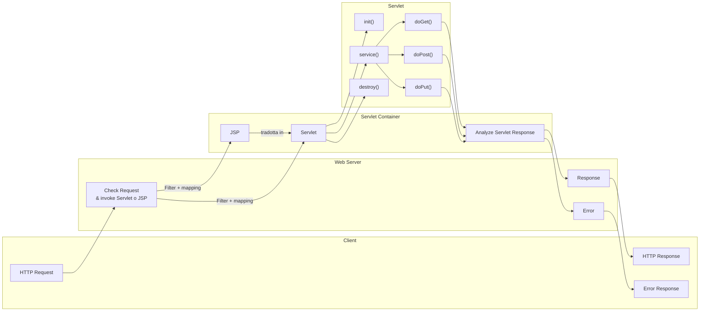

Rispetto allo schema in [[#Architettura generale]] si aggiunge la **JSP**, che passa dallo stesso mapping e viene tradotta in una servlet.

## Approccio legacy: jsp useBean

> [!warning] Approccio LEGACY
>  Le azioni `<jsp:useBean>`, `<jsp:setProperty>` e (in parte) `<jsp:getProperty>` sono **sconsigliate**: la JSP dovrebbe solo **mostrare** i dati, non crearli o elaborarli. Si studiano per capire il codice esistente.

### Creare un bean nella JSP

- **Formato**: `<jsp:useBean id="name" class="package.Class" />`
- **Finalità**: istanziare classi senza sintassi Java esplicita

Interpretazione semplice: `<jsp:useBean id="book1" class="cwp.Book" />` equivale allo scriptlet `<% cwp.Book book1 = new cwp.Book(); %>`.

`useBean` ha però due funzionalità in più:

1. semplifica l'impostazione dei campi a partire dai **parametri della richiesta**
2. semplifica la **condivisione** dei bean (attributo `scope`)

### Creazione condizionale

- `<jsp:useBean>` crea un nuovo oggetto **solo se** non trova già un bean con lo stesso `id` e lo stesso `scope`. Se lo trova, associa semplicemente quello esistente alla variabile indicata da `id`.
- Anche le proprietà si possono impostare in modo condizionale, sostituendo `<jsp:useBean ... />` con

```jsp
<jsp:useBean ...>
	istruzioni
</jsp:useBean>
```

Le istruzioni nel corpo (di solito `jsp:setProperty`) vengono eseguite **solo se il bean viene creato**, non se ne viene trovato uno esistente.

### Leggere le proprietà

- **Formato**: `<jsp:getProperty name="name" property="property" />`
- **Finalità**: accedere alle proprietà del bean (chiamare i `getXxx`) senza codice Java esplicito
- `<jsp:getProperty name="book1" property="title" />` equivale a `<%= book1.getTitle() %>`

Va bene **in lettura** (anche se oggi si usa EL: `${book1.title}`).

### Impostare le proprietà

- **Formato**: `<jsp:setProperty name="name" property="property" value="value" />`
- **Finalità**: impostare le proprietà del bean (chiamare i `setXxx`) senza codice Java esplicito
- `<jsp:setProperty name="book1" property="title" value="Core Servlets and JSP" />` equivale a `<% book1.setTitle("Core Servlets and JSP"); %>`

Sconsigliato: è la JSP che modifica i dati.

### Esempio

```java
package cwp;

public class StringBean {
	private String message = "No message specified";

	public String getMessage() { return message; }
	public void setMessage(String message) { this.message = message; }
}
```

```jsp
<jsp:useBean id="stringBean" class="cwp.StringBean" />
<OL>
<LI>Initial value (getProperty):
	<I><jsp:getProperty name="stringBean" property="message" /></I>

<LI>Initial value (JSP expression):
	<I><%= stringBean.getMessage() %></I>

<LI><jsp:setProperty name="stringBean" property="message" value="Best string bean: Fortex" />
	Value after setting property with setProperty:
	<I><jsp:getProperty name="stringBean" property="message" /></I>

<LI><% stringBean.setMessage("My favorite: Kentucky Wonder"); %>
	Value after setting property with scriptlet:
	<I><%= stringBean.getMessage() %></I>
</OL>
```

Il bean **mantiene lo stato** e si può manipolare in più modi nella stessa pagina:

- creazione o recupero con `<jsp:useBean>` → sconsigliato
- lettura con `<jsp:getProperty>` o con l'expression `<%= bean.getMessage() %>`
- modifica con `<jsp:setProperty>` o con lo scriptlet `bean.setMessage(...)` → sconsigliato

### Scope del bean

`<jsp:useBean id="..." class="..." scope="..."/>`: l'attributo `scope` dice **dove** il bean viene memorizzato. Permette a più servlet/JSP di condividere dati e, insieme alla creazione condizionale, di creare un oggetto nuovo solo se non ne esiste già uno.

|Scope|Dove è memorizzato|Durata|Chi può accedere|Uso tipico|
|---|---|---|---|---|
|`page` (default)|`PageContext`|solo la JSP corrente|solo la pagina|dati temporanei di visualizzazione|
|`request`|`HttpServletRequest`|la richiesta|tutte le JSP/servlet della richiesta (anche dopo un `forward`)|trasporto dati tra controller e view|
|`session`|`HttpSession`|la sessione utente|tutte le servlet/JSP della sessione|login, carrello, preferenze|
|`application`|`ServletContext`|l'applicazione|tutte le servlet/JSP della web app|configurazione, dati globali|

- Nelle applicazioni MVC moderne si usano soprattutto `request` e `session`; `application` solo per dati davvero globali (vedi [[#ServletContext]]).
- Lo scope `page` è raro, perché oggi le JSP sono solo View e i dati arrivano dal Controller.

## EL e JavaBeans

EL accede facilmente ai dati nei JavaBean con `${bean.property}`:

- chiama **automaticamente i getter** (`${u.name}` → `u.getName()`)
- supporta operatori logici, aritmetici e funzioni

La servlet inserisce la lista nella request → la JSP la legge → EL cerca l'attributo `userList` negli scope (page, request, session, application) secondo le regole di risoluzione.

```jsp
<%@ page contentType="text/html; charset=UTF-8" %>
<%@ taglib prefix="c" uri="http://java.sun.com/jsp/jstl/core" %>
<html>
<body>
<h2>Elenco utenti</h2>
<c:choose>
	<%-- Se la lista non è vuota --%>
	<c:when test="${not empty userList}">
		<ul>
			<c:forEach var="u" items="${userList}">
				<li>${u.name}</li>
			</c:forEach>
		</ul>
	</c:when>
	<%-- Se la lista è vuota --%>
	<c:otherwise>
		<p>Nessun utente trovato</p>
	</c:otherwise>
</c:choose>
</body>
</html>
```

> [!success] Ho eliminato gli scriptlet: è la versione JavaBean della [[#Risultato JSP finale]].

## Wrapping up: Beans e JSP

### Il bean e la servlet

```java
import java.io.Serializable;

public class Utente implements Serializable {
	private String nome;
	private int eta;

	public Utente() {}
	public Utente(String nome, int eta) { this.nome = nome; this.eta = eta; }

	public String getNome() { return nome; }
	public void setNome(String nome) { this.nome = nome; }
	public int getEta() { return eta; }
	public void setEta(int eta) { this.eta = eta; }
}
```


```java
@WebServlet("/listaUtenti")
public class ListaUtentiServlet extends HttpServlet {
	protected void doGet(HttpServletRequest request, HttpServletResponse response) throws ServletException, IOException {
		List<Utente> utenti = new ArrayList<>();
		utenti.add(new Utente("Mario", 30));
		utenti.add(new Utente("Luca", 16));
		utenti.add(new Utente("Anna", 25));
		request.setAttribute("utenti", utenti);
		request.getRequestDispatcher("/listaUtenti.jsp").forward(request, response);
	}
}
```

### Lettura: JSTL vs scriptlet

```jsp
<%-- con JSTL + EL: pulito, leggibile, sicuro, manutenibile --%>
<%@ taglib uri="http://java.sun.com/jsp/jstl/core" prefix="c" %>
<html>
<body>
<h2>Lista utenti</h2>
<table border="1">
	<tr><th>Nome</th><th>Età</th><th>Note</th></tr>
	<c:forEach var="u" items="${utenti}">
		<tr>
			<td>${u.nome}</td>
			<td>${u.eta}</td>
			<td>
				<c:choose>
					<c:when test="${u.eta >= 18}">Maggiorenne</c:when>
					<c:otherwise>Minorenne</c:otherwise>
				</c:choose>
			</td>
		</tr>
	</c:forEach>
</table>
</body>
</html>
```

```jsp
<%-- stessa pagina con scriptlet --%>
<%@ page import="mypackage.Utente" %>
<%@ page import="java.util.List" %>
<html>
<body>
<h2>Lista utenti</h2>
<table border="1">
	<tr><th>Nome</th><th>Età</th><th>Note</th></tr>
<%
	List<Utente> utenti = (List<Utente>) request.getAttribute("utenti");
	for (Utente u : utenti) {
		out.println("<tr>");
		out.println("<td>" + u.getNome() + "</td>");
		out.println("<td>" + u.getEta() + "</td>");
		if (u.getEta() >= 18) {
			out.println("<td>Maggiorenne</td>");
		} else {
			out.println("<td>Minorenne</td>");
		}
		out.println("</tr>");
	}
%>
</table>
</body>
</html>
```

### Scrittura: dalla JSP o dalla servlet

Legacy: la JSP crea e popola il bean da sola.

```jsp
<%@ page language="java" contentType="text/html; charset=UTF-8" %>
<%@ page import="mypackage.Utente" %>

<!-- Creo o recupero il bean -->
<jsp:useBean id="utente" class="mypackage.Utente" scope="request" />

<!-- Imposto i valori direttamente -->
<jsp:setProperty name="utente" property="nome" value="Mario" />
<jsp:setProperty name="utente" property="eta" value="30" />

<p>Nome: <jsp:getProperty name="utente" property="nome" /></p>
<p>Età: <jsp:getProperty name="utente" property="eta" /></p>
```

Corretto (MVC): il form invia i dati alla servlet, che crea il bean e fa forward alla JSP.

```html
<html>
<body>
<h2>Inserisci dati utente</h2>
<form action="salvaUtente" method="post">
	Nome: <input type="text" name="nome" /><br/>
	Età: <input type="number" name="eta" /><br/>
	<input type="submit" value="Salva" />
</form>
</body>
</html>
```
⭐️⭐️⭐️⭐️⭐️: codice top
```java
@WebServlet("/salvaUtente")
public class SalvaUtenteServlet extends HttpServlet {
	protected void doPost(HttpServletRequest request, HttpServletResponse response) throws ServletException, IOException {
		// Recupero i dati dal form
		String nome = request.getParameter("nome");
		int eta = Integer.parseInt(request.getParameter("eta"));

		// Creo e popolo il bean
		Utente u = new Utente();
		u.setNome(nome);
		u.setEta(eta);

		// Salvo il bean nella request (o in sessione se serve)
		request.setAttribute("utente", u);

		// Forward a una JSP di conferma
		request.getRequestDispatcher("/confermaUtente.jsp").forward(request, response);
	}
}
```

La `confermaUtente.jsp` mostra semplicemente `${utente.nome}` e `${utente.eta}`.

## Approccio moderno: JavaBeans e DAO

> [!important] **DAO** (Data Access Object) è un pattern che **separa il codice di accesso ai dati dal resto dell'applicazione**. La servlet usa i dati ma ignora come vengono recuperati.

```java
public class Product {
	private Long id;
	private String name;
	private double price;
	// costruttore, getter, setter
}
```

```java
public class ProductDAO {
	public Product findById(Long id) throws SQLException {
		String sql = "SELECT id, name, price FROM products WHERE id = ?";
		// JDBC...
		return product;
	}
}
```

Il `// JDBC...` delle slide, completato con un `PreparedStatement` (vedi [[#Prepared Statement]]).

```java
public Product findById(Long id) throws SQLException {
	String sql = "SELECT id, name, price FROM products WHERE id = ?";
	try (Connection conn = DriverManager.getConnection(URL, USER, PWD);
	     PreparedStatement ps = conn.prepareStatement(sql)) {
		ps.setLong(1, id);
		try (ResultSet rs = ps.executeQuery()) {
			if (!rs.next()) return null;          // nessun prodotto con quell'id
			Product p = new Product();
			p.setId(rs.getLong("id"));
			p.setName(rs.getString("name"));
			p.setPrice(rs.getDouble("price"));
			return p;
		}
	}
}
```

```java
@WebServlet("/products/*")
public class ProductServlet extends HttpServlet {
	private ProductDAO productDAO = new ProductDAO();

	protected void doGet(HttpServletRequest request, HttpServletResponse response) throws ServletException, IOException {
		Product product = productDAO.findById(15L);
		// utilizza il Product ma ignora come recuperare i dati
	}
}
```

> [!attention] Nel codice delle slide `doGet` dichiara solo `ServletException, IOException`, ma `findById` lancia `SQLException` (checked): così non compila. Va catturata e, ad esempio, rilanciata come `new ServletException("Errore DB", e)`.

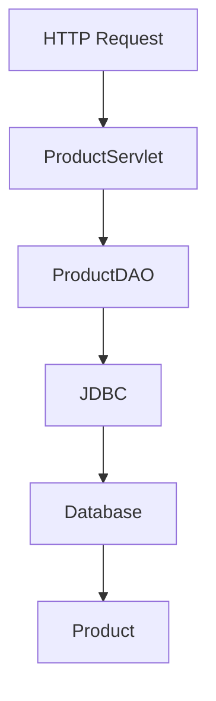

|Componente|Responsabilità|
|---|---|
|`Product`|rappresenta i dati|
|`ProductDAO`|accesso al database|
|`ProductService`|logica applicativa|
|`ProductServlet`|gestione HTTP|

> [!note] `ProductService` compare nella tabella ma non nel codice: è lo strato intermedio in cui vanno le regole di business (es. "uno sconto si applica solo sopra i 50 €"), così la servlet resta limitata a HTTP e il DAO al database.

## Servlet, Beans e JSP nel MVC

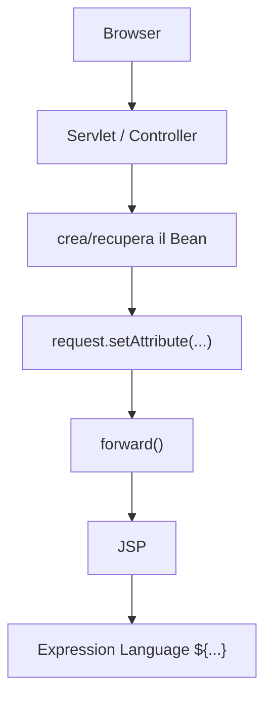

```java
public class Product {
	private String name;
	private double price;
	// getter e setter
}
```

```java
// nella servlet (controller)
Product product = productDAO.findById(123);
request.setAttribute("product", product);
RequestDispatcher dispatcher = request.getRequestDispatcher("/product.jsp");
dispatcher.forward(request, response);
```

```jsp
<%-- product.jsp (view) --%>
<h1>${product.name}</h1>
<p>Prezzo: € ${product.price}</p>
```

> [!important] Controller (Servlet) → prepara il Model → View (JSP) → presenta i dati.

## Anticipazione: CDI Bean e Spring Bean

Finora il Bean è stato una classe Java semplice che contiene e rappresenta dati, creata da noi con `new`. In Jakarta EE esiste anche il **CDI Bean** (Contexts and Dependency Injection): non siamo più noi a creare e gestire l'oggetto, lo fa il **container**. Allo stesso modo in Spring ci sono gli **Spring Bean**, gestiti dal framework.

- → CDI Beans in Jakarta EE
- → Spring Beans in Spring

## Mettersi alla prova: progetto in IntelliJ IDEA

IntelliJ IDEA (la Community Edition è gratuita) crea un progetto web strutturato secondo lo standard Jakarta EE. Alla creazione si scelgono:

- il **tipo di progetto** (Web application)
- il **server applicativo** (es. Apache Tomcat, Eclipse GlassFish, WildFly)
- il **sistema di build** (es. Maven o Gradle, per automatizzare le fasi di sviluppo)

Struttura tipica, che separa logica applicativa e presentazione:

- `src/` → codice Java (servlet, bean, DAO)
- `web/` → pagine JSP, HTML, CSS, JavaScript
- `WEB-INF/` → file di configurazione (es. `web.xml`) e risorse **non accessibili direttamente dal browser**

> [!note] Con Maven la struttura standard ha nomi diversi: `src/main/java` per il codice e `src/main/webapp` (con dentro `WEB-INF/`) per le risorse web. Il concetto è lo stesso.

> [!question] Perché mettere una JSP dentro `WEB-INF/`?
>  Così il browser non può aprirla direttamente con un URL: ci si arriva solo tramite il `forward` di una servlet. Si obbliga ogni richiesta a passare dal Controller.

Il **WAR** (Web Application Archive) è il pacchetto che l'IDE genera quando fai il deploy: contiene tutto il necessario perché l'applicazione funzioni sul server e, seguendo le specifiche Jakarta EE, la rende **portabile** tra server diversi senza ricompilare.

|Tipo di archivio|Contenuto principale|Scopo|
|---|---|---|
|**JAR**|classi Java e librerie|eseguire applicazioni Java standalone o distribuire librerie|
|**WAR**|classi Java, JSP, HTML, CSS, librerie|distribuire applicazioni web Java/Jakarta EE|

## Ancora sui pattern

Proseguono il discorso di [[#Pattern]].

### Factory

- **Problema**: un'applicazione deve creare oggetti di tipi diversi. Se ogni parte del programma li crea direttamente, la logica di creazione viene ripetuta e sparsa in molti punti.
- **Idea**: una **Factory** è un componente a cui si affida la responsabilità di creare gli oggetti. Chi ha bisogno di un oggetto lo chiede alla Factory, senza conoscere i dettagli della creazione.
- **Esempio**: in un e-commerce la Factory crea il metodo di pagamento appropriato (carta di credito, PayPal, bonifico).
- **Vantaggio**: separare la **creazione** degli oggetti dal loro **utilizzo**. Invece di creare direttamente un oggetto, delego alla Factory.

```java
public class PaymentFactory {
	public static Payment create(String type) {
		if (type.equals("card"))   return new CardPayment();
		if (type.equals("paypal")) return new PayPalPayment();
		throw new IllegalArgumentException("Not supported");
	}
}
```

```java
Payment payment = PaymentFactory.create("card");
payment.pay();
```

`Payment` è un'interfaccia (o classe astratta) implementata da `CardPayment` e `PayPalPayment`: chi usa `payment` conosce solo il tipo `Payment`. Per aggiungere il bonifico si modifica **solo** la Factory.

### Singleton

- **Problema**: a volte creare più oggetti che rappresentano la stessa risorsa è inutile o problematico; serve un **unico punto di accesso condiviso**.
- **Idea**: il **Singleton** garantisce che una classe abbia **una sola istanza** e fornisce un punto di accesso a essa.
- **Esempio**: un e-commerce usa un unico `ProductCatalog`; home, ricerca e pagina di dettaglio accedono alla stessa istanza.
- **Vantaggio**: evitare più istanze quando serve un unico oggetto condiviso.

```java
public class ProductCatalog {
	private static final ProductCatalog INSTANCE = new ProductCatalog();

	private ProductCatalog() { }    // nessuno può fare new da fuori

	public static ProductCatalog getInstance() { return INSTANCE; }

	public void showProducts() {
		System.out.println("Elenco dei prodotti");
	}
}
```

```java
ProductCatalog homeCatalog   = ProductCatalog.getInstance();
ProductCatalog searchCatalog = ProductCatalog.getInstance();
System.out.println(homeCatalog == searchCatalog);   // true: stesso oggetto
```

Due ingredienti: il **costruttore privato** impedisce di creare altre istanze, il campo `static final` contiene l'unica istanza (creata al caricamento della classe, quindi senza problemi di concorrenza).

> [!note] Collegamento con le servlet
>  Il container crea normalmente **una sola istanza** di ogni servlet (vedi [[#Ciclo di vita]]): un comportamento "da singleton", ma garantito dal container e non dal costruttore privato. Per questo i suoi campi sono condivisi tra thread.

## Recap: Servlet, JSP e JavaBeans

- **Servlet Java**
    - **Definizione**: componente server-side, piattaforma Jakarta EE, estensione di `HttpServlet`, gestione di `HttpServletRequest` e `HttpServletResponse`
    - **Ciclo di vita**: `init()` inizializzazione, `service()` elaborazione delle richieste, `destroy()` cleanup delle risorse, concorrenza multi-thread
    - **Mapping**: exact match `/users`, path match `/api/*`, extension match `*.jsp`, default mapping `/`
    - **Configurazione**: `ServletConfig` per singola servlet, `ServletContext` condiviso, file `web.xml`, annotazioni `@WebServlet` e `@WebInitParam`
    - **HTTP e sessioni**: protocollo stateless, scope request/session/application, cookie (`maxAge`, `httpOnly`, `secure`)
- **JavaServer Pages (JSP)**
    - ciclo di vita JSP
    - **Sintassi Java**: expression `<%= ... %>`, scriptlet `<% ... %>`, declaration `<%! ... %>`
    - **Librerie e tag**: Expression Language `${...}`, JSTL Core (`c:if`, `c:forEach`), direttiva page (`contentType`, `isThreadSafe`)
- **JavaBeans e MVC**
    - **Pattern MVC**: Model = JavaBeans e dati, View = pagine JSP, Controller = servlet
    - **Convenzioni JavaBeans**: costruttore senza argomenti, incapsulamento delle variabili, interfaccia `Serializable`, scope page/request/session/application

# Persistenza (JPA)

## Il problema: troppo lavoro manuale

Finora, per salvare o leggere un prodotto nel DB, abbiamo scritto query SQL e trasformato **a mano** i risultati in oggetti Java (vedi [[#Java Database Connectivity]]):

1. scrivere la query SQL
2. creare e configurare il `PreparedStatement`
3. eseguire la query
4. leggere il `ResultSet`
5. costruire l'oggetto Java
6. copiare i valori delle colonne nei campi dell'oggetto
7. gestire le risorse e gli eventuali errori

> [!question] Possiamo delegare una parte di questo lavoro al framework?

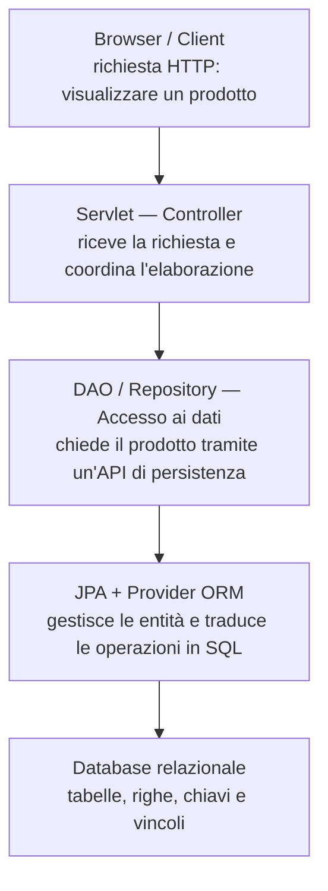

JPA si inserisce tra il DAO e il database: i passi 2–7 li fa il provider.

## JPA

> [!important] Storicamente l'acronimo indicava **Java Persistence API**; oggi il nome ufficiale della specifica è **Jakarta Persistence** → **JPA**. È una **specifica**: definisce API, annotazioni e regole che le implementazioni devono rispettare. **Non è, da sola, un prodotto** che esegue le operazioni sul database.

La specifica stabilisce come **descrivere** gli oggetti persistenti, come **cercarli**, come **modificarli** e come **coordinare** le operazioni di persistenza.

|Termine|Significato|
|---|---|
|JPA / Jakarta Persistence|specifica e API standard|
|ORM|tecnica di mappatura tra oggetti e dati relazionali|
|Hibernate ORM|**implementazione** della specifica Jakarta Persistence (un "provider"; un altro è EclipseLink)|
|JDBC|API a basso livello per accedere al DB|

> [!attention] JPA **non sostituisce** il DB, il linguaggio SQL o il pattern DAO. Introduce un modo **standardizzato** di gestire la persistenza attraverso oggetti Java, riducendo il codice di mapping manuale e gestendo le relazioni tra entità.

> [!info] javax → jakarta Le slide usano `javax.persistence.*`: è il nome fino a JPA 2.2. Da Jakarta EE 9 (Jakarta Persistence 3.0) il package è `jakarta.persistence.*`, come per le servlet. Annotazioni e metodi sono gli stessi: negli esempi uso `jakarta`.

JPA permette di gestire in modo standard la **persistenza** dei dati, cioè la memorizzazione e il recupero di **oggetti Java** da un database relazionale. Mette a disposizione:

- **annotazioni** per dichiarare le entità e il mapping
- **API** per cercare, inserire, modificare ed eliminare entità
- **regole** per gestire il ciclo di vita delle entità e il contesto di persistenza
- un linguaggio di query orientato agli oggetti, **JPQL**

### JDBC vs JPA

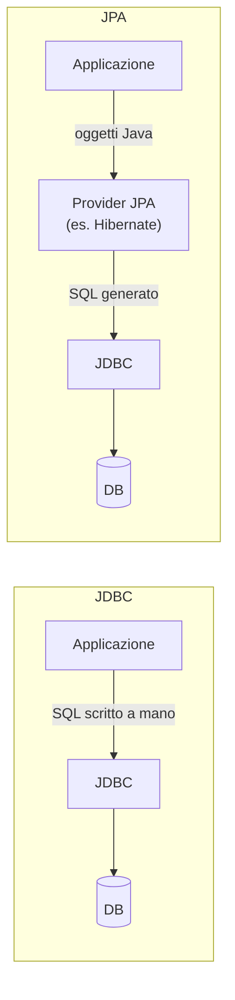

- **JDBC** = parli **al database** direttamente → JDBC → DB
- **JPA** = parli **agli oggetti Java** → il provider traduce tutto in SQL → JDBC → DB

> [!note] JPA non elimina JDBC: il provider lo usa **sotto**. Cambia chi scrive l'SQL e chi copia i dati nei campi.

I risultati non sono più dati primitivi o `ResultSet`, ma oggetti: **Entity** (bean "potenziati": ogni oggetto corrisponde a una riga di una tabella).

|Aspetto|JDBC|JPA|
|---|---|---|
|Livello di astrazione|basso|alto|
|SQL|scritto a mano|generato automaticamente (ORM/JPQL)|
|Mapping|manuale|automatico tra oggetti e tabelle|
|Transazioni|manuali (vedi [[#Transaction]])|`EntityManager` + JTA (dietro le quinte)|
|Vantaggi|controllo totale sull'SQL, alte prestazioni in casi specifici, flessibile|codice più pulito, gestione automatica di relazioni e transazioni, portabile tra database|
|Svantaggi|codice verboso e ripetitivo, mapping manuale, gestione complessa di connessioni e transazioni|leggermente più lento, minor controllo sull'SQL generato, dipendenza dal provider ORM|

### Le due parti di JPA

1. **Parte descrittiva: Object-Relational Mapping**
    - le classi Java sono annotate (`@Entity`) o mappate in XML; gli attributi sono annotati (`@Column`)
    - gli oggetti diventano **gestiti** (`EntityManager`) all'interno di un **contesto di persistenza** (Persistence Context)
    - le relazioni sono annotate (`@OneToMany`, `@ManyToOne`, `@Embedded`, ...) per gestire **cardinalità** ed **ereditarietà**
2. **Parte operativa: transazioni e query** (in questa lezione: le operazioni dell'`EntityManager`)

## Object-Relational Mapping (ORM)

|Object-Oriented|Relazionale|
|---|---|
|oggetti con attributi, metodi, ereditarietà|tabelle con righe e colonne|
|riferimenti tra oggetti|chiavi esterne (FK)|
|ereditarietà|nessun supporto diretto, join complesse|
|stato **in memoria** (POJO)|stato **persistente** sul DB|

> [!note] POJO Un **POJO** (Plain Old Java Object) è un normale oggetto Java che non dipende da alcun framework o classe speciale.

> [!important] L'**ORM** fa da ponte tra questi due mondi, permettendo di mappare gli oggetti Java sulle tabelle di un database relazionale. Questa differenza strutturale si chiama anche _object-relational impedance mismatch_.

## Entity

> [!important] Una **Entity** è una classe Java il cui stato può essere reso persistente attraverso JPA.

`Prodotto`, ad esempio, può rappresentare contemporaneamente:

- una classe Java
- il modello di un prodotto nell'applicazione
- una **tabella** del database, attraverso il mapping
- una singola **riga** della tabella, attraverso una sua istanza persistente

> [!attention] Non significa che ogni oggetto `Prodotto` creato con `new` venga salvato automaticamente nel DB. La persistenza dipende dallo **stato** dell'oggetto e dalle **operazioni** fatte tramite JPA (vedi [[#Ciclo di vita dell'Entity]]).

> [!note] Una entity non è semplicemente un JavaBean con qualche annotazione: è un oggetto inserito nel **modello di persistenza** di JPA, con un **identificativo** e un **ciclo di vita** gestito dal provider. Le entity sono note anche come **Entity Bean** (termine legacy, dagli EJB 2).

## Mapping degli oggetti persistenti

JPA richiede **solo due metadati** per creare una classe persistente:

- `@Entity` → la classe sarà una **tabella**
- `@Id` → la proprietà che sarà la **chiave primaria** (e non solo: decide anche il tipo di accesso, vedi sotto)

Tutto il resto ha un **default**: ogni altra proprietà è mappata su una colonna con lo **stesso nome** e un tipo compatibile, e la tabella ha il nome della classe.

|Aspetto|Java Bean|Entity JPA|
|---|---|---|
|Scopo|contenere dati|rappresentare una tabella del DB|
|Annotazioni|no|sì (`@Entity`, `@Id`)|
|Persistenza|no|sì|
|Identità|no|sì (chiave primaria)|

### Definire la chiave: field access e property access

```java
package com.titan.domain;
import jakarta.persistence.*;

@Entity
public class Customer implements java.io.Serializable {
	@Id                       // FIELD ACCESS: @Id sul campo
	private long id;
	private String firstName;
	private String lastName;

	public long getId() { return id; }
	public void setId(long id) { this.id = id; }
	public String getFirstName() { return firstName; }
	public void setFirstName(String firstName) { this.firstName = firstName; }
	public String getLastName() { return lastName; }
	public void setLastName(String lastName) { this.lastName = lastName; }
}
```

```java
@Entity
public class Customer implements java.io.Serializable {
	private long id;
	private String firstName;
	private String lastName;

	@Id                       // PROPERTY ACCESS (stile Bean): @Id sul getter
	public long getId() { return id; }
	public void setId(long id) { this.id = id; }
	// ... altri getter/setter come sopra
}
```

In entrambi i casi la tabella generata è:

```sql
create table Customer (
	id        long primary key not null,
	firstName VARCHAR,
	lastName  VARCHAR
);
```

Dove metti `@Id` decide se JPA userà lo stile JavaBean (getter/setter) per individuare le proprietà persistenti oppure i campi, e quindi **come JPA accede ai dati** (variabili o metodi).

|Aspetto|Field access|Property access|
|---|---|---|
|Dove metti `@Id`|sul campo|sul getter|
|JPA legge da|variabili|metodi|
|Usa i setter|no|sì|
|Usa i getter|no|sì|
|Perché usarlo|meno codice, più diretto, standard de facto|validazioni nei setter o logica nei getter; bean legacy|

> [!attention] Tutte le annotazioni di mapping vanno messe **dalla stessa parte** di `@Id`: con field access sui campi, con property access sui getter. Un `@Column` sul getter in una classe a field access viene ignorato (o causa un errore, a seconda del provider).

### Mapping in XML: orm.xml

Alternativa alle annotazioni: il file `orm.xml` (di default in `META-INF`, oppure un altro file dichiarato nel descrittore di distribuzione). Serve a configurare le mappature **esternamente**, per personalizzare o sovrascrivere il mapping senza modificare il codice sorgente.

```xml
<entity-mappings>
	<!-- Customer è un'entità JPA; access="PROPERTY" forza l'uso di getter/setter
	     per tutta la classe, sovrascrivendo il comportamento di default -->
	<entity class="com.titan.domain.Customer" access="PROPERTY">
		<attributes>
			<!-- id è la chiave primaria: JPA si aspetta getId() e setId() -->
			<id name="id"/>
		</attributes>
	</entity>
</entity-mappings>
```

### Basic Relational Mapping

Due approcci per implementare le entity:

1. si parte dal **modello a oggetti** Java e da questo si **deriva lo schema** del database
2. si parte da uno **schema di database esistente** e da questo si deriva il modello a oggetti

Nel secondo caso i nomi e i tipi delle colonne sono già decisi e vanno indicati esplicitamente.

### Mapping su una tabella specifica

Tabella esistente:
⭐⭐⭐
```sql
create table CUSTOMER_TABLE (
	CUST_ID    integer primary key not null,
	FIRST_NAME varchar(20) not null,
	LAST_NAME  varchar(255) not null
);
```

```java
@Entity
@Table(name = "CUSTOMER_TABLE")
public class Customer implements java.io.Serializable {
	private long id;
	private String firstName;
	private String lastName;

	@Id
	@Column(name = "CUST_ID", nullable = false, columnDefinition = "integer")
	public long getId() { return id; }
	public void setId(long id) { this.id = id; }

	@Column(name = "FIRST_NAME", length = 20, nullable = false)
	public String getFirstName() { return firstName; }
	public void setFirstName(String firstName) { this.firstName = firstName; }

	@Column(name = "LAST_NAME", length = 255, nullable = false)
	public String getLastName() { return lastName; }
	public void setLastName(String lastName) { this.lastName = lastName; }
}
```

> [!question] "JPA richiede solo due metadati"... e qui ne usiamo molti di più? Sì: i due metadati sono il **minimo obbligatorio**. Qui serve di più perché i nomi delle colonne (`CUST_ID`, `FIRST_NAME`) **non coincidono** con i nomi delle proprietà, quindi i default non bastano. `@Table` cambia il nome della tabella, `@Column` quello della colonna e i vincoli (`length`, `nullable`, `columnDefinition`).

> [!note] Le slide dichiarano `FIRST_NAME varchar(20) not null` senza virgola finale: nello script SQL corretto ci vuole.

### Chiavi primarie

- `@Id` identifica **una o più** proprietà che costituiscono la chiave primaria della tabella.
- La chiave si può generare a mano oppure lasciarla generare al provider con `@GeneratedValue`.
- A volte la chiave è composta da più proprietà persistenti: **chiavi composite**. Si definiscono con `@IdClass` oppure con `@EmbeddedId` più una classe di appoggio.

> [!important] Requisiti della classe della chiave composita (in entrambe le notazioni):
> 
> - deve essere **serializzabile**
> - deve avere un **costruttore pubblico senza argomenti**
> - deve implementare **`equals()` e `hashCode()`**

> [!question] Perché `equals()` e `hashCode()`?
>  Il persistence context identifica ogni entity tramite la sua chiave (vedi [[#Entity Manager, Persistence Context, Persistence Unit]]). Con una chiave composita, due oggetti chiave distinti con gli stessi valori devono risultare **uguali**, altrimenti JPA crederebbe che siano due righe diverse. L'`equals()` di default di `Object` confronta i riferimenti, non i valori.

#### Chiavi composite con `@IdClass`

I campi della chiave sono **ripetuti** nella classe dell'entity, marcati con `@Id`.

```java
public class BookLoanId implements Serializable {
	private Long userId;
	private Long bookId;

	public BookLoanId() {}
	public BookLoanId(Long userId, Long bookId) {
		this.userId = userId;
		this.bookId = bookId;
	}
	// get e set

	@Override
	public boolean equals(Object o) {
		if (this == o) return true;
		if (o == null || getClass() != o.getClass()) return false;
		BookLoanId that = (BookLoanId) o;
		return Objects.equals(userId, that.userId) && Objects.equals(bookId, that.bookId);
	}

	@Override
	public int hashCode() {
		return Objects.hash(userId, bookId);
	}
}
```

```java
@Entity
@IdClass(BookLoanId.class)
public class BookLoan {
	@Id private Long userId;     // incorporo i campi della chiave primaria
	@Id private Long bookId;     // nella classe del bean
	private LocalDate loanDate;
	private LocalDate returnDate;

	public BookLoan() {}
	public BookLoan(Long userId, Long bookId, LocalDate loanDate, LocalDate returnDate) {
		this.userId = userId;
		this.bookId = bookId;
		this.loanDate = loanDate;
		this.returnDate = returnDate;
	}
	// get e set
}
```

#### Chiavi composite con `@EmbeddedId`

La classe della chiave viene **incorporata direttamente** come un unico campo dell'entity.

```java
@Embeddable
public class BookLoanId implements Serializable {
	private Long userId;
	private Long bookId;

	public BookLoanId() {}
	public BookLoanId(Long userId, Long bookId) { this.userId = userId; this.bookId = bookId; }
	// get e set, equals() e hashCode() come sopra
}
```

```java
@Entity
public class BookLoanEmbedded {
	@EmbeddedId
	private BookLoanId id;        // la chiave è un oggetto
	private LocalDate loanDate;
	private LocalDate returnDate;

	public BookLoanEmbedded() {}
	public BookLoanEmbedded(BookLoanId id, LocalDate loanDate, LocalDate returnDate) {
		this.id = id;
		this.loanDate = loanDate;
		this.returnDate = returnDate;
	}
	public BookLoanId getId() { return id; }
	public void setId(BookLoanId id) { this.id = id; }
	// altri get e set
}
```


|`@IdClass`|`@EmbeddedId`|
|---|---|
|campi della chiave ripetuti nell'entity, ognuno con `@Id`|un solo campo-oggetto con `@EmbeddedId`|
|accesso diretto: `loan.getUserId()`|accesso tramite la chiave: `loan.getId().getUserId()`|
|classe chiave senza annotazioni|classe chiave annotata `@Embeddable`|

#### Rinominare le colonne della chiave: `@AttributeOverrides`

Di default, quando un oggetto `@Embeddable` è usato in un'entity, i suoi campi prendono i nomi di colonna definiti nella classe embeddable. Per cambiarli nell'entity si usa `@AttributeOverride`.

```java
@Embeddable
public class CustomerPK implements java.io.Serializable {
	private String lastName;
	private long ssn;
	public CustomerPK() {}
	// getter, setter, equals(), hashCode()
}
```

```java
@Entity
public class Customer implements java.io.Serializable {
	private String firstName;
	private CustomerPK pk;

	public String getFirstName() { return firstName; }
	public void setFirstName(String firstName) { this.firstName = firstName; }

	@EmbeddedId
	@AttributeOverrides({
		@AttributeOverride(name = "lastName", column = @Column(name = "LAST_NAME")),
		@AttributeOverride(name = "ssn",      column = @Column(name = "SSN"))
	})
	public CustomerPK getPk() { return pk; }
	public void setPk(CustomerPK pk) { this.pk = pk; }
}
```

`name` è il nome della **proprietà** in `CustomerPK`, `column` la colonna a cui mapparla.

### `@Transient`

Il gestore della persistenza presuppone che **ogni proprietà non transitoria** della classe sia persistente. Le proprietà derivate (es. scorciatoie per i campi della chiave) o i valori calcolati che **non corrispondono a colonne** vanno esclusi con `@Transient`.

```java
@Entity
public class Customer implements java.io.Serializable {
	private String firstName;
	private CustomerPK pk;
	// ...

	@Transient
	public String getLastName() { return pk.getLastName(); }   // derivata dalla chiave

	@Transient
	public long getSsn() { return pk.getSsn(); }

	@EmbeddedId
	public CustomerPK getPk() { return pk; }
	public void setPk(CustomerPK pk) { this.pk = pk; }
}
```

> [!question] Cosa succederebbe senza `@Transient`? 
> Con property access JPA vedrebbe `getLastName()` e cercherebbe una colonna `lastName` nella tabella `Customer`, che non esiste come colonna separata (è già dentro la chiave): errore di mapping.

> [!note] `@Transient` (annotazione JPA) ≠ `transient` (parola chiave Java). 
> La parola chiave esclude un campo dalla **serializzazione** Java; JPA ignora anche i campi `transient`, ma l'annotazione serve quando vuoi escludere qualcosa **solo** dal database.

### Mapping types

JPA supporta senza annotazioni esplicite i tipi di base:

- tipi primitivi e relativi wrapper, `String`, `byte[]`, `Byte[]`, `char[]`, `Character[]`, `BigInteger`, `BigDecimal`, `java.sql.Date`, `Time`, `Timestamp`

Per `java.util.Date` e `Calendar` si indica la precisione con `@Temporal`:

- `@Temporal(TemporalType.DATE)` → solo data
- `@Temporal(TemporalType.TIME)` → solo ora
- `@Temporal(TemporalType.TIMESTAMP)` → data e ora

> [!note] Da JPA 2.2 i tipi `java.time` (`LocalDate`, `LocalDateTime`, ...) sono supportati **direttamente**, senza `@Temporal`: è il motivo per cui gli esempi `BookLoan` usano `LocalDate` senza annotazioni. Nelle versioni recenti di Jakarta Persistence `@Temporal` è deprecata.

### `@Enumerated`

Mappa un tipo `enum` Java sul database, come **stringa** oppure come **numero ordinale**.

```java
public enum CustomerType {
	UNREGISTERED, REGISTERED, BIG_SPENDAH
}

@Enumerated(EnumType.STRING)   // oppure EnumType.ORDINAL
public CustomerType getCustomerType() { ... }
public void setCustomerType(CustomerType type) { ... }
```

|`EnumType.STRING`|`EnumType.ORDINAL` (default)|
|---|---|
|salva `"REGISTERED"`|salva `1` (la posizione nell'enum, da 0)|
|leggibile, robusto|più compatto|
|resiste al riordino delle costanti|se aggiungi una costante **in mezzo** o le riordini, i dati già salvati cambiano significato|

## Entity Inheritance
JPA supporta l'**ereditarietà** delle entity, le relazioni **polimorfiche** e le query polimorfiche. Esempio: `Employee` estende `Customer` che estende `Person`.

```mermaid
classDiagram
    Person <|-- Customer
    Customer <|-- Employee
    class Person {
        id
        firstName
        lastName
    }
    class Customer {
        street
        city
        state
        zip
    }
    class Employee {
        employeeId
    }
```

Tre strategie per mappare una gerarchia su un DB relazionale:

|Strategia|Come funziona|Pro|Contro|
|---|---|---|---|
|**Single Table** (s1)|una tabella per tutta la gerarchia, con tutte le proprietà|veloce (nessuna JOIN)|molti `NULL`|
|**Table per Concrete Class** (s2)|una tabella per ogni classe concreta, con i suoi attributi **e** quelli della superclasse|nessun `NULL`|query globali (polimorfiche) difficili|
|**Table per Subclass / Joined** (s3)|una tabella per classe con **solo** i suoi attributi, collegate con JOIN|struttura pulita, normalizzata|query più lente|

### s1: Single Table per Class Hierarchy

```sql
create table PERSON_HIERARCHY (
	id integer primary key not null,
	firstName varchar(255),
	lastName varchar(255),
	street varchar(255),
	city varchar(255),
	state varchar(255),
	zip varchar(255),
	employeeId integer,
	DISCRIMINATOR varchar(31) not null
);
```

Il numero di colonne è determinato analizzando **l'intera gerarchia**: classe base e tutte le sottoclassi.

```java
@Entity
@Table(name = "PERSON_HIERARCHY")
@Inheritance(strategy = InheritanceType.SINGLE_TABLE)   // strategia per la relazione di eredità
@DiscriminatorColumn(name = "DISCRIMINATOR", discriminatorType = DiscriminatorType.STRING)
@DiscriminatorValue("PERSON")
public class Person {
	private int id;
	private String firstName;
	private String lastName;

	@Id @GeneratedValue // Generated value: assegnato al salvataggio
	public int getId() { return id; }
	public void setId(int id) { this.id = id; }
	public String getFirstName() { return firstName; }
	public void setFirstName(String first) { this.firstName = first; }
	public String getLastName() { return lastName; }
	public void setLastName(String last) { this.lastName = last; }
}
```

Ogni riga di `PERSON_HIERARCHY` è un'istanza di `Person` o di una sottoclasse: la colonna **discriminatore** dice quale (`"PERSON"` per `Person`).

Il resto della gerarchia è semplice: l'unico metadato specifico è il valore del discriminatore, se ne vuoi uno diverso dal default.

```java
@Entity
@DiscriminatorValue("CUSTOMER")
public class Customer extends Person { ... }

// usa il valore di default del discriminatore
@Entity
public class Employee extends Customer { ... }
```

> [!note] Il valore di default del discriminatore (per `DiscriminatorType.STRING`) è il **nome dell'entity**, cioè di solito il nome della classe: `Employee` → `"Employee"`.

| id  | DISCRIMINATOR | firstName | lastName | street/city | employeeId |
| --- | ------------- | --------- | -------- | ----------- | ---------- |
| 1   | PERSON        | Mario     | Rossi    | NULL        | NULL       |
| 2   | CUSTOMER      | Luca      | Bianchi  | Roma        | NULL       |
| 3   | EMPLOYEE      | Anna      | Verdi    | Milano      | E123       |

> [!attention] Si vede il contro principale: le colonne delle sottoclassi sono `NULL` per le righe che non le usano. Per questo **non si possono dichiarare `NOT NULL`** le colonne specifiche delle sottoclassi. La struttura del DB è semplice, ma con molte sottoclassi la tabella diventa molto larga.

### s2: Table per Concrete Class

```sql
create table Person (
	id integer primary key not null,
	firstName varchar(255),
	lastName varchar(255)
);
create table Customer (
	id integer primary key not null,
	firstName varchar(255),
	lastName varchar(255),
	street varchar(255),
	city varchar(255),
	state varchar(255),
	zip varchar(255)
);
create table Employee (
	id integer primary key not null,
	firstName varchar(255),
	lastName varchar(255),
	street varchar(255),
	city varchar(255),
	state varchar(255),
	zip varchar(255),
	employeeId integer
);
```

Differenza fondamentale con SINGLE_TABLE: **non serve una colonna discriminante**. Il tipo è dato dalla tabella in cui sta la riga ("me lo dice Java").

```java
@Entity
@Inheritance(strategy = InheritanceType.TABLE_PER_CLASS)
public class Person {
	@Id @GeneratedValue
	public int getId() { return id; }
	// ...
}

@Entity
public class Customer extends Person { ... }

@Entity
public class Employee extends Customer { ... }
```

`@Inheritance` serve a dire a JPA che le entity fanno parte della **stessa gerarchia** e devono supportare polimorfismo e query comuni. JPA vede che `Employee` estende `Person` dal codice Java (`extends`), ma **il database non rappresenta direttamente l'ereditarietà**.

> [!question] Perché le query globali sono difficili? 
> Una query "tutte le `Person`" deve leggere **tre tabelle** diverse e unirle con `UNION`, perché ogni persona sta in una sola tabella a seconda del suo tipo concreto.

### s3: Table per Subclass (Joined)

```sql
create table Person (
	id integer primary key not null,
	firstName varchar(255),
	lastName varchar(255)
);
create table Customer (
	id integer primary key not null,
	street varchar(255),
	city varchar(255),
	state varchar(255),
	zip varchar(255)
);
create table Employee (
	EMP_PK integer primary key not null,
	employeeId integer
);
```

Ogni tabella contiene **solo** le proprietà definite in quella classe. Anche qui non serve il discriminatore (di default; JPA lo permette ma non lo richiede).

```java
@Entity
@Inheritance(strategy = InheritanceType.JOINED)
public class Person {
	@Id @GeneratedValue
	public int getId() { return id; }
	// ...
}

@Entity
public class Customer extends Person { ... }

@Entity
@PrimaryKeyJoinColumn(name = "EMP_PK")
public class Employee extends Customer { ... }
```

JOINED salva ogni classe in una tabella separata, ma le collega con **chiavi esterne** sulla chiave primaria e ricostruisce l'ereditarietà con **JOIN**. `@PrimaryKeyJoinColumn(name="EMP_PK")` rinomina la colonna della chiave primaria nella tabella `Employee` da `id` a `EMP_PK`: è la colonna che fa da PK **e** da FK verso `Customer`.

> [!example] Per leggere un `Employee` completo servono due JOIN:
> 
> ```sql
> SELECT * FROM Employee e
> JOIN Customer c ON e.EMP_PK = c.id
> JOIN Person p   ON c.id = p.id
> WHERE e.EMP_PK = 3;
> ```

### Nonentity base classes: `@MappedSuperclass`

> [!important] `@MappedSuperclass` si usa per una classe base che **non è mappata su una tabella**, ma fornisce attributi e comportamenti comuni alle sottoclassi. Non è un'entity a sé stante: non ha una propria tabella, ma i suoi campi vengono **ereditati** dalle entity che la estendono.

```java
@MappedSuperclass
public class Person {
	@Id @GeneratedValue
	public int getId() { return id; }
	public void setId(int id) { this.id = id; }
	public String getFirstName() { return firstName; }
	public void setFirstName(String first) { this.firstName = first; }
	public String getLastName() { return lastName; }
	public void setLastName(String last) { this.lastName = last; }
}

@Entity
@Table(name = "CUSTOMER")
@Inheritance(strategy = InheritanceType.JOINED)
@AttributeOverride(name = "lastName", column = @Column(name = "SURNAME"))
public class Customer extends Person { ... }

@Entity
@Table(name = "EMPLOYEE")
@PrimaryKeyJoinColumn(name = "EMP_PK")
public class Employee extends Customer { ... }
```

```sql
create table CUSTOMER (
	id integer primary key not null,
	firstName varchar(255),
	SURNAME varchar(255),
	street varchar(255),
	city varchar(255),
	state varchar(255),
	zip varchar(255)
);
create table EMPLOYEE (
	EMP_PK integer primary key not null,
	employeeId integer
);
```

- Non esiste una tabella `PERSON`: i campi di `Person` finiscono nella tabella di `Customer`.
- `@AttributeOverride(name="lastName", column=@Column(name="SURNAME"))` rinomina il campo `lastName` (ereditato da `Person`) in `SURNAME` nella tabella `CUSTOMER`.
- `@PrimaryKeyJoinColumn(name="EMP_PK")` (strategia JOINED): la PK di `Employee` è unita alla tabella `Customer` (la superclasse) tramite la colonna `EMP_PK`.

> [!question] `@MappedSuperclass` o `@Inheritance`?
>  Con `@MappedSuperclass` si riusa **codice** (campi comuni) ma `Person` non è un'entity: non puoi fare `em.find(Person.class, ...)` né query su `Person`. Con `@Inheritance` `Person` è un'entity vera e le query sono **polimorfiche**.

## Come si configura JPA
Per far funzionare il codice serve un ambiente configurato:
- il **database**, che contiene le tabelle
- il **provider JPA** (es. Hibernate ORM o EclipseLink), che implementa la specifica
- l'**EntityManager**, l'interfaccia con cui si gestiscono le entity: cercarle, renderle persistenti, aggiornarle, rimuoverle
- la **Persistence Unit**, che definisce la configurazione della persistenza
### Le entity sono POJO
- Nella specifica, le entity sono **semplici oggetti Java** (POJO): si allocano con `new` come qualsiasi altro oggetto.
- Le istanze **non diventano persistenti** finché non vengono associate a un `EntityManager`.
- Hanno un **ciclo di vita** proprio.

### JDBC vs JPA: il ruolo dell'EntityManager
Se JDBC mette a disposizione `Connection`, `Statement` e `ResultSet`, JPA mette a disposizione soprattutto l'**`EntityManager`**.

|Metodo|Funzione|
|---|---|
|`find()`|recupera un'entity tramite identificativo|
|`persist()`|rende persistente una **nuova** entity|
|`merge()`|copia lo stato di un oggetto **non gestito** in un'istanza gestita|
|`remove()`|marca un'entity gestita per la rimozione|
|`createQuery()`|crea una query, per esempio in JPQL|
|`flush()`|sincronizza le modifiche pendenti con il database|

### Managed e unmanaged
- Durante il ciclo di vita, un'istanza di entity può essere **managed** (collegata a un `EntityManager`) oppure **unmanaged** (scollegata).
- Il **Persistence Context** è l'insieme delle istanze di entity gestite da un `EntityManager`.
- L'`EntityManager` tiene traccia di tutte le entity del contesto per **rilevare le modifiche** e le invia al database.
- Quando il contesto si chiude, tutte le entity gestite vengono **scollegate**: le modifiche non sono più tracciate.

```mermaid
flowchart LR
    EM["EntityManager"] -->|"gestisce"| PC
    subgraph PC["Persistence Context"]
        E1["Entity"]
        E2["Entity"]
    end
    PC -->|"esegue UPDATE / SQL<br>(in blocco)"| DB[("DB")]
```

### Esempio
```java
import jakarta.persistence.*;

@Entity
public class Customer {
	private int id;
	private String name;

	@Id @GeneratedValue
	public int getId() { return id; }
	public void setId(int id) { this.id = id; }

	public String getName() { return name; }
	public void setName(String name) { this.name = name; }
}
```

|Annotazione|Scopo|
|---|---|
|`@Entity`|marca la classe come entity JPA (mappata su una tabella)|
|`@Id`|marca la chiave primaria|
|`@GeneratedValue`|genera automaticamente i valori della chiave|

```java
Customer cust = new Customer();
cust.setName("Bill");
```

> [!attention] Queste istruzioni creano un oggetto Java e chiamano `setName`, ma **nel database non succede nulla**. `cust` è solo un oggetto Java finché non si chiede all'`EntityManager` di creare l'entity corrispondente.

### Ciclo di vita dell'Entity
Un JavaBean è "solo" un oggetto Java. Un'entity JPA può trovarsi in stati diversi **in relazione al contesto di persistenza**: **transient**, **managed**, **detached**, **removed**.

```mermaid
stateDiagram-v2
    [*] --> Transient: new
    Transient --> Managed: persist()
    Managed --> Detached: detach() / chiusura del contesto
    Managed --> Removed: remove()
    Detached --> Managed: merge() (restituisce una copia gestita)
    Removed --> [*]: commit / flush (DELETE)
```

|Stato|Significato|
|---|---|
|**Transient** (nuova)|creata con `new`, non ancora gestita da JPA|
|**Managed** (gestita)|l'`EntityManager` ne tiene traccia e può sincronizzarne le modifiche|
|**Detached**|non più tracciata dal contesto (ha ancora i dati, ma le modifiche non vengono salvate)|
|**Removed**|marcata per la cancellazione|

## Ottenere un EntityManager: l'EntityManagerFactory

In **Java SE** gli `EntityManager` si creano con una `EntityManagerFactory`:

```java
public interface EntityManagerFactory {
	EntityManager createEntityManager();
	EntityManager createEntityManager(java.util.Map map);
	void close();
	boolean isOpen();
	// ...
}
```

|Metodo|Descrizione|
|---|---|
|`createEntityManager()`|crea un nuovo `EntityManager` con le impostazioni di default|
|`createEntityManager(Map map)`|crea un `EntityManager` con proprietà personalizzate (es. impostazioni di connessione, livello di isolamento delle transazioni)|
|`close()`|chiude la factory e rilascia tutte le risorse associate|
|`isOpen()`|`true` se la factory è aperta, `false` se è stata chiusa|

> [!important] Collegamento ai pattern
> 
> - Creare un `EntityManager` non è banale (configurazione, connessione al DB, contesto di persistenza...). La **factory** gestisce tutto questo in modo efficiente e riutilizzabile, ma è **costosa**: se ne crea **una per applicazione** (uso da [[#Singleton]]).
> - Gli `EntityManager` sono **leggeri** e vengono creati indirettamente dalla factory, che nasconde i dettagli complessi: è il pattern [[#Factory]].

### Java SE: la classe Persistence
La classe `Persistence` avvia una `EntityManagerFactory`:

```java
public class Persistence {
	public static EntityManagerFactory createEntityManagerFactory(String unitName);
	public static EntityManagerFactory createEntityManagerFactory(String unitName, java.util.Map properties);
}
```

Le configurazioni (URL JDBC, username, password, ...) sono fornite da una **Persistence Unit** definita nel file `persistence.xml`.

```java
EntityManagerFactory emf = Persistence.createEntityManagerFactory("myPU");
// ...
EntityManager em = emf.createEntityManager();
```

```mermaid
flowchart TD
    P["Persistence"] -->|"crea"| EMF["EntityManagerFactory"]
    PU["Persistence Unit<br>(persistence.xml)"] -->|"configura"| EMF
    EMF -->|"crea"| EM["EntityManager"]
    EM -->|"gestisce"| PC["Persistence Context"]
```

### Java EE / Jakarta EE: iniezione dal container

```java
import jakarta.persistence.*;
import jakarta.ejb.*;

public class MyBean implements MyBusinessInterface {
	@PersistenceUnit(unitName = "CRM")
	private EntityManagerFactory factory;

	private EntityManagerFactory factory2;

	@PersistenceUnit(unitName = "CUSTDB")
	public void setFactory2(EntityManagerFactory f) { this.factory2 = f; }
}
```

```java
public class MyStatefulBean implements MyStatefulRemote {
	@PersistenceContext(unitName = "titan", type = PersistenceContextType.EXTENDED)
	private EntityManager manager;
	// ...
}
```

A differenza di Java SE:

- l'`EntityManagerFactory` viene **iniettata** (`@PersistenceUnit`) e chiusa automaticamente dal container
- l'`EntityManager` si inietta **direttamente** in un EJB con `@PersistenceContext`

> [!note] `EXTENDED` vs default
>  Di default (`TRANSACTION`) il persistence context dura **una transazione**. Con `PersistenceContextType.EXTENDED` (per gli `EntityManager` iniettati dal container, solo negli EJB stateful) sopravvive tra più transazioni, finché vive il bean: è il caso in cui si può chiamare `persist()` fuori da una transazione (vedi [[#Persist]]).

## Persistence Unit
Una Persistence Unit è definita nel file `persistence.xml`, che può contenerne **una o più**. Il file sta nella directory `META-INF` di un JAR nel classpath (programma Java SE) o di un JAR in `WEB-INF/lib` di un `.war`, ecc.

```xml
<persistence xmlns="https://jakarta.ee/xml/ns/persistence" version="3.0">

	<!-- Prima Persistence Unit -->
	<persistence-unit name="db1PU">
		<provider>org.hibernate.jpa.HibernatePersistenceProvider</provider>
		<class>com.example.User</class>
		<properties>
			<property name="jakarta.persistence.jdbc.url" value="jdbc:mysql://localhost:3306/db1"/>
			<property name="jakarta.persistence.jdbc.user" value="root"/>
			<property name="jakarta.persistence.jdbc.password" value="password"/>
		</properties>
	</persistence-unit>

	<!-- Seconda Persistence Unit -->
	<persistence-unit name="db2PU">
		<provider>org.hibernate.jpa.HibernatePersistenceProvider</provider>
		<class>com.example.Product</class>
		<properties>
			<property name="jakarta.persistence.jdbc.url" value="jdbc:mysql://localhost:3306/db2"/>
			<property name="jakarta.persistence.jdbc.user" value="root"/>
			<property name="jakarta.persistence.jdbc.password" value="password"/>
		</properties>
	</persistence-unit>
</persistence>
```

Nella classe Java del progetto, una factory per ogni unità:

```java
// Prima persistence unit
EntityManagerFactory emf1 = Persistence.createEntityManagerFactory("db1PU");
EntityManager em1 = emf1.createEntityManager();

// Seconda persistence unit
EntityManagerFactory emf2 = Persistence.createEntityManagerFactory("db2PU");
EntityManager em2 = emf2.createEntityManager();
```

### Quali classi appartengono a una Persistence Unit

- Di default appartengono alla PU **tutte le classi del JAR annotate con `@Entity`**.
- Se ne possono aggiungere altre con gli elementi `<jar-file>` e `<class>`.
- `<exclude-unlisted-classes/>` disabilita la scansione automatica delle classi `@Entity`: valgono solo quelle elencate.

```xml
<persistence-unit name="my-pu">
	<jar-file>../path/to/your/external/jar-file.jar</jar-file>
	<class>com.example.Customer</class>
	<class>com.example.Order</class>
</persistence-unit>
```

## Entity Manager, Persistence Context, Persistence Unit

|Componente|Cos'è|Caratteristiche|
|---|---|---|
|**Persistence Unit (PU)**|la **configurazione** logica (nome, datasource, provider, entity)|non contiene oggetti Entity; è il "blueprint" per creare i componenti concreti|
|**EntityManagerFactory**|creata a partire dalla PU|**thread-safe**, pesante, da riutilizzare in tutta l'applicazione; produce gli `EntityManager`|
|**EntityManager**|l'oggetto **operativo**, quello che usi per il CRUD|gestisce il persistence context; **non thread-safe**, dura poco (spesso una transazione)|
|**Persistence Context**|lo **stato in memoria** delle entity gestite in una transazione|controlla dirty checking, merge, remove, flush|

> [!warning] Concorrenza e servlet
>  Dato che una servlet ha **una sola istanza** condivisa tra thread (vedi [[#Ciclo di vita]]), un `EntityManager` **non** va messo in un campo di istanza della servlet: va creato per ogni richiesta. La `EntityManagerFactory`, invece, essendo thread-safe può essere condivisa (es. creata all'avvio e salvata nel [[#ServletContext]]).

> [!note] Dirty checking
>  Il persistence context ricorda lo stato delle entity gestite al momento del caricamento. Al flush confronta lo stato attuale con quello iniziale e genera un `UPDATE` **solo** per le entity effettivamente modificate ("sporche"). Per questo basta chiamare un setter (vedi [[#Update]]).

# Data operations

## Persistere un'entity

Persistere un'entity significa **inserirla** nel database:

1. si crea un'istanza dell'entity, se ne impostano le proprietà e le eventuali relazioni con altri oggetti
2. si chiama `EntityManager.persist()`
3. infine si eseguono le istruzioni SQL verso il DB tramite `flush()` (esplicito o automatico)

```java
Customer cust = new Customer();
cust.setName("Bolletta");
entityManager.persist(cust);
```

Quando viene chiamato `persist()`, l'entity manager mette in coda il `Customer` per l'inserimento e l'istanza diventa **gestita**. Verrà sincronizzata con il DB in seguito (flush).

> [!important] Con `persist()` l'entity diventa **managed**, cioè gestita dal persistence context. Questo **non** significa che venga eseguito subito un `INSERT`: il provider (es. Hibernate) può rimandare l'operazione SQL a un momento successivo.

### Persist
Il momento dell'inserimento effettivo dipende da alcune variabili:

- se `persist()` viene chiamato **dentro una transazione**, l'inserimento può avvenire subito oppure al flush/commit
- si può chiamare `persist()` **fuori da una transazione** solo se l'entity manager ha un contesto di persistenza **EXTENDED**: l'inserimento viene messo in coda e posticipato finché il contesto non viene associato a una transazione

> [!example] In Java SE la transazione si gestisce a mano:
> 
> ```java
> EntityManager em = emf.createEntityManager();
> EntityTransaction tx = em.getTransaction();
> try {
> 	tx.begin();
> 	Customer cust = new Customer();
> 	cust.setName("Bolletta");
> 	em.persist(cust);          // managed, INSERT in coda
> 	tx.commit();               // flush automatico → INSERT eseguito
> } catch (RuntimeException e) {
> 	if (tx.isActive()) tx.rollback();
> 	throw e;
> } finally {
> 	em.close();                // cust diventa detached
> }
> ```
> 
> È lo stesso schema `commit`/`rollback` di [[#Transaction]], ma su oggetti invece che su `Connection`.

## Trovare le entity
L'entity manager offre due meccanismi:

1. metodi che individuano un'entity **tramite la sua chiave primaria** (`find`, `getReference`)
2. **query ad-hoc** (JPQL, `createQuery()`)

Tutte le istanze restituite restano **gestite** finché il persistence context in cui sono state lette è attivo. Quindi ulteriori chiamate a `find()` (o simili) restituiscono **la stessa istanza** dell'oggetto.

```java
Customer a = em.find(Customer.class, 1);
Customer b = em.find(Customer.class, 1);
System.out.println(a == b);   // true: stesso persistence context → stessa istanza, una sola SELECT
```

### Per chiave primaria: `find()` e `getReference()`

```java
public interface EntityManager {
	<T> T find(Class<T> entityClass, Object primaryKey);
	<T> T getReference(Class<T> entityClass, Object primaryKey);
}
```

**`find()`**:

- carica **immediatamente** l'entity: interroga il DB e restituisce un'istanza gestita (o **`null`** se non esiste) con tutti i suoi campi
- l'entity è completamente inizializzata: tutti i campi (tranne le relazioni caricate in modo differito) vengono letti dal DB
- se l'entity è già nel persistence context restituisce l'istanza gestita **senza interrogare** di nuovo il DB

**`getReference()`**:

- restituisce un **proxy** caricato in modo differito: invece di interrogare subito il DB, restituisce un'istanza proxy (solo l'ID, senza gli altri campi)
- la query vera è posticipata finché non si accede allo stato dell'entity; se l'entity è già gestita si comporta come `find` e restituisce l'istanza gestita
- se l'entity non esiste, viene lanciata **`EntityNotFoundException`** quando si accede a un campo (`find` invece restituirebbe `null`)

> [!important] In sintesi
> 
> - `find()` → voglio tutti i dati subito (**eager**)
> - `getReference()` → voglio solo il riferimento, per relazioni o chiavi esterne (**lazy**)

> [!example] Quando conviene `getReference()`?
>  Per collegare una prenotazione a una crociera esistente basta la sua chiave, non tutti i suoi dati:
> ```java
> Cruise cruise = em.getReference(Cruise.class, 42);  // nessuna SELECT
> reservation.setCruise(cruise);                      // all'INSERT serve solo CRUISE_ID = 42
> ```

### Lazy loading: entity detached e FetchType

Le entity **scollegate** possono avere proprietà o relazioni **non inizializzate**:

- quando un'istanza viene scollegata, il suo stato potrebbe non essere completo, perché alcune proprietà o relazioni sono marcate come caricate in modo **differito** (lazy) nei metadati di mapping
- se si restituiscono queste entity ai client usandole come oggetti di trasferimento dati, bisogna capire bene cosa succede accedendo a relazioni non inizializzate

Il problema dell'inizializzazione pigra si supera in due modi:

- **navigando** le relazioni necessarie mentre l'istanza è ancora gestita da un persistence context
- facendo il **fetch immediato** dei dati quando si interroga l'entity (da lazy a eager)

> [!example] Scenario tipico nell'MVC
> 
> ```java
> // servlet
> Cruise c = em.find(Cruise.class, 1);   // reservations NON ancora caricate (lazy)
> em.close();                            // c diventa detached
> request.setAttribute("cruise", c);
> // JSP: ${cruise.reservations} → la lista va caricata ora, ma il contesto è chiuso
> ```
> 
> Con Hibernate questo produce una `LazyInitializationException`. Soluzione: accedere a `c.getReservations()` **prima** di `em.close()`, oppure caricarle subito (fetch eager o una query con `JOIN FETCH`).

> [!note] FetchType
>  Ogni relazione ha un attributo `fetch` (`FetchType.LAZY` o `FetchType.EAGER`). I default: `@OneToMany` e `@ManyToMany` sono **LAZY**; `@ManyToOne` e `@OneToOne` sono **EAGER**. Esempio: `@OneToMany(mappedBy = "cruise", fetch = FetchType.EAGER)`.

## Update

Si modifica lo stato dell'entity come si farebbe con **qualsiasi altro oggetto**. Se l'entity è **gestita**, le modifiche vengono sincronizzate automaticamente (a seconda della modalità di flush) oppure quando chiami `flush()`.

```java
public void updateBedCount(int id, int newCount) {
	Cabin cabin = entityManager.find(Cabin.class, id);   // cabin è managed
	cabin.setBedCount(newCount);                         // nessun metodo "update": basta il setter
}
```

> [!question] Dove è finito l'`UPDATE`? 
> Non serve chiamarlo: `cabin` è gestita, quindi al flush il [[#Entity Manager, Persistence Context, Persistence Unit|dirty checking]] vede che `bedCount` è cambiato e genera l'`UPDATE`.

## Merge

`merge()` unisce le modifiche fatte a un'entity **scollegata** nel persistence context (e quindi nel DB).

```java
// lato client: cabin è detached
cabin.setBedCount(4);
travelAgent.updateCabin(cabin);

// lato server
public void updateCabin(Cabin cabin) {
	Cabin copy = entityManager.merge(cabin);
}
```

> [!attention] `merge()` **non** rende gestito l'oggetto passato: copia il suo stato in un'istanza gestita e **restituisce quella**. Dopo la chiamata `cabin` resta detached, `copy` è managed. Le modifiche successive vanno fatte su `copy`.

## Remove

```java
@PersistenceContext
EntityManager entityManager;

@TransactionAttribute(REQUIRED)
public void removeCabin(int id) {
	Cabin cabin = entityManager.find(Cabin.class, id);
	entityManager.remove(cabin);
}
```

- Dopo `remove()` l'istanza non è più gestita e verrà scollegata (per la specifica è nello stato **removed** fino al commit, quando avviene il `DELETE`).
- Se l'entity ha relazioni con altre entity, anche queste potrebbero essere rimosse, secondo le regole di **cascade** (vedi [[#Cascading]]).

> [!note] `remove()` accetta solo entity **gestite**: per questo prima si fa `find()`. Passare un'entity detached lancia `IllegalArgumentException`.

`@TransactionAttribute(REQUIRED)` (EJB) indica che il metodo deve essere eseguito in una transazione: se ne esiste già una la usa, altrimenti il container ne crea una nuova.

## refresh()

Se temi che un'entity gestita **non sia aggiornata** rispetto al database, usa `EntityManager.refresh(Object entity)`: ricarica lo stato dell'entity dal DB, **sovrascrivendo** qualsiasi modifica fatta in memoria.

## contains() e clear()

- `contains(entity)` restituisce `true` se quella **particolare istanza** è attualmente gestita dal persistence context.
- `clear()` scollega **tutte** le entity gestite dal persistence context.

> [!warning] Con `clear()` tutte le modifiche non ancora sincronizzate vanno **perse**. È buona norma chiamare `flush()` prima di `clear()`.

## Flush e FlushModeType

Le modifiche fatte con `persist()`, `merge()` o `remove()` non vengono sincronizzate con il DB finché l'entity manager non decide di fare il **flush**.

- Si può forzare la sincronizzazione in qualsiasi momento con `flush()`.
- **Di default** il flush avviene automaticamente **prima dell'esecuzione di una query correlata** e **al commit** della transazione.
- Eccezione: la **ricerca per chiave primaria**. Con `find()` o `getReference()` non serve il flush, perché l'oggetto viene preso dalla memoria (se già nel persistence context) o letto per la prima volta dal DB.

|Modalità|Quando avviene il flush automatico|
|---|---|
|`FlushModeType.AUTO` (default)|prima delle query che potrebbero vedere dati modificati, e al commit|
|`FlushModeType.COMMIT`|solo al commit|

Si imposta con `entityManager.setFlushMode(FlushModeType.COMMIT)`.

> [!question] Perché il flush prima di una query?
>  Se ho fatto `persist()` di un cliente e poi eseguo una query "tutti i clienti", senza flush il nuovo cliente sarebbe ancora solo in memoria e la query (che va sul DB) non lo vedrebbe.

> [!important] Non confondere
> 
> - `persist()`: rende una nuova entity **gestita** dal persistence context
> - `flush()`: **sincronizza** le modifiche del persistence context con il DB, eseguendo l'SQL
> - `commit()`: rende **definitive** le modifiche. Un flush senza commit può ancora essere annullato con un rollback.

## Cascading
Quando si esegue un'operazione dell'entity manager su un'entity, si può eseguire automaticamente **la stessa operazione** su tutte le sue relazioni. Esempio: salvando un nuovo cliente con un nuovo indirizzo e un nuovo numero di telefono, l'entity manager può creare tutto con **una sola** `persist()`.

```java
Customer cust = new Customer();
cust.setAddress(new Address());
cust.getPhoneNumbers().add(new Phone());
// li crea tutti con una sola invocazione dell'entity manager
entityManager.persist(cust);
```
### L'attributo cascade()
La cascade si applica a diverse operazioni: `persist()`, `merge()`, `remove()`, `refresh()`. Si abilita con l'attributo `cascade()` dell'annotazione di relazione, un **array** delle operazioni da propagare alle entity correlate.

```java
public enum CascadeType {
	ALL, PERSIST, MERGE, REMOVE, REFRESH, DETACH
}
```

```java
@OneToMany(cascade = {CascadeType.PERSIST, CascadeType.MERGE})
```

> [!warning] `REMOVE` (e quindi `ALL`) va usato solo quando le entity correlate **appartengono** davvero al padre (es. i telefoni di un cliente). Su un `@ManyToOne` verso un'entity condivisa (es. la nave di una crociera) cancellerebbe la nave e tutte le altre crociere che la usano ne resterebbero senza.

# Entity Relationships

## I sette tipi di relazione

|Relazione|Esempio|Navigazione|
|---|---|---|
|**uno a uno unidirezionale**|cliente → indirizzo|trovo l'indirizzo di un cliente, ma non il cliente di un indirizzo|
|**uno a uno bidirezionale**|cliente ↔ carta di credito|dal cliente alla carta e dalla carta al titolare|
|**uno a molti unidirezionale**|cliente → numeri di telefono (ufficio, casa, cellulare)|trovo i telefoni di un cliente, ma non uso un numero per trovare il cliente|
|**uno a molti bidirezionale**|crociera ↔ prenotazioni|dalla prenotazione alla crociera e da una crociera a tutte le sue prenotazioni|
|**molti a uno unidirezionale**|crociere → nave|trovo la nave di una crociera; molte crociere condividono la stessa nave (in periodi diversi)|
|**molti a molti unidirezionale**|prenotazione → cabine|una prenotazione può riguardare più cabine; difficilmente serve la prenotazione di una cabina|
|**molti a molti bidirezionale**|crociere ↔ clienti|un cliente prenota molte crociere e ogni crociera ha molti clienti; serve navigare in entrambe le direzioni|

> [!note] Una relazione **bidirezionale molti-a-uno** è semplicemente un'altra prospettiva sulla **uno-a-molti bidirezionale**: per questo i tipi sono sette e non otto.

Due dimensioni indipendenti:

- **cardinalità** (1:1, 1:N, N:1, N:M) → come sono le **tabelle** (dove sta la FK, se serve una tabella di join)
- **direzione** (uni/bi) → come sono le **classi Java** (quali entity hanno il riferimento all'altra). Nel DB una FK si può sempre percorrere in entrambi i versi con una JOIN.

> [!important] Il lato proprietario (owner) 
> In ogni relazione **un solo lato** "possiede" la relazione: è quello le cui modifiche vengono scritte nel DB. Lo riconosci così:
> - ha `@JoinColumn` o `@JoinTable` → **proprietario**
> - ha `mappedBy` → **lato inverso** (solo una vista: le sue modifiche sono ignorate dal DB)

## One-to-One unidirezionale (Customer → Address)

```
Customer(ID, LAST_NAME, FIRST_NAME, HAS_GOOD_CREDIT, ADDRESS_ID)
Address(ID, STREET, CITY, STATE, ZIP)
```

```mermaid
classDiagram
    direction LR
    Customer "1" --> "1" Address
    class Customer {
        getAddress()
        setAddress(Address)
    }
    class Address {
        getStreet()
        getCity()
    }
```

Solo un'entity (`Customer`) conosce l'altra (`Address`), che non ha alcun riferimento alla prima. Nelle relazioni unidirezionali una delle entity definisce una proprietà che permette di ottenere o impostare l'altra.

```java
@Entity
public class Customer implements java.io.Serializable {
	// ...
	private Address address;

	@OneToOne(cascade = {CascadeType.ALL})
	@JoinColumn(name = "ADDRESS_ID")
	public Address getAddress() { return address; }
	public void setAddress(Address address) { this.address = address; }
}
```

- `@OneToOne` definisce una relazione uno a uno.
- `cascade = {CascadeType.ALL}`: tutte le operazioni (persist, merge, remove, refresh, detach) fatte su `Customer` si applicano anche all'indirizzo.
- `@JoinColumn` indica la colonna **chiave esterna** che collega le due tabelle (`ADDRESS_ID` in `Customer`). È `JoinColumn` a definire davvero la relazione: la sua presenza indica l'entity **proprietaria**.

### Primary-key join columns

Nei casi di One-to-One "forte", in cui ogni record esiste solo se esiste l'altro (es. Cittadino–Passaporto), la relazione è un 1:1 perfetto anche nel DB. Si possono usare le **chiavi primarie** delle due entity invece di una colonna di join apposita, con `@PrimaryKeyJoinColumn`.

```java
@OneToOne
@PrimaryKeyJoinColumn
public Passport getPassport() { ... }   // Passport ha lo stesso ID del Cittadino
```

## One-to-One bidirezionale (Customer ↔ CreditCard)

```sql
CREATE TABLE CREDIT_CARD (
	ID INT PRIMARY KEY NOT NULL,
	EXP_DATE DATE,
	NUMBER CHAR(20),
	NAME CHAR(40),
	ORGANIZATION CHAR(20)
);
CREATE TABLE CUSTOMER (
	ID INT PRIMARY KEY NOT NULL,
	LAST_NAME CHAR(20),
	FIRST_NAME CHAR(20),
	ADDRESS_ID INT,
	CREDIT_CARD_ID INT
);
```

Entrambe le entity si conoscono.

```java
@Entity
public class CreditCard implements Serializable {
	private int id;
	private Date expiration;
	private String number;
	private String name;
	private String organization;
	private Customer customer;
	// ...
	@OneToOne(mappedBy = "creditCard")
	public Customer getCustomer() { ... }
	public void setCustomer(Customer customer) { ... }
}
```

```java
@Entity
public class Customer implements Serializable {
	private CreditCard creditCard;
	// ...
	@OneToOne(cascade = {CascadeType.ALL})
	@JoinColumn(name = "CREDIT_CARD_ID")
	public CreditCard getCreditCard() { ... }
	public void setCreditCard(CreditCard card) { ... }
}
```

- In `CreditCard`, `@OneToOne(mappedBy="creditCard")` definisce la relazione **inversa**: `"creditCard"` è il nome della proprietà in `Customer` che stabilisce la relazione.
- La presenza di `mappedBy` (qualunque sia il valore) conferma che il proprietario **non** è `CreditCard`, ma l'altra parte, `Customer`.
- Il proprietario non coincide necessariamente con la tabella che ha la colonna FK, anche se in questo caso sì.

### Usage example

```java
Customer cust = new Customer();
CreditCard card = new CreditCard();
cust.setCreditCard(card);   // PRIMA si opera sul proprietario
card.setCustomer(cust);
entityManager.persist(cust);
```

> [!attention] Nel caso 1:1 bidirezionale lo sviluppatore deve **mantenere coerenti entrambi i lati**. JPA salva solo il lato **owning**; l'altro resta inconsistente in memoria se non lo aggiorni. Quando si definiscono le relazioni, è sempre necessario collegare **entrambi** i lati.

> [!question] Cosa succede se scrivo solo `card.setCustomer(cust)`?
>  Nel DB **nulla**: `card` è il lato inverso, quindi `CREDIT_CARD_ID` in `CUSTOMER` resta `NULL`. Se scrivo solo `cust.setCreditCard(card)` il DB è corretto, ma in memoria `card.getCustomer()` restituisce `null` finché non ricarico.

## One-to-Many unidirezionale (Customer → Phone)

```sql
CREATE TABLE PHONE (
	ID INT PRIMARY KEY NOT NULL,
	NUMBER CHAR(20),
	TYPE INT,
	CUSTOMER_ID INT
);
```

Un'entity è collegata a molte altre, ma serve solo la navigazione **padre → figli**.

```java
@Entity
public class Customer implements Serializable {
	private Collection<Phone> phoneNumbers = new ArrayList<Phone>();
	// ...
	@OneToMany(cascade = {CascadeType.ALL})
	@JoinColumn(name = "CUSTOMER_ID")
	public Collection<Phone> getPhoneNumbers() { return phoneNumbers; }
	public void setPhoneNumbers(Collection<Phone> phones) { this.phoneNumbers = phones; }
}
```

`@JoinColumn(name="CUSTOMER_ID")` definisce `CUSTOMER_ID` come chiave esterna che collega `PHONE` a `CUSTOMER`. Per via di `@OneToMany` la FK viene memorizzata **nella tabella `PHONE`**: dietro le quinte JPA usa una colonna `CUSTOMER_ID` "invisibile" in `Phone`. La presenza di `@JoinColumn` in `Customer` lo rende il **proprietario**.

```java
@Entity
public class Phone implements java.io.Serializable {
	private int id;
	private String number;
	private int type;

	public Phone() {}
	public Phone(String number, int type) { this.number = number; this.type = type; }

	@Id @GeneratedValue
	public int getId() { return id; }
	public void setId(int id) { this.id = id; }
	public String getNumber() { return number; }
	public void setNumber(String number) { this.number = number; }
	public int getType() { return type; }
	public void setType(int type) { this.type = type; }
}
```

> [!note] In `Phone` **non** c'è alcun riferimento al cliente: non puoi fare `p.getCustomer()`. La colonna `CUSTOMER_ID` esiste nella tabella ma non nella classe.

### Usage example

```java
Customer cust = entityManager.find(Customer.class, pk);
Phone phone = new Phone("617-333-3333", 5);
cust.getPhoneNumbers().add(phone);   // grazie alla cascade il telefono viene salvato
```

Per rimuovere un telefono dalla relazione, va tolto **sia dalla collezione sia dal database**:

```java
cust.getPhoneNumbers().remove(phone);
entityManager.remove(phone);
```

> [!question] Perché due istruzioni? Togliere il telefono dalla collezione elimina solo il **collegamento** (JPA mette `CUSTOMER_ID = NULL`): la riga in `PHONE` resta, orfana. `remove()` cancella la riga. In alternativa si può usare `@OneToMany(orphanRemoval = true)`, che cancella in automatico i figli tolti dalla collezione.

> [!note] Nelle slide si usa `cust.getPhones()`, ma il getter definito è `getPhoneNumbers()`: qui è uniformato.

### Join table mapping

Un altro approccio usa una **tabella di associazione** (join table) con due colonne di chiavi esterne, verso il cliente e verso il telefono.

```sql
create table CUSTOMER_PHONE (
	CUSTOMER_ID int not null,
	PHONE_ID int not null unique
);
```

```java
@Entity
public class Customer implements Serializable {
	// ...
	private Collection<Phone> phoneNumbers;

	@OneToMany(cascade = {CascadeType.ALL})
	@JoinTable(
		name = "CUSTOMER_PHONE",
		joinColumns = {@JoinColumn(name = "CUSTOMER_ID")},
		inverseJoinColumns = {@JoinColumn(name = "PHONE_ID")})
	public Collection<Phone> getPhoneNumbers() { ... }
}
```

Invece di una colonna `CUSTOMER_ID` in `PHONE`, si crea una tabella di collegamento `CUSTOMER_PHONE`. `@JoinTable` definisce la relazione e rende `Customer` il **proprietario**.

- `joinColumns` → la FK verso il **proprietario** (`Customer`)
- `inverseJoinColumns` → la FK verso l'**altra** entity (`Phone`)

> [!question] Perché `PHONE_ID` è `unique`? È ciò che rende la relazione **uno**-a-molti: ogni telefono può comparire una sola volta, quindi appartiene a un solo cliente. Senza `unique` la stessa tabella rappresenterebbe un molti-a-molti.

## Many-to-One unidirezionale (Cruise →> Ship)

Molte entity fanno riferimento a una singola entity, ma quella referenziata non lo sa (`CRUISE(s) ->> SHIP`). È semplicemente il **lato opposto della One-to-Many**.

```sql
CREATE TABLE SHIP (
	ID INT PRIMARY KEY NOT NULL,
	NAME CHAR(30),
	TONNAGE DECIMAL(8,2)
);
CREATE TABLE CRUISE (
	ID INT PRIMARY KEY NOT NULL,
	NAME CHAR(30),
	SHIP_ID INT
);
```

```java
@Entity
public class Cruise implements java.io.Serializable {
	private int id;
	private String name;
	private Ship ship;

	public Cruise() {}
	public Cruise(String name, Ship ship) { this.name = name; this.ship = ship; }

	@Id @GeneratedValue
	public int getId() { return id; }
	public void setId(int id) { this.id = id; }
	public String getName() { return name; }
	public void setName(String name) { this.name = name; }

	@ManyToOne
	@JoinColumn(name = "SHIP_ID")
	public Ship getShip() { return ship; }
	public void setShip(Ship ship) { this.ship = ship; }
}
```

## One-to-Many bidirezionale (Cruise ↔>> Reservation)

```sql
CREATE TABLE RESERVATION (
	ID INT PRIMARY KEY NOT NULL,
	AMOUNT_PAID DECIMAL(8,2),
	DATE_RESERVED DATE,
	CRUISE_ID INT
);
CREATE TABLE CRUISE (
	ID INT PRIMARY KEY NOT NULL,
	NAME CHAR(30),
	SHIP_ID INT
);
```

Navigazione in entrambe le direzioni. Il lato owning è **SEMPRE il lato "many"**: solo modificando l'entity con la FK il database viene cambiato.

```java
@Entity
public class Reservation implements Serializable {
	// ...
	private Cruise cruise;

	@ManyToOne
	@JoinColumn(name = "CRUISE_ID")
	public Cruise getCruise() { return cruise; }
	public void setCruise(Cruise cruise) { this.cruise = cruise; }
}
```

```java
@Entity
public class Cruise implements Serializable {
	// ...
	private Collection<Reservation> reservations = new ArrayList<Reservation>();

	@OneToMany(mappedBy = "cruise")
	public Collection<Reservation> getReservations() { return reservations; }
	public void setReservations(Collection<Reservation> res) { this.reservations = res; }
}
```

`@OneToMany(mappedBy="cruise")` stabilisce la relazione **inversa** con `Reservation`. `"cruise"` è la proprietà di `Reservation` mappata su questa `Cruise`. La presenza di `mappedBy` dice che il proprietario è l'altra estremità, `Reservation`.

### Relationship owner

- Java Persistence richiede che il **lato molti-a-uno sia sempre il proprietario**: qui `Reservation`.
- Bisogna chiamare `Reservation.setCruise()` ogni volta che si aggiunge o si rimuove una prenotazione da una crociera.
- Se non si chiama `Reservation.setCruise()`, la relazione **non viene modificata** nel database.

> [!important] In generale **una sola parte gestisce il DB**, mentre l'altra è solo una **vista**.

> [!example] Metodo di utilità (non nelle slide) per tenere sincronizzati i due lati in un punto solo:
> 
> ```java
> // in Cruise
> public void addReservation(Reservation r) {
> 	reservations.add(r);   // lato inverso: coerenza in memoria
> 	r.setCruise(this);     // lato proprietario: è questo che scrive CRUISE_ID
> }
> ```

> [!question] Perché il lato "many" è per forza il proprietario? Per come funzionano le tabelle: la FK `CRUISE_ID` sta in `RESERVATION`, una per riga. Chi ha la colonna è la `Reservation`: è lì che JPA deve scrivere.

## Many-to-Many bidirezionale (Reservation ↔ Customer)

```sql
CREATE TABLE RESERVATION_CUSTOMER (
	RESERVATION_ID INT,
	CUSTOMER_ID INT
);
```

Due entity collegate molti-a-molti che si conoscono entrambe. Nel DB un N:M richiede **sempre** una tabella di join: con una sola FK si potrebbe rappresentare un solo collegamento per riga.

```java
@Entity
public class Reservation implements Serializable {
	// ...
	private Set<Customer> customers = new HashSet<Customer>();

	@ManyToMany
	@JoinTable(name = "RESERVATION_CUSTOMER",
		joinColumns = {@JoinColumn(name = "RESERVATION_ID")},
		inverseJoinColumns = {@JoinColumn(name = "CUSTOMER_ID")})
	public Set<Customer> getCustomers() { return customers; }
	public void setCustomers(Set<Customer> customers) { this.customers = customers; }
}
```

`@JoinTable` significa che `Reservation` definisce la relazione ed è il **proprietario**: è responsabile di creare e gestire la tabella di collegamento (l'altra è una semplice vista).

### Reservation Entity

- Come per tutte le relazioni bidirezionali, deve esserci **un lato proprietario**: qui `Reservation`.
- Poiché `Reservation` è proprietaria, la sua classe definisce il mapping `@JoinTable`.
- **Sempre sincronizzare entrambi i lati!**

```java
@Entity
public class Customer implements Serializable {
	private Collection<Reservation> reservations = new ArrayList<Reservation>();
	// ...
	@ManyToMany(mappedBy = "customers")
	public Collection<Reservation> getReservations() { return reservations; }
	public void setReservations(Collection<Reservation> reservations) { this.reservations = reservations; }
}
```

`@ManyToMany(mappedBy="customers")`: la relazione si basa sulla proprietà `customers` di `Reservation`. La presenza di `mappedBy` indica che il proprietario è l'altra estremità (`Reservation`). `Customer` **non crea** una tabella di join.

> [!note] Many-to-Many unidirezionale (Reservation → Cabin) è uguale, ma solo `Reservation` ha la collezione con `@ManyToMany` + `@JoinTable`; `Cabin` non ha alcun riferimento alle prenotazioni.

### Riepilogo: chi è il proprietario

|Relazione|Proprietario|Annotazione sul proprietario|Annotazione sul lato inverso|
|---|---|---|---|
|1:1 uni|chi ha il riferimento|`@OneToOne` + `@JoinColumn`|—|
|1:1 bi|chi ha la FK (scelta)|`@OneToOne` + `@JoinColumn`|`@OneToOne(mappedBy=...)`|
|1:N uni|il lato "uno"|`@OneToMany` + `@JoinColumn` o `@JoinTable`|—|
|N:1 uni|il lato "molti"|`@ManyToOne` + `@JoinColumn`|—|
|1:N / N:1 bi|**sempre** il lato "molti"|`@ManyToOne` + `@JoinColumn`|`@OneToMany(mappedBy=...)`|
|N:M uni|chi ha il riferimento|`@ManyToMany` + `@JoinTable`|—|
|N:M bi|uno dei due (scelta)|`@ManyToMany` + `@JoinTable`|`@ManyToMany(mappedBy=...)`|

## Relazioni basate su collezioni

Finora sono state usate `java.util.Collection` e `java.util.Set`. Altre possibilità: `java.util.List` e `java.util.Map`.

> [!note] `Set` o `List`? Un `Set` non ammette duplicati (un cliente compare una sola volta in una prenotazione), ed è il motivo per cui gli elementi devono avere `equals()`/`hashCode()` coerenti. Una `List` ammette duplicati e ha un ordine.

### List-based relationship

- Non servono metadati speciali per usare una `List` invece di un `Set` o una `Collection`.
- La `List` permette in più di **ordinare** la relazione restituita secondo criteri specifici, con `@OrderBy`.

```java
@Target({METHOD, FIELD})
@Retention(RUNTIME)
public @interface OrderBy {
	String value() default "";
}
```

```java
@ManyToMany
@OrderBy("lastName asc, firstName asc")
@JoinTable(name = "RESERVATION_CUSTOMER",
	joinColumns = {@JoinColumn(name = "RESERVATION_ID")},
	inverseJoinColumns = {@JoinColumn(name = "CUSTOMER_ID")})
public List<Customer> getCustomers() { return customers; }
public void setCustomers(List<Customer> customers) { this.customers = customers; }
```

`@OrderBy("lastName asc, firstName asc")`: i clienti sono ordinati per cognome crescente e, a parità di cognome, per nome crescente.

> [!note] Correzioni rispetto alle slide Le slide scrivono `@OrderBy('lastname asc, ...")` (apice singolo che apre e doppio che chiude: non compila) e chiudono `@JoinTable(...)` subito dopo il nome. Inoltre in `@OrderBy` si indicano i nomi delle **proprietà** Java (`lastName`), non delle colonne.

> [!question] `value` vuoto? `@OrderBy` senza valore ordina per **chiave primaria** dell'entity correlata. L'ordinamento è fatto dal DB (`ORDER BY` nella query), non in memoria.

### Map-based relationship

`@MapKey` trasforma una `@OneToMany` in una `Map<Key, Entity>`, usando un campo dell'entity di destinazione come **chiave**. Permette l'accesso diretto tramite chiave senza iterazioni. Se si usa `java.util.Map` serve `@MapKey`.

```java
@Target({METHOD, FIELD})
public @interface MapKey {
	String name() default "";
}
```

`name()` è il nome della proprietà persistente da usare come chiave della mappa. Se lo si lascia vuoto, si usa la **chiave primaria** dell'entity correlata.

```java
@Entity
public class Customer implements java.io.Serializable {
	// ...
	private Map<String, Phone> phoneNumbers = new HashMap<String, Phone>();

	@OneToMany(cascade = {CascadeType.ALL})
	@JoinColumn(name = "CUSTOMER_ID")
	@MapKey(name = "number")
	public Map<String, Phone> getPhoneNumbers() { return phoneNumbers; }
	public void setPhoneNumbers(Map<String, Phone> phones) { this.phoneNumbers = phones; }
}
```

`@MapKey(name="number")` dice a JPA di usare l'attributo `number` di `Phone` come chiave: presuppone che `Phone` abbia un campo `number` (es. `private String number`).

```java
Phone p = cust.getPhoneNumbers().get("617-333-3333");   // accesso diretto, senza scorrere la lista
```

> [!attention] La chiave scelta deve essere **unica** tra gli elementi della relazione: due telefoni con lo stesso `number` nella stessa mappa si sovrascriverebbero.


## Transazioni: JDBC vs JPA

> [!important] Transazione
>  Una transazione in JDBC (e nei database in generale) è una sequenza di una o più operazioni SQL trattate come **un'unica unità logica di lavoro**: o tutte le operazioni hanno esito positivo, oppure nessuna.

```mermaid
flowchart LR
    S1(("Stato<br>consistente 1")) -->|"INSERT / UPDATE / DELETE"| I1(("intermedio"))
    I1 --> I2(("intermedio"))
    I2 --> I3(("intermedio"))
    I3 -->|"COMMIT"| S2(("Stato<br>consistente 2"))
    I1 -.->|"ROLLBACK / errore"| S1
    I2 -.->|"ROLLBACK / errore"| S1
    I3 -.->|"ROLLBACK / errore"| S1
```

Gli stati intermedi non devono mai diventare "lo stato del DB": o si arriva al commit, o si torna allo stato di partenza.

### Lato JDBC

Il meccanismo è quello di [[#Transaction]]: `setAutoCommit(false)`, poi `commit()` o `rollback()`. In più si può scegliere il **livello di isolamento** (vedi [[#Inconsistenze]] e [[#Transaction Isolation]]):

```java
conn.setAutoCommit(false);
conn.setTransactionIsolation(Connection.TRANSACTION_REPEATABLE_READ);

Statement stmt = conn.createStatement();
ResultSet rs = stmt.executeQuery("SELECT saldo FROM conti WHERE id=1");

// se un'altra transazione aggiorna il saldo,
// rs.next() restituirà sempre lo stesso valore fino al commit
```

|Livello JDBC|Descrizione|Problemi evitati|
|---|---|---|
|`TRANSACTION_READ_UNCOMMITTED`|nessuna protezione, si leggono anche dati non confermati|nessuno (possibili dirty, non-repeatable e phantom read)|
|`TRANSACTION_READ_COMMITTED`|legge solo dati confermati|dirty read (ma non non-repeatable e phantom read)|
|`TRANSACTION_REPEATABLE_READ`|le righe già lette non cambiano durante la transazione|dirty e non-repeatable read (ma non phantom read)|
|`TRANSACTION_SERIALIZABLE`|massima protezione: esecuzione seriale delle transazioni|dirty, non-repeatable e phantom read|

> [!bug] Attenzione: il commit nel `finally`
>  Il `finally` viene eseguito **sempre**, anche dopo un errore: in caso di eccezione si fa `rollback()` e poi comunque `commit()`. Dopo il rollback non c'è più nulla da confermare, quindi di solito non fa danni, ma è fuorviante. La forma corretta mette il `commit()` alla fine del `try` (si arriva lì solo se tutto è andato bene) e lascia nel `finally` solo la `close()`. Lo stesso schema c'è anche in [[#Transaction]].
> 
> ```java
> try {
> 	statement.executeUpdate(...);
> 	statement.executeUpdate(...);
> 	connection.commit();          // solo se tutte le operazioni sono riuscite
> } catch (SQLException e) {
> 	connection.rollback();
> } finally {
> 	connection.close();
> }
> ```
### Lato JPA

> [!important] Il legame
>  L'`EntityManager` gestisce il persistence context; la **transazione** definisce **quando** le entity managed vengono sincronizzate con il database.

```java
EntityManager em = emf.createEntityManager();
EntityTransaction tx = em.getTransaction();
tx.begin();            // collega l'EM alla transazione
em.persist(entity);    // lavora dentro la transazione
tx.commit();           // flush + commit e traduzione in SQL
```

|JPA|JDBC|
|---|---|
|`tx.begin()`|`setAutoCommit(false)`|
|`tx.commit()`|`connection.commit()`|
|`tx.rollback()`|`connection.rollback()`|

> [!important] Le transazioni JPA sono implementate usando le transazioni JDBC del database! In modalità resource-local il provider, sotto, chiama proprio `setAutoCommit(false)` / `commit()` / `rollback()` sulla `Connection`.

Le operazioni e le query EJB QL/JPQL vengono eseguite tramite l'`EntityManager` **dentro un contesto transazionale**, che garantisce la coerenza tra persistence context e database.

> [!warning] Attenzione a bulk update/delete
>  Una query JPQL di massa (`UPDATE Product p SET p.price = ...` o `DELETE ...`, eseguita con `executeUpdate()`) va **direttamente sul DB** e **salta il persistence context**: le entity già caricate in memoria non vengono aggiornate e restano con i valori vecchi. Dopo una bulk operation conviene fare `clear()` o `refresh()` sulle entity coinvolte.

#### Architettura della Java Persistence API

```mermaid
flowchart TD
    P["Persistence"] -->|"crea<br>(all'avvio dell'app)"| EMF["EntityManagerFactory"]
    PU["Persistence Unit"] -->|"configura"| EMF
    EMF -->|"crea"| EM["EntityManager"]
    EM -->|"crea"| ET["EntityTransaction<br>(vive poco: termina con<br>commit o rollback)"]
    EM -->|"crea"| Q["Query<br>(interroga il DB in SQL/JPQL)"]
    EM -->|"gestisce"| E["Entity<br>(oggetti persistiti tramite l'EntityManager)"]
```

## JTA vs EntityManager

Due modalità principali di gestione delle transazioni:

|Resource-local transactions (JPA)|Transaction Manager (JTA)|
|---|---|
|gestita **direttamente dall'applicazione** tramite `EntityManager.getTransaction()`|**componente del container**, esterno a JPA|
|`begin()` e `commit()` scritti a mano|transazioni coordinate a livello globale e gestite automaticamente: **niente** `begin()` o `commit()`|
|una sola risorsa (un DB)|anche più risorse (più DB, code di messaggi...)|

```java
// Resource-local
EntityManager em = emf.createEntityManager();
EntityTransaction tx = em.getTransaction(); // API che controlla la transaction
tx.begin();
em.persist(entity);
tx.commit();
```

```java
// JTA
@PersistenceContext
EntityManager em;

@Transactional
public void save() {
	em.persist(entity);
}
```

Con JTA il container gestisce la transazione associata al metodo: se il metodo termina normalmente la transazione può essere confermata; se si verifica un'eccezione che ne determina il rollback, le modifiche vengono annullate.

> [!note] Quale eccezione causa il rollback?
>  Con `@Transactional` (Jakarta Transactions) di default fanno rollback le eccezioni **unchecked** (`RuntimeException`, `Error`); le eccezioni **checked** no, a meno di indicarle con `rollbackOn`. È per questo che le slide dicono "un'eccezione che **ne determina** il rollback", e non "qualsiasi eccezione".

> [!important] Quando serve JTA
>  Per gestire **transazioni distribuite** (più database o risorse nella stessa transazione) e per **evitare la gestione manuale** delle transazioni.
### JTA ed EntityManager insieme

Tipicamente si usano **insieme**, non in contrapposizione:

1. il Transaction Manager JTA **apre** una transazione (in automatico con `@Transactional` o `@TransactionAttribute(REQUIRED)`) che la controlla
2. l'`EntityManager` viene **associato** a quella transazione: si crea un persistence context **transaction-scoped**
3. durante il metodo le entity diventano **managed** e le modifiche si accumulano nel persistence context
4. al **commit** della transazione JTA, il Transaction Manager chiede all'`EntityManager` di fare **flush**, esegue il **commit**, e infine l'`EntityManager` **chiude** il persistence context (a meno che non sia EXTENDED)

```mermaid
sequenceDiagram
    participant C as Container (JTA)
    participant M as Metodo @Transactional
    participant EM as EntityManager / PC
    participant DB as Database
    C->>C: begin()
    C->>M: invoca il metodo
    M->>EM: find / persist / setXxx
    Note over EM: le modifiche si accumulano<br>nel persistence context
    M-->>C: ritorno normale
    C->>EM: flush()
    EM->>DB: INSERT / UPDATE / DELETE
    C->>DB: commit()
    C->>EM: chiude il persistence context
```

> [!attention] flush ≠ commit
>  `flush()` sincronizza le modifiche pendenti con il DB eseguendo l'SQL necessario. **Non equivale al commit**: la transazione può essere ancora aperta e terminare poi con un **rollback**.

> [!important] Divisione dei compiti
> 
> - **JTA** → definisce **quando** una transazione inizia, finisce, fa commit o rollback
> - **EntityManager** → definisce **cosa** viene fatto dentro la transazione

### JPA e JTA: servono sempre entrambi?

|Scenario|Gestione tipica|
|---|---|
|Jakarta EE con JPA e transazioni gestite dal container|JPA + JTA|
|Jakarta EE con transazioni gestite dall'applicazione|JPA con controllo esplicito tramite l'API transazionale appropriata (es. `UserTransaction`)|
|applicazione Java SE che usa JPA senza un container Jakarta EE|JPA con transazioni resource-local tramite `EntityTransaction`|

> [!important] Take-away
>  JPA gestisce la **persistenza degli oggetti**; JTA gestisce il **contesto transazionale**.

> [!question] E con Tomcat? 
> Tomcat è un servlet container, **non** un application server Jakarta EE completo: di base non ha un Transaction Manager JTA. Con Tomcat + Hibernate si è quindi nel terzo caso: resource-local con `EntityTransaction`, come in Java SE.

## Persistence contexts

> [!important] Persistence context
>  È l'ambiente in cui JPA tiene traccia delle entity Java gestite e delle modifiche apportate a esse, sincronizzandole con il database quando necessario.

Ma **come** e **per quanto tempo** l'`EntityManager` mantiene le entity managed? 
Due tipi:
- **Transaction-scoped** ("livello di transazione")
    - durano per tutta la transazione e vengono chiusi **al suo termine**
    - vengono iniettati con `@PersistenceContext` (o l'equivalente XML)
- **Extended** ("estesi")
    - durano **più** di una transazione
    - le entity associate restano gestite **anche dopo** il completamento di una transazione

|Transaction-scoped|Extended|
|---|---|
|step 1 → carichi le entity|carichi le entity una volta|
|step 2 → devi fare `merge()`|le modifichi tra gli step|
|step 3 → un altro `merge()`|alla fine fai commit → tutto salvato|

|Caratteristica|Transaction-scoped|Extended|
|---|---|---|
|Durata tipica|associata alla transazione, in un ambiente con gestione transazionale JTA|può estendersi su più transazioni|
|Utilizzo tipico|operazioni web ordinarie|flussi applicativi più lunghi, tradizionalmente in componenti stateful|
|Entity managed|il contesto termina normalmente con la transazione, salvo altre condizioni previste dalla specifica|possono restare managed tra transazioni successive|
|Complessità|minore|maggiore: richiede attenzione alla durata e alla concorrenza|

> [!example] Flusso a più step
>  Un wizard di prenotazione in tre pagine. Con un contesto **transaction-scoped** ogni richiesta è una transazione diversa: alla fine di ognuna la prenotazione diventa detached e alla pagina dopo va riattaccata con `merge()`. Con un contesto **extended** la prenotazione resta managed per tutto il wizard e si salva con un solo commit finale.

#### persistence.xml

- La radice è l'elemento `<persistence>`, che contiene uno o più `<persistence-unit>` (vedi [[#Persistence Unit]]).
- Ogni `<persistence-unit>` ha due attributi: `name` (**obbligatorio**) e `transaction-type` (facoltativo: `JTA` o `RESOURCE_LOCAL`).

|Sottoelemento (tutti opzionali)|Significato|
|---|---|
|`<description>`|descrizione leggibile della PU (solo documentazione)|
|`<provider>`|il provider JPA (es. Hibernate, EclipseLink); se omesso viene rilevato automaticamente|
|`<jta-data-source>`|data source gestito da JTA (transazioni gestite dal container)|
|`<non-jta-data-source>`|data source non JTA (transazioni locali)|
|`<mapping-file>`|file di mapping ORM esterno (es. `orm.xml`, vedi [[#Mapping in XML orm.xml]])|
|`<jar-file>`|JAR che contengono classi entity|
|`<class>`|elenco esplicito delle classi entity della PU|
|`<properties>`|proprietà chiave-valore per la configurazione (es. impostazioni del DB, logging)|
|`<exclude-unlisted-classes>`|flag (`true`/`false`): se `true`, le entity non elencate non vengono incluse|

> [!note] Default di `transaction-type`
>  Se non indicato vale `JTA` in un ambiente Jakarta EE e `RESOURCE_LOCAL` in Java SE.

```xml
<!-- esempio in un application server Jakarta EE -->
<persistence-unit name="titan" transaction-type="JTA">
	<jta-data-source>jdbc/TitanDS</jta-data-source>
</persistence-unit>
```

### Transaction-scoped persistence context

```java
@PersistenceContext(unitName = "titan")
EntityManager entityManager;

@TransactionAttribute(REQUIRED)
public Customer someMethod() {
	Customer cust = entityManager.find(Customer.class, 1 /* key of the object */);
	cust.setName("new name");
	return cust;
}
```

- `@PersistenceContext` **inietta** un'istanza di `EntityManager` nella classe; `unitName="titan"` indica la persistence unit (definita in `persistence.xml`). Se `unitName` non è specificato si usa la PU predefinita.
- `@TransactionAttribute(REQUIRED)` garantisce che il metodo venga eseguito **dentro una transazione**: se non ne esiste una ne viene avviata una nuova, se esiste già viene usata quella.

Passo per passo:

1. quando viene eseguito `someMethod()`, il container lo invoca **sempre** nel contesto di una transazione JTA (per le proprietà ACID)
2. un riferimento al cliente viene recuperato dall'`EntityManager` (`cust` è **managed**)
3. `setName()` modifica il nome del cliente: la modifica viene riflessa nel DB **al commit** della transazione (dirty checking, nessun `UPDATE` esplicito)
4. completata la transazione JTA, il persistence context transaction-scoped viene **distrutto** e l'istanza `Customer` restituita **non è più gestita**

> [!attention] Conseguenza
>  Se chi riceve `cust` chiama `setName()` dopo che l'istanza è stata scollegata, **nessuna modifica** arriva al DB. Per salvarla bisogna passarla di nuovo a un metodo transazionale che faccia `merge()`.

### Extended persistence context

```java
Customer cust = null;

transaction.begin();   // start transaction 1
cust = extendedEntityManager.find(Customer.class, 1 /* object ID */);
transaction.commit();  // transaction 1 ends

transaction.begin();   // start transaction 2
cust.setName("Bill");
extendedEntityManager.flush();
transaction.commit();
// cust instance remains managed and changes are flushed
```

- `cust` viene inizializzata con `find()` nella transazione 1.
- A differenza di un contesto transaction-scoped, l'istanza resta **gestita** anche dopo la fine della transazione 1 (il persistence context rimane attivo).
- Nella transazione 2 il cliente viene aggiornato e le modifiche vengono salvate nel DB.

> [!note] Da dove arriva `transaction`?
>  Qui `transaction` è una transazione JTA gestita dall'applicazione (es. una `UserTransaction` iniettata). Nel caso transaction-scoped è invece JTA a farsi carico di begin/commit, anche di transazioni multiple. L'`extendedEntityManager` sarebbe iniettato con `@PersistenceContext(type = PersistenceContextType.EXTENDED)` in un bean stateful.

### Stessa istanziazione, uso diverso (Java SE)

In Java SE non c'è il container, ma i due comportamenti si possono riprodurre decidendo **quanto a lungo** tenere aperto l'`EntityManager`.

**Case 1: simulare un extended persistence context**

```java
EntityManager em = emf.createEntityManager();   // creato una volta e riusato

em.getTransaction().begin();
Customer cust = em.find(Customer.class, 1);     // `cust` resta managed
em.getTransaction().commit();

// Riuso lo stesso EntityManager
em.getTransaction().begin();
cust.setName("Updated Name");                   // ancora managed
em.getTransaction().commit();

em.close();                                     // chiuso dopo tutte le transazioni
```

**Case 2: transaction-scoped persistence context**

```java
EntityManager em = emf.createEntityManager();   // creato per ogni transazione

em.getTransaction().begin();
Customer cust = em.find(Customer.class, 1);
em.getTransaction().commit();
em.close();                                     // EM chiuso, `cust` ora è detached

// Nuova transazione, nuovo EntityManager
em = emf.createEntityManager();
em.getTransaction().begin();
cust.setName("Updated Name");                   // ✗ `cust` è detached
em.merge(cust);                                 // ✓ serve il merge per salvare la modifica
em.getTransaction().commit();
em.close();
```

> [!question] Perché nel Case 2 la modifica viene salvata anche se `setName()` è chiamato su un oggetto detached? 
> Perché `merge()` viene chiamato **dopo**: copia nell'istanza managed lo stato attuale di `cust`, nome nuovo compreso. Senza `merge()` la modifica andrebbe persa. Ricorda che `merge()` restituisce una **copia** managed e che `cust` resta detached (vedi [[#Merge]]).

## EJB QL (Enterprise JavaBeans Query Language)

- Gli oggetti persistenti si possono interrogare anche tramite **EJB QL**.
- EJB QL si esprime in termini di **schema di persistenza astratto** di un'entity: il suo nome astratto, le proprietà di base e le proprietà di relazione.
    - usa i **nomi astratti** dello schema per identificare i bean, le **proprietà di base** per specificare i valori e le **proprietà di relazione** per navigare tra le relazioni

> [!info] EJB QL → JPQL
>  EJB QL era il linguaggio di interrogazione della persistenza dei vecchi EJB (prima di JPA), per interrogare entity gestite dai container EJB 2.x. Oggi è stato sostituito da **JPQL** in JPA, ma il ruolo concettuale è lo stesso: permettere query orientate agli **oggetti**, non alle **tabelle** del database.

|EJB QL|SQL|
|---|---|
|`SELECT OBJECT(e) FROM Employee e`|`SELECT * FROM EMPLOYEE`|
|`SELECT OBJECT(si) FROM StockItem AS si WHERE si.price BETWEEN 10 AND 100`|`SELECT * FROM STOCKITEM WHERE STOCKITEM.PRICE >= 10 AND STOCKITEM.PRICE <= 100`|
|`SELECT DISTINCT w.lastname FROM Winners w WHERE w.lastname LIKE 'Mac%'`|`SELECT DISTINCT LASTNAME FROM WINNERS WHERE WINNERS.LASTNAME LIKE 'Mac%'`|

> [!note] Cosa cambia In EJB QL/JPQL
>  `Employee` è il nome dell'**entity** (la classe), non della tabella, e `si.price` è una **proprietà** Java, non una colonna. Il provider traduce in SQL usando il mapping. In JPQL `OBJECT(...)` non serve più: si scrive `SELECT e FROM Employee e`.
### Queries

Creare ed eseguire una query EJB QL è analogo a creare ed eseguire un `PreparedStatement` JDBC, ma invece di un `ResultSet` con righe del DB si ottengono **oggetti Entity già gestiti** dal persistence context, con binding dei parametri sicuro e type-safe:

```java
Query query = entityManager.createQuery("from Customer c where id=2");
Customer cust = (Customer) query.getSingleResult();
```

> [!note]  In JPQL standard servono la `SELECT` e il riferimento tramite alias, e il valore va passato come **parametro**, come con il `PreparedStatement` (vedi [[#SQL injection]]):
> 
> ```java
> TypedQuery<Customer> query = entityManager.createQuery(
> 		"SELECT c FROM Customer c WHERE c.id = :id", Customer.class);
> query.setParameter("id", 2);
> Customer cust = query.getSingleResult();          // nessun cast con TypedQuery
> 
> List<Customer> all = entityManager
> 		.createQuery("SELECT c FROM Customer c", Customer.class)
> 		.getResultList();                          // più risultati
> ```
> 
> `getSingleResult()` lancia `NoResultException` se non trova nulla e `NonUniqueResultException` se trova più di un risultato.

Un oggetto `Query` si crea con:

|Metodo|Uso|
|---|---|
|`createQuery(String queryString)`|query JPQL scritta al momento|
|`createNamedQuery(String name)`|query JPQL predefinita con un nome (con `@NamedQuery` sull'entity)|
|`createNativeQuery(String sqlString)`|query in **SQL nativo** del DB|
|`createNativeQuery(String sqlString, Class resultClass)`|SQL nativo, risultati convertiti in entity della classe indicata|
|`createNativeQuery(String sqlString, String resultSetMapping)`|SQL nativo con un mapping dei risultati definito a parte|

## Cache
**Obiettivo**: ridurre le interrogazioni al database e migliorare le prestazioni. La cache JPA può evitare di rileggere ripetutamente entity già presenti nel contesto.
### Cache di primo livello
- è associata al **persistence context** di un `EntityManager`
- mantiene le entity già caricate o gestite nel contesto
- se si recupera più volte la stessa entity nello stesso contesto, JPA può restituire **lo stesso oggetto** senza una nuova query SQL

È parte del funzionamento ordinario di JPA. Esempio: in un e-commerce, recuperare più volte il prodotto con ID 10 usando lo stesso `EntityManager` non richiede necessariamente una nuova interrogazione al DB (è il comportamento di `find()` visto in [[#Trovare le entity]]).

### Cache di secondo livello
- è **opzionale** e dipende dal provider JPA e dalla sua configurazione
- può **condividere** le entity memorizzate tra diversi `EntityManager` della stessa persistence unit
- può ridurre ulteriormente gli accessi al database

```mermaid
flowchart LR
    EM1["EntityManager 1<br>(cache di 1° livello)"] --> L2["Cache di 2° livello<br>(condivisa, nella EntityManagerFactory)"]
    EM2["EntityManager 2<br>(cache di 1° livello)"] --> L2
    L2 --> DB[("Database")]
```

|Caratteristica|Primo livello|Secondo livello|
|---|---|---|
|Ambito|singolo persistence context|condiviso tra persistence context|
|Gestione|EntityManager|provider JPA|
|Standard JPA|sì|supporto opzionale|
|Configurazione esplicita|non necessaria|generalmente necessaria|
|Rischio di dati obsoleti|possibile|possibile, soprattutto tra transazioni|

### Configurare la cache di secondo livello
Per indicare che un'entity può essere memorizzata nella cache:
```java
@Entity
@Cacheable
public class Prodotto {
	@Id private Long id;
	private String nome;
	private double prezzo;
}
```
Nel `persistence.xml` si seleziona la modalità di cache condivisa:
```xml
<shared-cache-mode>ENABLE_SELECTIVE</shared-cache-mode>
```
Con `ENABLE_SELECTIVE` vengono considerate per la cache condivisa **solo** le entity indicate esplicitamente come `@Cacheable`.

- **Utile per**: dati letti spesso e modificati raramente, come categorie e descrizioni dei prodotti.
- **Da valutare con attenzione per**: prezzi, disponibilità di magazzino e ordini, che possono cambiare spesso.
- **Rischio principale**: leggere **dati non aggiornati**.

> [!note] Altri valori di `shared-cache-mode
> ` `ALL` (tutte le entity), `NONE` (nessuna), `ENABLE_SELECTIVE` (solo le `@Cacheable`), `DISABLE_SELECTIVE` (tutte tranne le `@Cacheable(false)`), `UNSPECIFIED` (decide il provider).
### Cache: attenzione alla coerenza

> [!warning] Rischio principale
>  Leggere dati **non aggiornati** rispetto a quelli presenti nel database. Come evitarlo?

**Esempio**: un utente visualizza il prodotto con ID 10, che costa 100 €. Nel frattempo un altro processo modifica il prezzo nel DB portandolo a 90 €. Se l'entity è già nel persistence context, una successiva `find()` nello stesso contesto **non garantisce** che il nuovo prezzo venga letto dal DB.

|Operazione|Effetto principale|
|---|---|
|`em.refresh(prodotto)`|ricarica lo stato dell'entity dal DB, sovrascrivendo le modifiche locali non sincronizzate|
|`em.clear()`|scollega tutte le entity dal persistence context; **non** svuota direttamente la cache di secondo livello|
|`em.detach(prodotto)`|scollega la singola entity dal contesto|
|`em.flush()`|sincronizza le modifiche pendenti con il DB; **non** svuota la cache|

Per la cache di secondo livello, le regole di aggiornamento e invalidazione dipendono anche dal provider JPA e dalla configurazione.

> [!note] Svuotare la cache di secondo livello
>  Si fa dalla factory, non dall'`EntityManager`: `emf.getCache().evict(Prodotto.class, 10L)` toglie una singola entity, `emf.getCache().evictAll()` svuota tutto.

# Entity Callbacks and Listeners

## Life cycle events

Quando si eseguono i metodi dell'`EntityManager` come `persist()`, `merge()`, `remove()` e `find()`, oppure query EJB QL, viene attivato un insieme predefinito di **eventi del ciclo di vita**. Ogni fase ha la sua annotazione:

|Annotazione|Quando|
|---|---|
|`@PrePersist`|prima che `persist()` renda managed una nuova entity|
|`@PostPersist`|dopo l'`INSERT` nel DB|
|`@PostLoad`|dopo che l'entity è stata caricata dal DB|
|`@PreUpdate`|prima dell'`UPDATE` nel DB|
|`@PostUpdate`|dopo l'`UPDATE` nel DB|
|`@PreRemove`|prima che `remove()` marchi l'entity per la cancellazione|
|`@PostRemove`|dopo il `DELETE` nel DB|

## Life cycle events interceptors

In JPA si possono **intercettare** gli eventi del ciclo di vita di un'entity: creazione, persistenza, aggiornamento, rimozione, caricamento dal DB. Due modi:

- **Entity Callbacks** → metodi **dentro la stessa entity**
- **Listeners** → metodi in **classi separate** dedicate alla gestione degli eventi, associabili a una o più entity

> [!important] A cosa servono
>  Eseguire **automaticamente** del codice in corrispondenza di determinati eventi del ciclo di vita di un'entity.

> [!attention] JPA, non JTA!
>  Gli eventi possono verificarsi durante una transazione, ma **non** sono un meccanismo JTA.

**Esempio**: creazione di un ordine (`@PrePersist`). Un utente crea un nuovo ordine sul sito e bisogna impostarne la data.

- **Con callback**: la logica è dentro l'entity `Order`. `@PrePersist` imposta `createdAt = now()`; quando chiami `em.persist(order)` il metodo viene eseguito automaticamente.
- **Con listener**: la logica è in una classe esterna `OrderListener`. `prePersist(Order order)` imposta `createdAt = now()`; quando chiami `em.persist(order)` il metodo viene eseguito automaticamente.

|Feature|Entity Callback|Entity Listener|
|---|---|---|
|Posizione|dentro l'entity|classe separata|
|Riutilizzabile|no|sì (più entity)|
|Pulizia del codice|no, logica nell'entity|sì, separata|
|Accesso ai dati|l'entity stessa (`this`)|entity passata come parametro|

## Callbacks on Entity Classes

Se i metodi di callback sono definiti **dentro la classe dell'entity**:

- **non** possono accettare alcun parametro (nemmeno l'entity stessa: è `this`)
- devono restituire `void`
- non devono lanciare eccezioni **checked**

```java
@Entity
public class Cabin {
	// ...
	@PostPersist void afterInsert() { ... }
	@PostLoad void afterLoading() { ... }
}
```

> [!attention] Gli eventi sono legati alle operazioni di persistenza
>  Non alla semplice chiamata di un metodo Java: modificare un attributo **non** esegue subito `@PreUpdate`. L'evento è associato all'aggiornamento eseguito dal provider, cioè al **flush** .

## Entity Listeners

- Con un listener di entity (associato con `@EntityListeners`) si possono definire metodi che **accettano l'entity come parametro**.
- I listener sono classi in grado di intercettare in modo **generico** gli eventi di callback delle entity: a ogni metodo si assegna lo specifico evento da intercettare.
- I metodi restituiscono `void` e accettano un parametro `Object` che rappresenta l'istanza dell'entity su cui scatta l'evento.

```java
public class TitanAuditLogger {
	@PostPersist void postInsert(Object entity) {
		System.out.println("Inserted entity: " + entity.getClass().getName());
	}
	@PostLoad void postLoad(Object entity) {
		System.out.println("Loaded entity: " + entity.getClass().getName());
	}
}
```

### Entity class

```java
@Target(TYPE) @Retention(RUNTIME)
public @interface EntityListeners { Class[] value(); }
```

```java
@Entity
@EntityListeners({            // listener esterni con metodi esterni
	TitanAuditLogger.class,
	EntityJmxNotifier.class
})
public class Cabin {
	// ...
	@PostPersist void afterInsert() { ... }    // metodo di callback proprio
	@PostLoad void afterLoading() { ... }      // metodo di callback proprio
}
```

`Cabin` usa più listener con `@EntityListeners`: quando si verifica un evento vengono attivati i metodi di callback sia in `TitanAuditLogger` sia in `EntityJmxNotifier`, oltre a quelli definiti nell'entity stessa.

> [!note] Ordine di esecuzione
>  Per uno stesso evento vengono chiamati prima i metodi dei **listener**, nell'ordine in cui sono elencati in `@EntityListeners`, e poi il callback **dell'entity**.
### Callback direttamente nell'entity
Una classe `Product` di un e-commerce:

```java
import jakarta.persistence.*;
import java.time.LocalDateTime;

@Entity
public class Product {
	@Id
	@GeneratedValue
	private Long id;

	private String name;
	private LocalDateTime createdAt;

	@PrePersist
	private void beforeInsert() {
		createdAt = LocalDateTime.now();
	}
}
```

```java
Product p = new Product();
p.setName("Laptop");
entityManager.persist(p);    // JPA chiama beforeInsert() prima dell'inserimento
```

Non dobbiamo richiamare `beforeInsert()` a mano: è il provider JPA a invocarlo in risposta all'evento del ciclo di vita.

> [!question] Quando conviene? Quando il comportamento è **semplice** e strettamente legato alla **singola** entity.

### Entity listener esterno
Supponiamo che più entity debbano registrare automaticamente le date di creazione e modifica: replicare gli stessi callback in `Product`, `Customer` e `Order` sarebbe ridondante. Si sposta il comportamento in una classe dedicata.

```java
import jakarta.persistence.*;
import java.time.LocalDateTime;

public class AuditListener {
	@PrePersist
	public void beforeInsert(Object entity) {
		if (entity instanceof Product p) {
			p.setCreatedAt(LocalDateTime.now());
		}
	}
}
```

```java
@Entity
@EntityListeners(AuditListener.class)
public class Product {
	@Id
	@GeneratedValue
	private Long id;

	private String name;
	private LocalDateTime createdAt;

	public void setCreatedAt(LocalDateTime createdAt) {
		this.createdAt = createdAt;
	}
}
```

Così JPA sa che deve invocare il listener associato a `Product` quando si verifica l'evento previsto.

> [!note] `entity instanceof Product p`
>  È il **pattern matching per `instanceof`** (Java 16+): controlla il tipo e, se è vero, crea già la variabile `p` di tipo `Product`, senza cast esplicito. Per renderlo davvero riutilizzabile tra più entity si può far implementare a tutte un'interfaccia comune (es. `Auditable` con `setCreatedAt`) e controllare quella invece di `Product`.

### Callback vs Entity Listener

|Criterio|Callback nell'entity|Entity Listener|
|---|---|---|
|Codice specifico di `Product`|ideale|possibile|
|Comportamento condiviso tra più entity|poco adatto|ideale|
|Separazione delle responsabilità|minore|maggiore|
|Esempio tipico|calcolare un valore derivato semplice|gestire campi di auditing comuni|

> [!attention] Limiti
>  Callback e listener sono adatti a operazioni **circoscritte** sul ciclo di vita dell'entity. Va evitato di inserirvi logiche applicative complesse, come la gestione completa di un ordine o l'invocazione di altre operazioni di persistenza.

# Value Object Pattern

## Il problema delle entity detached

- Le entity **detached** (non gestite) possono essere serializzate e inviate in rete a un client remoto.
- **Problema**: il client può modificarle in remoto e rimandarle al server per essere unite (`merge()`) e sincronizzate con il DB; l'istanza corretta da unire viene identificata tramite la **chiave primaria**.

## Value Object

> [!important] Value Object
>  È un pattern di progettazione in cui un oggetto rappresenta un **valore**, definito dalle sue proprietà, anziché un'entity dotata di **identità** propria.

Esempio in un e-commerce, un oggetto `Money`:
```java
public record Money(BigDecimal amount, String currency) {}
```

Due oggetti `Money` con lo stesso importo e la stessa valuta sono **equivalenti** in base al loro valore:

```java
Money a = new Money(new BigDecimal("29.99"), "EUR");
Money b = new Money(new BigDecimal("29.99"), "EUR");
System.out.println(a.equals(b));   // true
```

In Java, un `record` genera automaticamente `equals()` e `hashCode()` basati sui componenti dichiarati. Al contrario, due entity `Product` possono avere lo stesso prezzo e lo stesso nome ma essere **prodotti distinti**, con identificativi diversi.

> [!important] Uguaglianza per valore
>  Un value object contiene attributi ma **non ha un'identità univoca**: la sua uguaglianza si basa sul **valore**, non sull'identità. Due istanze sono uguali se hanno gli stessi dati, anche se sono oggetti diversi in memoria. Quindi nessuna incoerenza o desincronizzazione rispetto al persistence context, nemmeno con entity scollegate.

|Entity|Value Object|
|---|---|
|uguaglianza per **identità** (chiave primaria)|uguaglianza per **valore** (tutti gli attributi)|
|mutabile: cambia nel tempo|immutabile: si **sostituisce**|
|vive da sola (ha una tabella)|vive dentro un'entity|
|es. `Product`, `Customer`|es. `Money`, `Address`|

> [!attention] `BigDecimal.equals()` e la scala `Money(new BigDecimal("29.99"), ...)` e `Money(new BigDecimal("29.990"), ...)` **non** risultano uguali: `BigDecimal.equals()` confronta anche la scala (numero di decimali). Per i soldi conviene normalizzare la scala nel costruttore.

## Record

Il `record` è una funzionalità del linguaggio introdotta in **Java 16** che permette di definire in modo conciso una classe destinata principalmente a contenere dati.

```java
public record Money(
	BigDecimal amount,
	String currency
) {}
```

> [!note] Metodi di accesso I metodi di accesso sono `amount()` e `currency()`, **non** `getAmount()` e `getCurrency()` come per convenzione nei JavaBean.

Scrivere un record equivale, per molti aspetti, a definire una classe con:

- campi `private final` per le componenti dichiarate
- un costruttore che riceve tutti i componenti
- metodi di accesso con il nome della componente
- `equals()`, `hashCode()` e `toString()` basati sui componenti

```java
// circa equivalente a
public final class Money {
	private final BigDecimal amount;
	private final String currency;

	public Money(BigDecimal amount, String currency) {
		this.amount = amount;
		this.currency = currency;
	}
	public BigDecimal amount() { return amount; }
	public String currency() { return currency; }
	// equals(), hashCode() e toString() basati su amount e currency
}
```

> [!important] Perché un record è adatto a un Value Object
> 
> - i componenti **non possono essere riassegnati** dopo la costruzione
> - l'uguaglianza è calcolata sui **valori** dei componenti
> - la definizione è concisa e leggibile

> [!question] Un record può essere un JavaBean o un'entity?
>  No: non ha costruttore senza argomenti né setter, e la classe è `final`. Per questo un'entity JPA **non** può essere un record. Un record può invece essere un **embeddable** (supportato da Jakarta Persistence 3.2).

## Detached entities: Value Object Pattern

**Soluzione** al problema delle entity detached: il pattern Value Object aiuta a rappresentare le modifiche più facilmente, considerando importanti **i dati stessi** (gli attributi) invece di tracciare le modifiche a livello di **identità**.

> [!important] Regola pratica
> 
> - Se un concetto ha **identità**, vive da solo e cambia nel tempo → **ENTITY**.
> - Se è definito **solo dai suoi valori**, è immutabile e "vive dentro" un'entity → **VALUE OBJECT**.

In JPA un value object si realizza con `@Embeddable` (vedi anche [[#Chiavi composite con `@EmbeddedId`]]):

```java
@Embeddable                       // indica un value object: non è persistente da solo
public class Address {
	private final String street;
	private final String city;

	// JPA richiede anche un costruttore protected/no-arg
	protected Address() {
		this.street = null; this.city = null;
	}
	public Address(String street, String city) {
		this.street = street; this.city = city;
	}

	// Getter
	public String getStreet() { return street; }
	public String getCity() { return city; }

	// equals/hashCode basati sui valori
	@Override
	public boolean equals(Object o) {
		if (this == o) return true;
		if (!(o instanceof Address)) return false;
		Address other = (Address) o;
		return Objects.equals(street, other.street) && Objects.equals(city, other.city);
	}
	@Override
	public int hashCode() {
		return Objects.hash(street, city);
	}
}
```

```java
@Entity
public class User {
	@Id
	private Long id;

	@Embedded                     // value object incorporato nell'entity principale
	private Address address;

	protected User() {}
	public User(Long id, Address address) {
		this.id = id;
		this.address = address;
	}

	public Address getAddress() { return address; }

	public void changeAddress(Address newAddress) {
		this.address = newAddress;   // sostituzione del VO (immutabile)
	}
}
```

> [!important] Immutabilità
>  Nel Value Object pattern gli oggetti sono **immutabili**: invece di essere modificati vengono **sostituiti** con nuove istanze (`changeAddress(new Address(...))`, non `address.setCity(...)`).

Nel DB non esiste una tabella `ADDRESS`: le colonne `street` e `city` stanno direttamente nella tabella `User`.

# Entity Graph

> [!important] Entity Graph
>  È un meccanismo di Jakarta Persistence che permette di specificare **quali attributi** di un'entity e **quali relazioni** con altre entity devono essere recuperati durante una **determinata operazione di lettura**.

- È particolarmente utile con `@OneToMany`, `@ManyToOne`, `@OneToOne` e `@ManyToMany`, perché permette di controllare il caricamento dei dati **senza modificare permanentemente** le annotazioni delle entity, evitando comportamenti tutto-o-niente.
- `LAZY` ed `EAGER` definiscono il comportamento **predefinito** della relazione; l'Entity Graph specifica quali dati servono per una **particolare operazione**.

```java
@Entity
public class Studente {
	@Id
	private Long id;
	private String nome;

	@OneToMany(mappedBy = "studente", fetch = FetchType.LAZY)   // oppure EAGER
	private List<Esame> esami;
}
```

```java
@Entity
public class Esame {
	@Id
	private Long id;
	private String materia;
	private int voto;

	@ManyToOne
	@JoinColumn(name = "studente_id")
	private Studente studente;
}
```

```java
Studente s = entityManager.find(Studente.class, 1L);
```

- Con `FetchType.LAZY` non serve caricare subito la lista degli esami: JPA può rimandare il caricamento a quando serve. Se però nel frattempo l'entity è diventata **detached**, il caricamento non è più possibile (vedi [[#Lazy loading entity detached e FetchType]]).
- Con `FetchType.EAGER` la lista degli esami viene caricata subito, ma così lo si impone **anche** alle operazioni che hanno bisogno solo del nome dello studente.

> [!question] Il dilemma LAZY rischia di lasciare i dati non caricati quando servono; EAGER carica sempre tutto, anche quando non serve. L'Entity Graph risolve proprio questo: si dice a JPA di caricare subito gli esami **solo per questa operazione**, lasciando LAZY come impostazione predefinita.

```java
@NamedEntityGraph(
	name = "Studente.conEsami",
	attributeNodes = @NamedAttributeNode("esami")
)
@Entity
public class Studente {
	// ...
}
```

> [!note] Cosa stiamo facendo (e cosa no) Non stiamo creando una nuova tabella e non stiamo cambiando la relazione tra `Studente` ed `Esame`. Stiamo definendo un **piano di caricamento** (gli attributi di `Studente`, `id` ed `esami`) tramite un override "selettivo" del fetch type.

Le slide definiscono il grafo ma non mostrano come usarlo. Si passa come **hint** all'operazione di lettura:

```java
EntityGraph<?> graph = entityManager.getEntityGraph("Studente.conEsami");

Studente s = entityManager.find(
		Studente.class, 1L,
		Map.of("jakarta.persistence.fetchgraph", graph));   // esami caricati subito

// oppure su una query
List<Studente> studenti = entityManager
		.createQuery("SELECT s FROM Studente s", Studente.class)
		.setHint("jakarta.persistence.fetchgraph", graph)
		.getResultList();
```

|Hint|Effetto|
|---|---|
|`jakarta.persistence.fetchgraph`|gli attributi nel grafo vengono caricati subito; quelli **non** nel grafo vengono trattati come LAZY|
|`jakarta.persistence.loadgraph`|gli attributi nel grafo vengono caricati subito; gli altri mantengono il loro fetch type di default|

## Gestione delle transazioni in Jakarta EE: Jakarta Enterprise Beans

_EJB — Enterprise Java Beans: denominazione storica e acronimo tuttora utilizzato._

### Livelli di isolamento

L'isolamento definisce quanto una transazione è "visibile" alle altre mentre è in esecuzione (vedi anche [[#Inconsistenze]] e [[#Transaction Isolation]]).

|Isolation level|Evita dirty read?|Evita non-repeatable read?|Evita phantom read?|Prestazioni|Note|
|---|---|---|---|---|---|
|Read Uncommitted|no|no|no|la più veloce|praticamente nessun isolamento|
|Read Committed|sì|no|no|moderata|legge solo dati committati (default)|
|Repeatable Read|sì|sì|no|più lenta|le righe lette non cambiano|
|Serializable|sì|sì|sì|la più lenta|simula l'esecuzione di una transazione alla volta|

- **Dirty read**: una query legge un dato modificato da un'altra transazione **non ancora confermata**. Se quella transazione fa rollback, il dato letto è inconsistente.
- **Non-repeatable read**: una query legge lo stesso dato più volte, ma il valore **cambia** perché un'altra transazione lo ha modificato e confermato nel frattempo.
- **Phantom read**: la stessa query eseguita due volte restituisce un **insieme di righe diverso**, perché un'altra transazione ha aggiunto o eliminato righe che soddisfano il criterio.

> [!note] "Default" dipende dal DBMS Read Committed è il default di PostgreSQL, Oracle e SQL Server; MySQL (InnoDB) usa invece **Repeatable Read** come default.

### Modelli di transazioni

- **Transazioni piatte**
    - semplici
    - composte da una sequenza "piatta" di operazioni: o tutto o niente
- **Transazioni innestate**
    - possono includere altre transazioni (sotto-transazioni)
    - permettono di **ritentare** se una transazione innestata fallisce
    - se la transazione principale fallisce, **tutte** le transazioni figlie vengono annullate

**Esempio**: prenotazione di un viaggio da New York a Berlino, composta da tre sotto-transazioni:

1. volo New York → Londra
2. volo Londra → Parigi
3. volo Parigi → Berlino

```mermaid
flowchart TD
    T["Transazione principale<br>Viaggio New York → Berlino"] --> A["Volo NY → Londra"]
    T --> B["Volo Londra → Parigi"]
    T --> C["Volo Parigi → Berlino"]
    B -.->|"fallisce"| B2["ritento: altro volo<br>Londra → Parigi"]
```

Con una transazione **piatta**, se il volo Londra → Parigi non è disponibile si annulla l'intero viaggio. Con una transazione **innestata** si può ritentare solo quella tratta (es. un altro volo), senza perdere le altre due; se invece fallisce la transazione principale, anche le tratte già prenotate vengono annullate.

|Tipo di transazione|Struttura|Tentativi multipli|Flessibilità|Complessità|Utilizzo tipico|
|---|---|---|---|---|---|
|Piatte|sequenza lineare di operazioni|non supportati|limitata|bassa|operazioni semplici|
|Innestate|struttura gerarchica con sotto-transazioni|possibili per le transazioni figlie|maggiore, grazie all'indipendenza parziale delle figlie|più elevata|sistemi complessi con più passaggi|

> [!attention] EJB e JTA supportano solo transazioni piatte Le transazioni innestate sono un modello teorico: la specifica EJB e JTA **non** le supportano. Con `REQUIRES_NEW` (vedi sotto) si ottiene una transazione **indipendente**, che però non è una figlia: se la transazione esterna fa rollback, quella nuova, già confermata, resta confermata.

### EJB: Declarative Transaction Management

- In Jakarta EE la specifica EJB permette di gestire le transazioni in modo **dichiarativo** (si dice **cosa**, non **come**), separandole dalla logica di business.
- EJB sposta la responsabilità delle transazioni al **container**: il metodo fa solo business; il container fa begin, commit e rollback e garantisce isolamento, propagazione, ecc.
- Il comportamento transazionale si controlla **senza alterare la logica di business**, con l'annotazione `@TransactionAttribute` (`javax.ejb` nelle slide, `jakarta.ejb` con Jakarta) o con il deployment descriptor XML. Si può decidere se:
    - partecipare a una transazione esistente
    - crearne una nuova
    - non usare transazioni
    - quando inizia la transazione
    - quali metodi/codice sono inclusi
    - quando termina (commit o rollback)

> [!important] Transaction scope Stesso codice di business, comportamento transazionale diverso: è il **transaction scope**. Ci sono due modi in cui un EJB decide se partecipare a una transazione: **implicito** o **esplicito**.

|Approccio|Chi decide|Come|
|---|---|---|
|Implicito|il container|`@TransactionAttribute`|
|Esplicito|il programmatore|JTA (`begin`, `commit`)|

### Explicit Participation: JTA

- Il programmatore specifica cosa fare e usa la **Java Transaction API (JTA)**.
- Controlla **manualmente** la transazione e il suo scope, decidendo quando entrarne o uscirne (vedi [[#JTA vs EntityManager]] e [[#Extended persistence context]]).

```java
@Resource
UserTransaction utx;

public void bookPassage() throws Exception {
	utx.begin();
	try {
		// ... operazioni
		utx.commit();
	} catch (Exception e) {
		utx.rollback();
		throw e;
	}
}
```

> [!note] Spoiler: Spring Con Spring Framework l'approccio esplicito è disponibile, **ma** viene quasi sempre evitato a vantaggio di quello implicito (`@Transactional`).

### Implicit Participation: Transaction Attributes

- I server EJB possono gestire le transazioni in modo **implicito**, in base agli **attributi di transazione** stabiliti al momento del deployment.
- L'attributo si può impostare **a livello di classe** (default per tutti i metodi) o **a livello di singolo metodo**.
- Si imposta con l'annotazione `@TransactionAttribute` o con il deployment descriptor.

```java
@TransactionAttribute(REQUIRED)
public void bookPassage() {
	// TRANSAZIONE ATTIVA
}
```

> [!important] Cosa dice un transaction attribute I transaction attribute non dicono **come** gestire una transazione, ma **se e come un metodo partecipa** a una transazione.

|Attribute|Descrizione|Comportamento|
|---|---|---|
|`NotSupported`|il metodo non partecipa ad alcuna transazione|se esiste una transazione, viene **sospesa** durante l'esecuzione del metodo|
|`Supports`|il metodo può partecipare a una transazione se esiste|se esiste, il metodo vi partecipa; altrimenti viene eseguito senza transazione|
|`Required`|il metodo deve essere eseguito in una transazione; se non esiste, ne viene creata una|se esiste, il metodo vi si unisce; altrimenti ne avvia una nuova|
|`Requires_New`|il metodo viene sempre eseguito in una **nuova** transazione, indipendente da quella esistente|viene creata una nuova transazione per il metodo, sospendendo quella esistente|
|`Mandatory`|il metodo deve essere eseguito in una transazione **già esistente**|se non esiste una transazione viene lanciata un'eccezione|
|`Never`|il metodo **non deve** essere eseguito in una transazione|se esiste una transazione viene lanciata un'eccezione|

### @TransactionAttribute

```java
public enum TransactionAttributeType {
	MANDATORY, REQUIRED, REQUIRES_NEW,
	SUPPORTS, NOT_SUPPORTED, NEVER
}

@Target({METHOD, TYPE})
public @interface TransactionAttribute {
	TransactionAttributeType value() default TransactionAttributeType.REQUIRED;
}
```

> [!question] Come funzionano ereditarietà e override del comportamento transazionale in EJB? `@TransactionAttribute` può essere applicata:
> 
> - **a livello di classe** → comportamento di default
> - **a livello di metodo** → override del default
> 
> **Il metodo vince sempre sulla classe.** Se non c'è alcuna annotazione, il default è `REQUIRED`.

```java
@Stateless
@TransactionAttribute(NOT_SUPPORTED)              // per questo bean, in generale, niente transazioni
public class TravelAgentBean implements TravelAgentRemote {

	public void setCustomer(Customer cust) { ... }   // eredita NOT_SUPPORTED dalla classe

	@TransactionAttribute(REQUIRED)               // ma prenotare un viaggio deve essere transazionale
	public TicketDO bookPassage(CreditCardDO card, double price) {
		...
	}
}
```

### TransactionAttribute: NotSupported

_"Non voglio una transazione."_

- Invocare un metodo con questo attributo **sospende** la transazione fino al completamento del metodo.
    - l'ambito della transazione **non viene propagato** all'EJB NotSupported né agli EJB che esso chiama
    - terminato il metodo, la transazione originale **riprende**

|Comportamento|Quando usarlo|
|---|---|
|se esiste una transazione → sospesa; metodo eseguito fuori transazione; poi la transazione riprende|chiamate esterne, operazioni lente, logging non critico|

### TransactionAttribute: Supports

_"Se c'è una transazione, bene. Altrimenti va bene lo stesso."_

- Il metodo viene incluso nell'ambito della transazione **se** viene richiamato all'interno di una transazione.
    - se il client o l'EJB chiamante fa parte di una transazione, l'EJB Supports e tutti gli EJB a cui accede diventano parte della transazione originale
    - l'EJB Supports non deve necessariamente far parte di una transazione: può interagire con client ed EJB che non sono in una transazione

|Comportamento|Effetto|Quando usarlo|
|---|---|---|
|se esiste una transazione → partecipa; se non esiste → eseguito fuori transazione|comportamento "neutrale", nessuna forzatura|operazioni di sola lettura, servizi riutilizzabili|

### TransactionAttribute: Required

_"Ho bisogno di una transazione."_

- Il metodo deve essere richiamato all'interno di una transazione.
    - se il client o l'EJB chiamante fa parte di una transazione, l'EJB richiesto viene **automaticamente incluso** in essa
    - se il chiamante non è in una transazione, l'EJB richiesto ne **avvia una nuova**

|Comportamento|Effetto|Quando usarlo|
|---|---|---|
|se esiste una transazione → la usa; se non esiste → ne crea una nuova|transazione propagata; commit/rollback alla fine del metodo (se l'ha creata lui)|operazioni di business critiche, CRUD, casi standard|

> [!note] Chi fa il commit? Se `Required` si è **unito** a una transazione esistente, alla fine del metodo non succede nulla: il commit lo farà chi l'ha avviata. Il commit alla fine del metodo avviene solo se è stato **questo** metodo a creare la transazione.

### TransactionAttribute: RequiresNew

_"Voglio una nuova transazione, sempre."_

- Viene **sempre** avviata una nuova transazione, che il chiamante sia già in una transazione oppure no.
    - se il chiamante è già in una transazione, questa viene **sospesa** fino al termine del metodo RequiresNew
    - se non esiste una transazione, la crea

|Comportamento|Effetto|Quando usarlo|
|---|---|---|
|se esiste una transazione → sospesa; ne viene creata una nuova; alla fine commit/rollback, poi riprende quella sospesa|transazione **isolata**: fallisce o riesce indipendentemente|logging, auditing, operazioni che devono essere salvate comunque|

> [!example] Perché per il logging? Si vuole registrare il tentativo di prenotazione **anche se** la prenotazione fallisce. Se il log fosse `Required`, starebbe nella stessa transazione della prenotazione e verrebbe annullato insieme a essa dal rollback. Con `RequiresNew` il log viene confermato per conto suo.

### TransactionAttribute: Mandatory

_"Devo essere chiamato dentro una transazione."_

- Il metodo deve **sempre** essere incluso nella transazione del client chiamante.
    - se il chiamante fa parte di una transazione, bene
    - se il chiamante **non** fa parte di una transazione, l'invocazione fallisce con un'eccezione `EJBTransactionRequiredException`

|Comportamento|Effetto|Quando usarlo|
|---|---|---|
|se esiste una transazione → OK; se non esiste → eccezione|enforcement architetturale, niente transazioni implicite|metodi interni che non hanno senso fuori da un'unità di lavoro|

> [!note] Correzione rispetto alle slide Nella slide il punto a) dice "Se il client chiamante **non** fa parte di una transazione, bene": è un refuso, va letto "fa parte".

### TransactionAttribute: Never

_"Non deve esistere alcuna transazione."_

- Il metodo **non deve** essere invocato nell'ambito di una transazione.
    - se il chiamante non è in un contesto transazionale, bene
    - se il chiamante fa parte di una transazione, l'EJB Never lancia un'eccezione `EJBException`

|Comportamento|Effetto|Quando usarlo|
|---|---|---|
|se esiste una transazione → eccezione; se non esiste → OK|divieto assoluto di transazioni|operazioni che non devono mai essere transazionali, integrazioni esterne sensibili|

> [!note] Nomi delle eccezioni La tabella riassuntiva delle slide usa `TransactionRequiredException` (Mandatory) e `InvalidTransactionException` (Never): sono le eccezioni per i client **remoti** in stile EJB 2. Con le interfacce di business EJB 3 si ottengono `EJBTransactionRequiredException` ed `EJBException`, come indicato nelle slide dei singoli attributi.

### Riepilogo dei transaction attribute

|Attributo|Il chiamante **ha** una transazione|Il chiamante **non ha** una transazione|
|---|---|---|
|`NOT_SUPPORTED`|sospesa, il metodo gira senza|il metodo gira senza|
|`SUPPORTS`|il metodo la usa|il metodo gira senza|
|`REQUIRED` (default)|il metodo la usa|ne viene creata una nuova|
|`REQUIRES_NEW`|sospesa, ne viene creata una nuova|ne viene creata una nuova|
|`MANDATORY`|il metodo la usa|**eccezione**|
|`NEVER`|**eccezione**|il metodo gira senza|

## Isolation and Optimistic Locking

A prescindere dall'approccio transazionale (implicito o esplicito), l'**isolamento** definisce quanto le transazioni sono indipendenti l'una dall'altra quando accedono agli stessi dati contemporaneamente.

- **basso** isolamento → più velocità, più rischio di inconsistenza
- **alto** isolamento → più sicurezza, più lock e potenziale rallentamento

> [!important] Due strategie
> 
> - L'**Optimistic Locking** assume che le collisioni tra transazioni siano **rare** e verifica solo **al commit** se i dati sono stati modificati da un'altra transazione.
> - Il **Pessimistic Locking** serve a **impedire** che transazioni concorrenti modifichino contemporaneamente gli stessi dati in modo incompatibile.

|Tipo|Quando blocca|Performance|Uso tipico|
|---|---|---|---|
|Pessimistic lock|blocca **subito** il record per le altre transazioni|più lento, evita i conflitti|operazioni molto critiche, alto contenzioso|
|Optimistic lock|**non** blocca, controlla solo al commit|più veloce, scala meglio|sistemi ad alto throughput, pochi conflitti|

### Optimistic Locking

- Non è un blocco nel senso tradizionale del termine.
    - per un metodo di prenotazione `bookPassage()` si presuppone che nessun altro client stia prenotando la stessa cabina nello stesso momento
    - al commit si lascia che sia il **database** a verificare se la cabina è stata prenotata nel frattempo: in caso affermativo si genera un'eccezione e si annulla la transazione
- `@Version` permette a JPA di **rilevare i conflitti** di aggiornamento e fare **rollback automatico** quando due transazioni modificano la stessa entity contemporaneamente.
- JPA confronta la versione in memoria con quella nel database: se non coincidono lancia `OptimisticLockException` e **tutta la transazione** fa rollback.

```java
@Entity
public class Product {
	@Id
	private Long id;

	private String name;

	@Version
	private int version;   // gestito automaticamente da JPA, aumenta a ogni aggiornamento
}
```

Il controllo avviene direttamente nell'`UPDATE` che JPA genera al flush:

```sql
UPDATE Product
SET name = 'Laptop Pro', version = 4
WHERE id = 10 AND version = 3;
```

```mermaid
sequenceDiagram
    participant A as Transazione A
    participant DB as Database
    participant B as Transazione B
    A->>DB: legge Product 10 (version = 3)
    B->>DB: legge Product 10 (version = 3)
    A->>DB: UPDATE ... WHERE version = 3
    Note over DB: 1 riga aggiornata → version = 4
    A->>DB: commit
    B->>DB: UPDATE ... WHERE version = 3
    Note over DB: 0 righe aggiornate (ora è 4)
    DB-->>B: OptimisticLockException → rollback
```

> [!question] Perché `WHERE version = 3` basta a rilevare il conflitto? Se un'altra transazione ha già aggiornato la riga, la versione nel DB è salita a 4: l'`UPDATE` non trova righe con `version = 3` e ne modifica **zero**. JPA vede che il conteggio è 0 e capisce che qualcuno è arrivato prima. Nessun lock tenuto nel frattempo: il controllo e la scrittura avvengono in un'unica istruzione atomica.

> [!note] Cosa fare dopo l'eccezione Il lavoro di B non è salvato. Di solito si ricarica l'entity (con la nuova versione) e si **ripete** l'operazione, oppure si avvisa l'utente ("i dati sono stati modificati da qualcun altro"). Il campo `@Version` non va mai impostato a mano.

### Pessimistic Locking

|`LockModeType`|Significato|
|---|---|
|`PESSIMISTIC_READ`|lock che consente la **lettura** concorrente, ma protegge da modifiche incompatibili (lock condiviso)|
|`PESSIMISTIC_WRITE`|lock che impedisce ad altre transazioni di acquisire lock incompatibili per **modificare** lo stesso dato (lock esclusivo)|
|`PESSIMISTIC_FORCE_INCREMENT`|come `PESSIMISTIC_WRITE`, ma forza anche l'incremento della versione di un'entity versionata (`@Version`)|

```java
@Entity
public class ContoCorrente {
	@Id
	private Long id;
	private BigDecimal saldo;
	// getter e setter
}
```

```java
@Transactional
public void preleva(Long contoId, BigDecimal importo) {
	ContoCorrente conto = entityManager.find(
			ContoCorrente.class,
			contoId,
			LockModeType.PESSIMISTIC_WRITE);

	if (conto.getSaldo().compareTo(importo) < 0) {
		throw new IllegalArgumentException("Saldo insufficiente");
	}

	conto.setSaldo(conto.getSaldo().subtract(importo));
}
```

Il lock viene richiesto **durante il recupero** dell'entity ed è mantenuto secondo le regole transazionali e del database, normalmente **fino alla fine della transazione**.

> [!note] In SQL Di solito `PESSIMISTIC_WRITE` diventa una `SELECT ... FOR UPDATE`: il DB blocca la riga finché la transazione non termina.

**Cosa succede con due transazioni concorrenti?** A e B cercano entrambe di prelevare dallo stesso conto:

1. **A** acquisisce il lock: legge il saldo e inizia il prelievo.
2. **B** richiede lo stesso lock: deve **attendere** che A lo rilasci, oppure riceve un errore se scatta un timeout o un'altra condizione di conflitto.
3. **A** completa la transazione: il saldo viene aggiornato e il lock rilasciato.
4. **B** può procedere: dopo aver acquisito il lock opera su uno stato coerente con la propria transazione e le regole di isolamento adottate (legge il saldo **già** diminuito da A).

```mermaid
sequenceDiagram
    participant A as Transazione A
    participant DB as Database
    participant B as Transazione B
    A->>DB: find(..., PESSIMISTIC_WRITE) → lock acquisito
    B->>DB: find(..., PESSIMISTIC_WRITE)
    Note over B,DB: B attende il lock
    A->>DB: UPDATE saldo + commit → lock rilasciato
    DB-->>B: lock acquisito, legge il saldo aggiornato
    B->>DB: UPDATE saldo + commit
```

> [!question] Cosa succederebbe senza lock? Saldo 100 €, A e B prelevano 80 € ciascuna. Entrambe leggono 100, entrambe superano il controllo `saldo >= importo`, entrambe scrivono 20: sono usciti 160 € da un conto che ne aveva 100, e uno dei due aggiornamenti è andato perso (_lost update_).

> [!attention] `@Transactional` e lock pessimistico risolvono problemi diversi
> 
> - `@Transactional` definisce il **confine** della transazione: quali operazioni fanno parte della stessa unità di lavoro e vengono confermate o annullate insieme.
> - `LockModeType.PESSIMISTIC_WRITE` chiede una **protezione** contro modifiche concorrenti incompatibili sul dato.
> 
> Senza lock, la transazione da sola non impedisce che due prelievi leggano lo stesso saldo.

### Programmatic Locking via JPA

|Aspetto|Lock pessimistico|Lock ottimistico|
|---|---|---|
|Strategia|protegge il dato durante l'operazione|presuppone che i conflitti siano poco frequenti|
|Meccanismo tipico|lock sul database|attributo `@Version` e verifica al momento della scrittura|
|Concorrenza|una transazione può dover attendere|le transazioni procedono; un conflitto può essere rilevato dopo|
|Costo|attese, contesa e possibili **deadlock**|possibili tentativi falliti e necessità di ripetere l'operazione|
|Utilizzo tipico|operazioni critiche con forte contesa|applicazioni con molte letture e conflitti relativamente rari|

Per scenari ad alta concorrenza, in cui più transazioni leggono e scrivono la stessa entity, si possono **combinare** optimistic e pessimistic locking.

> [!note] Proprietà vs operazione `@Version` è una proprietà **dell'entity** (vale sempre); il lock pessimistico viene richiesto per una **specifica operazione**.

```java
@Entity
public class Appello {
	@Id
	private Long id;

	private String insegnamento;
	private int postiDisponibili;

	@Version
	private long versione;

	public Appello() { }
	public Appello(String insegnamento, int postiDisponibili) {
		this.insegnamento = insegnamento;
		this.postiDisponibili = postiDisponibili;
	}

	public void prenotaPosto() {
		if (postiDisponibili <= 0) {
			throw new IllegalStateException("Non ci sono posti disponibili");
		}
		postiDisponibili--;
	}
	// ...
}
```

```java
public class PrenotazioneService {
	@PersistenceContext
	private EntityManager entityManager;

	@Transactional
	public void prenota(Long idAppello) {
		Appello appello = entityManager.find(
				Appello.class, idAppello, LockModeType.PESSIMISTIC_WRITE);
		if (appello == null) {
			throw new EntityNotFoundException("Appello non trovato");
		}
		appello.prenotaPosto();
		entityManager.flush();
	}
}
```

> [!question] Perché tutti e due?
> 
> - Il **lock pessimistico** serializza le prenotazioni che passano da `prenota()`: due studenti non possono prendere l'ultimo posto contemporaneamente.
> - `@Version` protegge da modifiche che arrivano da **altri percorsi** senza lock (es. un amministratore che modifica l'appello da un'altra schermata): in quel caso il conflitto viene comunque rilevato al flush.
> 
> La regola di business ("niente posti negativi") sta nell'entity (`prenotaPosto()`), il controllo della concorrenza nel service.

